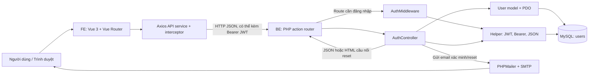
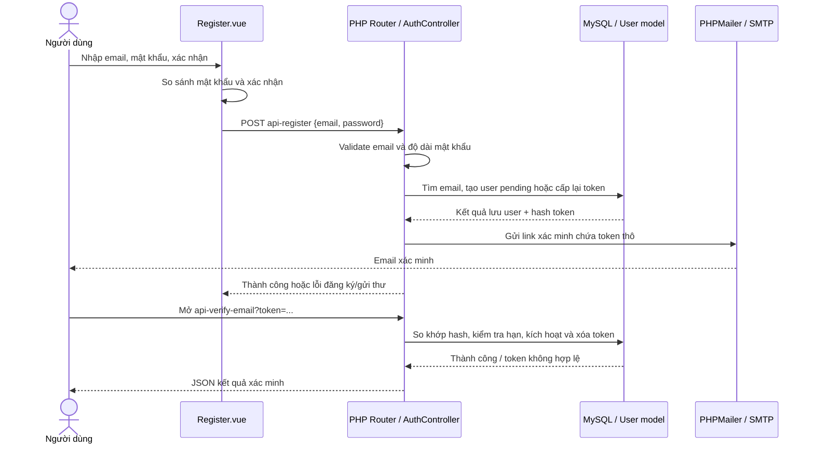
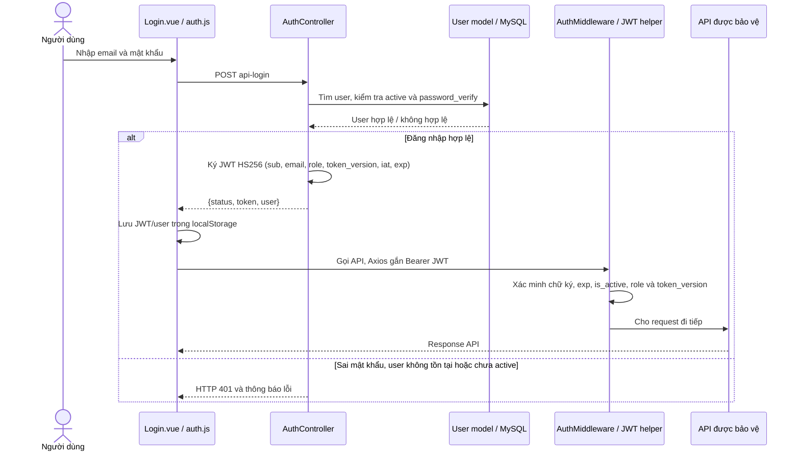
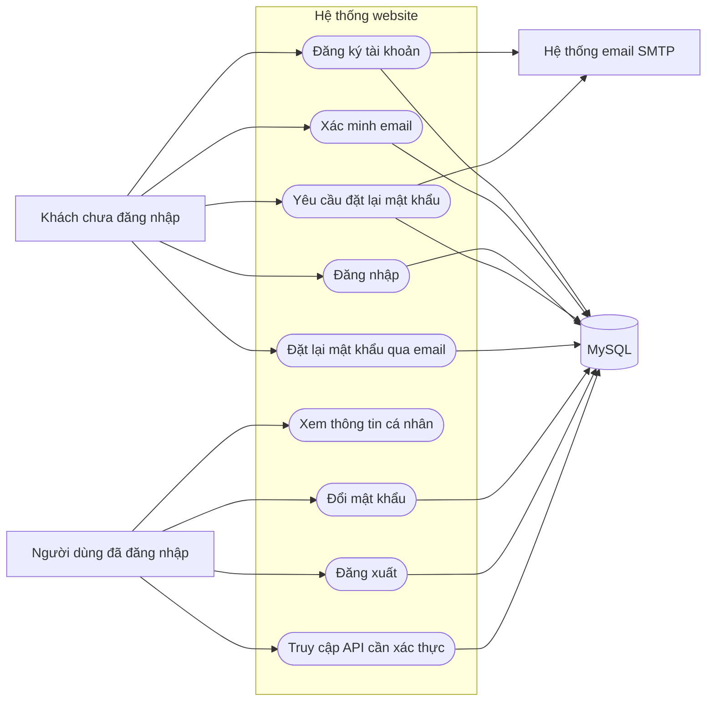
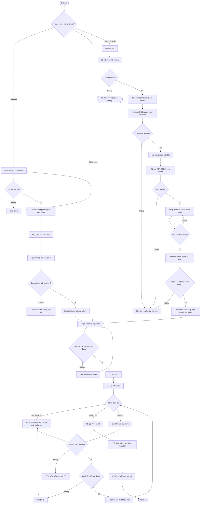

# Tài liệu luồng xác thực và tài khoản (Auth)

Tài liệu này mô tả nghiệp vụ xác thực hiện có của dự án, từ giao diện Vue đến API PHP, cơ sở dữ liệu MySQL và email. Nội dung được đối chiếu với mã nguồn hiện tại, phù hợp làm tư liệu phân tích và phát triển sơ đồ cho báo cáo dự án.

> Phạm vi: đăng ký, xác minh email, đăng nhập, duy trì phiên bằng JWT, đăng xuất, quên/đặt lại mật khẩu và đổi mật khẩu khi đã đăng nhập. Đây là mô tả trạng thái code tại thời điểm viết, không phải đặc tả cho các chức năng chưa được triển khai.

## 1. Tổng quan kiến trúc

Ứng dụng tách giao diện và xử lý nghiệp vụ thành hai phần:

- **FE:** Vue 3 + Composition API, Vue Router, Axios, Bootstrap 5; được phát triển/chạy bằng Vite.
- **BE:** PHP 8+ theo mô hình MVC tối giản. Router nhận `action`, Controller xử lý nghiệp vụ và response JSON/HTML, Model thao tác MySQL qua PDO.
- **Cơ sở dữ liệu:** MySQL, bảng `users` lưu thông tin tài khoản, trạng thái kích hoạt, mật khẩu đã hash và các token xác minh/reset đã hash.
- **Email:** PHPMailer gửi thư qua SMTP. Link xác minh và reset mang token thô; database chỉ lưu hash token.
- **Access token:** JWT ký HS256 do helper của BE tạo và xác thực. FE lưu JWT trong `localStorage`, rồi Axios interceptor gửi dưới dạng `Authorization: Bearer ...`.



### Vai trò từng lớp

| Lớp | Trách nhiệm trong auth |
|---|---|
| Vue views | Thu thập input, kiểm tra trải nghiệm cơ bản, gọi API, hiện thông báo và điều hướng. |
| Vue Router | Khai báo các trang auth; `meta.requiresAuth` kiểm tra sơ bộ xem FE có JWT trong localStorage hay không. |
| Axios service | Tự gắn Bearer JWT khi có; khi nhận HTTP 401 thì xóa session cục bộ và chuyển về trang đăng nhập. |
| PHP router | Chọn controller theo `?action=...`; gọi middleware cho endpoint được bảo vệ. |
| AuthController | Validate request, điều phối nghiệp vụ auth và trả kết quả cho FE. |
| AuthMiddleware / helper | Đọc Bearer header, xác minh JWT, rồi đối chiếu `is_active`, `role` và `token_version` với MySQL. |
| User model | Dùng PDO/prepared statements để đọc/cập nhật user, hash mật khẩu và kiểm tra token trong DB. |
| PHPMailer | Gửi email có link xác minh hoặc đặt lại mật khẩu qua SMTP. |

## 2. Các loại thông tin xác thực

Trong hệ thống có hai loại token với mục đích khác nhau:

| Token | Dùng cho | Vòng đời / nơi kiểm tra |
|---|---|---|
| **JWT access token** | Chứng minh người dùng đã đăng nhập khi gọi API được bảo vệ. | BE ký bằng HS256, có `sub`, `email`, `role`, `token_version`, `iat`, `exp`; FE gửi qua Bearer header. BE kiểm tra chữ ký, hạn, trạng thái, role và version ở mỗi request cần auth. |
| **Email verification token** | Kích hoạt tài khoản mới. | Token ngẫu nhiên 32 byte, biểu diễn 64 ký tự hex. Email chứa token thô, DB lưu SHA-256; xác minh thành công sẽ kích hoạt tài khoản và xóa token/hạn dùng. |
| **Password reset token** | Cho phép đặt mật khẩu mới khi không đăng nhập được. | Tạo và lưu tương tự verification token. Các lần GET chỉ kiểm tra, không tiêu thụ; POST đổi mật khẩu thành công sẽ xóa token/hạn dùng. |

Token xác minh/reset không phải JWT và không được dùng làm Bearer token. JWT cũng không thay thế token reset.

## 3. Dữ liệu tài khoản

Bảng `users` trong [BE/database/create_database.sql](BE/database/create_database.sql) có các trường liên quan:

| Trường | Ý nghĩa |
|---|---|
| `id` | Định danh người dùng, được đưa vào claim `sub` của JWT sau khi đăng nhập. |
| `email` | Địa chỉ email duy nhất dùng đăng nhập và nhận thư xác minh/reset. |
| `password` | Kết quả `password_hash()`, không lưu mật khẩu rõ. |
| `role` | Vai trò tài khoản (`admin` hoặc `user`); được đưa vào JWT và response đăng nhập. |
| `is_active` | `0` khi chưa xác minh email; `1` khi được phép đăng nhập. |
| `token_version` | Số phiên bản token hiện tại của user. Logout tăng số này để thu hồi các JWT cũ; mặc định là `0`, được thêm bởi [BE/database/migrations/20261109_add_user_token_version.sql](BE/database/migrations/20261109_add_user_token_version.sql). |
| `verification_token`, `verification_expires_at` | Hash token và hạn dùng xác minh email; được xóa sau khi xác minh. |
| `password_reset_token`, `password_reset_expires_at` | Hash token và hạn dùng reset; được xóa khi reset thành công hoặc khi cần vô hiệu hóa. |

Các mốc TTL nằm trong cấu hình BE: JWT, email verification và password reset hiện được đặt một giờ. Tài liệu không chép lại secret hoặc thông tin SMTP.

## 4. Luồng đăng ký và xác minh email

### Bước nghiệp vụ

1. Người dùng nhập email, mật khẩu và xác nhận mật khẩu ở `Register.vue`. FE so sánh hai mật khẩu; trường xác nhận không gửi lên BE.
2. FE gọi `POST ?action=api-register` với `email` và `password`.
3. BE chuẩn hóa email, kiểm tra định dạng và giới hạn độ dài mật khẩu 8–72 byte.
4. Nếu email đã thuộc tài khoản đang hoạt động, BE trả lỗi `409`. Nếu là tài khoản pending, BE cấp lại token xác minh và giữ nguyên mật khẩu đã đăng ký trước đó.
5. BE hash mật khẩu bằng `password_hash()`, tạo token ngẫu nhiên và chỉ lưu SHA-256 của token cùng thời hạn.
6. PHPMailer gửi link xác minh. Nếu gửi thất bại với user mới, BE cố gắng xóa user pending vừa tạo; nếu là user pending được cấp lại link, token mới được giữ trong DB dù email gửi thất bại.
7. Người dùng mở link `?action=api-verify-email&token=...`. BE kiểm tra định dạng, hash token rồi cập nhật `is_active = 1`, đồng thời xóa token và hạn dùng.
8. Khi tài khoản đã active, người dùng có thể đăng nhập.

Link xác minh hiện gọi trực tiếp endpoint BE và nhận JSON; chưa có trang FE riêng để trình bày trạng thái xác minh.



## 5. Luồng đăng nhập và sử dụng JWT

### Đăng nhập

1. Người dùng gửi email và mật khẩu từ `Login.vue`.
2. FE gọi `POST ?action=api-login`.
3. `User::authenticate()` tìm user, yêu cầu tài khoản đã active và dùng `password_verify()` so sánh mật khẩu.
4. Nếu hợp lệ, BE ký JWT HS256 với các claim `sub`, `email`, `role`, `token_version`, `iat`, `exp`.
5. BE trả `token` và thông tin user. FE lưu chúng bằng `setAuthSession()` vào `localStorage` dưới các key `auth_token` và `auth_user`.

### Request cần xác thực

1. FE gọi API qua Axios service. Nếu có JWT, request interceptor thêm `Authorization: Bearer <JWT>`.
2. Route BE cần bảo vệ gọi `AuthMiddleware::requireAuth()` hoặc controller gọi `requireBearerToken()`.
3. Helper xác minh chữ ký HMAC-SHA256 và `exp`, sau đó đọc user trong DB để kiểm tra `is_active = 1`, `role` và `token_version` còn khớp.
4. Nếu thiếu/sai/hết hạn/đã thu hồi JWT, user inactive hoặc role đã đổi, BE trả HTTP 401. Axios response interceptor xóa token/user cục bộ và điều hướng đến `/login`.

JWT cũ chưa có claim `token_version` được xem là version `0` để tương thích sau migration. Khi user logout lần đầu, version trong DB tăng lên và các JWT version `0` lập tức không còn hợp lệ.

`router.beforeEach()` ở FE chỉ kiểm tra xem localStorage có token hay không. Đây là tiện ích điều hướng, không phải ranh giới bảo mật; request vẫn phải được BE xác minh. Tương tự, dữ liệu user/role lưu ở FE chỉ phục vụ hiển thị, không được tin dùng để cấp quyền ở BE.



## 6. Luồng đăng xuất

1. Người dùng chọn đăng xuất ở trang Profile và xác nhận hộp thoại.
2. FE gọi `POST ?action=api-logout`; Axios gửi Bearer JWT.
3. BE xác minh JWT và đối chiếu trạng thái/version hiện tại trong DB.
4. `User::revokeTokenVersion()` tăng `token_version` nếu JWT gửi lên vẫn là phiên bản mới nhất.
5. Mọi JWT cũ cùng user (kể cả phiên đăng nhập trên thiết bị khác) không còn khớp version và bị trả HTTP 401. Login tiếp theo phát JWT với version mới.
6. Dù request thành công hay thất bại, `finally` phía FE vẫn xóa `auth_token` và `auth_user`, sau đó chuyển về trang chủ.

BE không lưu từng JWT riêng lẻ; thay vào đó dùng một version counter trong bảng `users`. Cách này đơn giản nhưng logout một thiết bị sẽ thu hồi tất cả phiên của user đó.

## 7. Luồng quên và đặt lại mật khẩu

### Yêu cầu email reset

1. Người dùng nhập email ở `ForgotPassword.vue`.
2. FE gọi `POST ?action=api-forgot-password`.
3. Nếu tìm thấy tài khoản đã active, BE tạo token ngẫu nhiên, chỉ lưu SHA-256 cùng thời hạn, rồi nhờ PHPMailer gửi email.
4. BE luôn trả thông báo chung HTTP 202 để hạn chế việc dò xem email có tài khoản hay không. Trường hợp gửi email lỗi được ghi log phía server; response công khai vẫn chung.

### Mở link và đổi mật khẩu

1. Link email mở `?action=reset-password-bridge&token=...` ở BE.
2. `showPasswordResetBridge()` kiểm tra định dạng và tính hợp lệ của token trong DB. Nếu hợp lệ, trang HTML cầu nối chuyển tiếp đến `FRONTEND_URL/reset-password?token=...`; nếu không, chuyển đến trang quên mật khẩu.
3. Khi `ResetPassword.vue` mở, FE gọi `GET ?action=api-reset-password&token=...`. Đây là lượt kiểm tra thứ hai; GET không tiêu thụ token.
4. FE chỉ hiện form khi GET thành công. Khi submit, FE so sánh mật khẩu xác nhận và gọi `POST ?action=api-reset-password` với cùng token và `new_password`.
5. BE kiểm tra token/độ dài mật khẩu lần cuối. Model cập nhật `password` bằng `password_hash()` và xóa reset token/hạn dùng trong cùng câu lệnh cập nhật. Token chỉ dùng thành công một lần.
6. FE thông báo thành công rồi chuyển người dùng đến `/login`.

Do đó cùng một token đi qua bridge, GET kiểm tra, và POST hoàn tất. Đây là cùng một token, không phải hai token được tạo. Kiểm tra cuối trong POST là bắt buộc vì token có thể hết hạn hoặc bị dùng sau lần GET.

```mermaid
sequenceDiagram
    actor U as Người dùng
    participant FE as ForgotPassword.vue / ResetPassword.vue
    participant BE as Router / AuthController
    participant DB as User model / MySQL
    participant Mail as PHPMailer / SMTP

    U->>FE: Nhập email quên mật khẩu
    FE->>BE: POST api-forgot-password {email}
    BE->>DB: Tìm user active, lưu hash token và hạn dùng
    BE->>Mail: Gửi email chứa token thô
    Mail-->>U: Link reset-password-bridge?token=...
    BE-->>FE: HTTP 202, thông báo chung

    U->>BE: Mở link reset-password-bridge?token=...
    BE->>DB: Kiểm tra hash token còn hạn
    alt Token còn hợp lệ
        BE-->>U: Trang cầu nối, chuyển tiếp sang FE/reset-password?token=...
        U->>FE: Mở trang ResetPassword
        FE->>BE: GET api-reset-password?token=...
        BE->>DB: Kiểm tra token (không tiêu thụ)
        BE-->>FE: Token hợp lệ, cho hiện form
        U->>FE: Nhập mật khẩu mới và xác nhận
        FE->>BE: POST api-reset-password {token, new_password}
        BE->>DB: Hash token, kiểm tra hạn; cập nhật password và xóa token
        DB-->>BE: Thành công / thất bại
        BE-->>FE: JSON kết quả
        FE-->>U: Thông báo và chuyển đến đăng nhập
    else Token sai hoặc hết hạn
        BE-->>U: Trang cầu nối báo link không hợp lệ
    end
```

## 8. Luồng đổi mật khẩu khi đã đăng nhập

1. FE route `/change-password` có `meta.requiresAuth`; route guard yêu cầu có JWT trong localStorage.
2. Người dùng nhập mật khẩu hiện tại, mật khẩu mới và xác nhận.
3. FE kiểm tra hai mật khẩu mới trùng nhau rồi gọi `POST ?action=api-change-password`.
4. Router BE xác minh Bearer JWT trước khi vào controller. Controller lấy user ID từ claim `sub`, không lấy ID do FE gửi.
5. Model kiểm tra user active và xác minh mật khẩu hiện tại bằng `password_verify()`.
6. Nếu đúng, BE hash mật khẩu mới, cập nhật DB và xóa reset token còn lại của tài khoản.

## 9. Endpoint auth hiện có

Base URL được chọn trong `FE/src/services/api.js`; bảng dưới chỉ ghi phần action để dễ đọc. Các response lỗi thường có dạng `{ "status": "error", "message": "..." }`.

| Action | Method đang dùng | Auth | Mục đích / kết quả chính |
|---|---|---|---|
| `api-register` | POST | Không | Tạo tài khoản pending, gửi mail xác minh. Thành công thường là HTTP 201; cấp lại link cho pending account là HTTP 200. |
| `api-verify-email` | GET qua link email | Không | Xác minh một lần, bật tài khoản và xóa verification token. |
| `api-login` | POST từ FE | Không | Xác thực user active; trả JWT và thông tin user. Sai thông tin trả HTTP 401. |
| `api-logout` | POST từ FE | Bearer JWT bắt buộc trong controller | Xác minh JWT, trả kết quả logout; không thu hồi JWT phía server. |
| `api-forgot-password` | POST | Không | Gửi link reset nếu email thuộc tài khoản active; luôn trả thông báo chung HTTP 202. |
| `api-reset-password` | GET rồi POST | Không; dùng reset token riêng | GET chỉ kiểm tra token. POST nhận `{token, new_password}`, cập nhật mật khẩu và tiêu thụ token. |
| `reset-password-bridge` | GET qua link email | Không; dùng reset token riêng | Xác minh token để quyết định hiển thị trang cầu nối và chuyển hướng sang FE. Response là HTML, không phải API JSON. |
| `api-change-password` | POST | Bearer JWT bắt buộc ở router | Nhận `{current_password, new_password}`; user ID lấy từ JWT. |

**Lưu ý về method:** `api-register`, `api-forgot-password`, `api-reset-password` và `api-change-password` kiểm tra method ở controller. `api-login` hiện không kiểm tra method một cách tường minh; `api-verify-email` đọc token từ query và không giới hạn method rõ ràng. Bảng mô tả method mà FE/email hiện đang sử dụng, không hàm ý BE đã từ chối mọi method khác.

## 10. Các trang FE liên quan

| Trang | File | Nhiệm vụ |
|---|---|---|
| Đăng ký | [FE/src/views/auth/Register.vue](FE/src/views/auth/Register.vue) | Gửi email/mật khẩu; xác nhận mật khẩu chỉ kiểm tra tại FE. |
| Đăng nhập | [FE/src/views/auth/Login.vue](FE/src/views/auth/Login.vue) | Gọi login, lưu JWT và user, chuyển về trang chủ. |
| Quên mật khẩu | [FE/src/views/auth/ForgotPassword.vue](FE/src/views/auth/ForgotPassword.vue) | Gửi yêu cầu email reset và hiển thị thông báo chung từ BE. |
| Đặt lại mật khẩu | [FE/src/views/auth/ResetPassword.vue](FE/src/views/auth/ResetPassword.vue) | Kiểm tra token qua GET, nhận mật khẩu mới qua POST. |
| Hồ sơ | [FE/src/views/auth/Profile.vue](FE/src/views/auth/Profile.vue) | Hiển thị dữ liệu user lưu cục bộ, gọi logout và luôn xóa session ở FE. |
| Đổi mật khẩu | [FE/src/views/auth/ChangePassword.vue](FE/src/views/auth/ChangePassword.vue) | Gửi mật khẩu hiện tại/mới lên endpoint có yêu cầu Bearer JWT. |
| Route | [FE/src/router/index.js](FE/src/router/index.js) | Khai báo trang auth, guard FE cho Profile và Change Password. |
| HTTP service | [FE/src/services/api.js](FE/src/services/api.js) | Tạo Axios client, gắn Bearer JWT và xử lý 401. |
| Lưu auth ở FE | [FE/src/services/auth.js](FE/src/services/auth.js) | Lưu/lấy/xóa `auth_token` và `auth_user` trong localStorage. |

## 11. Sơ đồ use case cho báo cáo

Có thể dùng sơ đồ dưới làm bản nháp use case. Khi vẽ UML, biểu diễn tác nhân ở ngoài ranh giới hệ thống, chức năng bằng hình ellipse, các đường nối là tương tác. “Dịch vụ email” và “MySQL” là hệ thống phụ trợ, không phải người dùng.



### Mô tả use case chính

| Use case | Tác nhân chính | Điều kiện trước | Kết quả thành công |
|---|---|---|---|
| Đăng ký | Khách | Email hợp lệ, chưa thuộc tài khoản active | Tạo hoặc cập nhật tài khoản pending; gửi email xác minh. |
| Xác minh email | Khách nhận email | Có token hợp lệ, chưa hết hạn, chưa sử dụng | Tài khoản được kích hoạt; token xác minh bị xóa. |
| Đăng nhập | Khách | Tài khoản active và mật khẩu đúng | FE nhận JWT và user; lưu session cục bộ. |
| Quên mật khẩu | Khách | Nhập email đúng định dạng | Nếu email thuộc user active, hệ thống gửi link; response không tiết lộ sự tồn tại của email. |
| Đặt lại mật khẩu | Khách có link | Reset token còn hạn và chưa dùng | Mật khẩu mới được hash/lưu; reset token bị xóa. |
| Đổi mật khẩu | Người dùng đã đăng nhập | Bearer JWT hợp lệ, mật khẩu hiện tại đúng | Lưu mật khẩu mới; reset token cũ bị xóa. |
| Đăng xuất | Người dùng đã đăng nhập | Bearer JWT còn đúng version và user đang active | BE tăng `token_version`, thu hồi mọi JWT cũ của user; FE xóa JWT/user khỏi localStorage. |
| Truy cập API bảo vệ | Người dùng đã đăng nhập | Có JWT hợp lệ | Router/middleware cho request tới controller. |

## 12. Sơ đồ hoạt động tổng quát

Sơ đồ này tập trung vào các nhánh quyết định. Có thể tách thành nhiều activity diagram riêng khi cần trình bày lớn hơn trên báo cáo.



## 13. Công nghệ và thuật ngữ

| Công nghệ / thuật ngữ | Vai trò trong dự án |
|---|---|
| PHP MVC tối giản | Tách route, controller và model; không dùng framework auth chuyên dụng. |
| PDO + prepared statement | Truy vấn MySQL và truyền tham số an toàn, tránh nối input trực tiếp vào SQL. |
| `password_hash()` / `password_verify()` | Hash mật khẩu khi lưu và xác minh mật khẩu lúc đăng nhập/đổi mật khẩu. |
| SHA-256 cho token email | Database giữ hash thay vì token thô; token thô chỉ cần cho link email/request reset. |
| JWT HS256 | Token có chữ ký dùng để xác thực request đăng nhập; payload có thể đọc được, không nên nhét bí mật vào payload. |
| Bearer token | Cách gửi JWT trong header `Authorization` của request API. |
| Middleware | Lớp chặn request cần auth trước khi controller xử lý nghiệp vụ. |
| Vue 3 Composition API | Xây dựng trang đăng ký, đăng nhập, reset, profile và đổi mật khẩu. |
| Vue Router | Điều hướng SPA và áp dụng guard trải nghiệm ở FE. |
| Axios | Gửi request JSON đến PHP API; interceptor quản lý Bearer JWT và response 401. |
| Vite | Dev server và build FE. |
| Bootstrap 5 | CSS framework dùng cho form/layout cơ bản. |
| PHPMailer + SMTP | Gửi email xác minh và reset mật khẩu. |

## 14. Giới hạn và lưu ý khi trình bày

- FE route guard chỉ dựa vào việc có token trong localStorage; BE mới là nơi xác thực chữ ký và hạn JWT.
- JWT đang được lưu trong localStorage. Cần bảo vệ FE khỏi XSS; với triển khai thực tế nên cân nhắc chiến lược lưu token phù hợp và kiểm soát bảo mật trình duyệt.
- Logout tăng `token_version` và thu hồi mọi phiên JWT của user. Không hỗ trợ thu hồi riêng từng thiết bị; mỗi protected request cần đọc trạng thái/version/role trong DB.
- User inactive hoặc role bị đổi sẽ không dùng được JWT đã cấp ở request tiếp theo. JWT hợp lệ về chữ ký nhưng sai version cũng trả HTTP 401.
- Luồng auth chưa thấy cơ chế rate limit cho đăng nhập, đăng ký hoặc yêu cầu reset; nên bổ sung trước khi triển khai Internet công khai.
- `role` có trong JWT/response, nhưng việc đưa claim vào token không tự tạo ra phân quyền. Mỗi API nhạy cảm cần kiểm tra quyền ở BE.
- Email verify hiện trả JSON từ BE, còn reset có trang HTML cầu nối. Đây là hai trải nghiệm khác nhau.
- Reset token xuất hiện trong URL email và URL FE; các lượt GET kiểm tra không tiêu thụ token. POST vẫn kiểm tra lại để xử lý đúng trường hợp hết hạn hoặc đã dùng.
- Cấu hình xác thực/SMTP hiện nằm trong file cấu hình BE. Không đưa secret vào báo cáo, ảnh chụp màn hình, log hay repository công khai; trước khi triển khai cần đưa secret vào cấu hình an toàn và thay/rotate thông tin nhạy cảm từng bị commit hoặc chia sẻ.
- Một số endpoint hiện chưa kiểm tra method tường minh như ghi chú ở bảng API. Nên siết method và chuẩn hóa response trước khi coi đây là contract production.

## 15. Mã nguồn tham chiếu

### Backend

- [BE/routes/index.php](BE/routes/index.php): ánh xạ `action` đến controller và middleware.
- [BE/controllers/AuthController.php](BE/controllers/AuthController.php): nghiệp vụ đăng ký, verify, login/logout, forgot/reset và change password.
- [BE/models/User.php](BE/models/User.php): truy vấn tài khoản, hash mật khẩu và token.
- [BE/extensions/AuthMiddleware.php](BE/extensions/AuthMiddleware.php): yêu cầu Bearer JWT cho route được bảo vệ.
- [BE/configs/helper.php](BE/configs/helper.php): tạo/xác minh JWT, đọc Bearer header, response JSON.
- [BE/configs/mail_helper.php](BE/configs/mail_helper.php): cấu hình PHPMailer và tạo email xác minh/reset.
- [BE/configs/env.php](BE/configs/env.php): cấu hình DB, JWT TTL, thời hạn email và SMTP; không sao chép giá trị bí mật vào tài liệu.
- [BE/database/create_database.sql](BE/database/create_database.sql): bảng `users` và các cột token.

### Frontend

- [FE/src/router/index.js](FE/src/router/index.js): khai báo route auth và route guard.
- [FE/src/services/api.js](FE/src/services/api.js): Axios client/interceptor.
- [FE/src/services/auth.js](FE/src/services/auth.js): lưu session ở localStorage.
- [FE/src/views/auth/Register.vue](FE/src/views/auth/Register.vue): ví dụ view trong nhóm màn hình auth; các trang còn lại được liệt kê ở mục 10.

### Hướng dẫn sơ đồ cho báo cáo

1. **Sơ đồ kiến trúc:** dùng các khối FE, PHP router/controller, middleware/helper, model/PDO, MySQL và SMTP như sơ đồ mục 1.
2. **Sequence đăng ký:** dùng người dùng, FE, AuthController, User/MySQL và PHPMailer; làm rõ trạng thái pending trước khi verify.
3. **Sequence login:** làm rõ `password_verify`, phát JWT, lưu token ở FE, rồi gửi Bearer đến API cần bảo vệ.
4. **Sequence reset:** nên thể hiện cả bridge BE, GET kiểm tra từ FE và POST hoàn tất để giải thích việc token xuất hiện nhiều lần.
5. **Use case:** tác nhân khách và người dùng đã đăng nhập; use case chính là đăng ký, xác minh, đăng nhập, quên/reset, xem hồ sơ, đổi mật khẩu, đăng xuất.
6. **Activity:** tách nhánh theo quyết định (token hợp lệ, tài khoản active, mật khẩu đúng); đặt bước cập nhật dữ liệu sau các điều kiện xác thực, không coi route guard FE là bước phân quyền cuối cùng.
