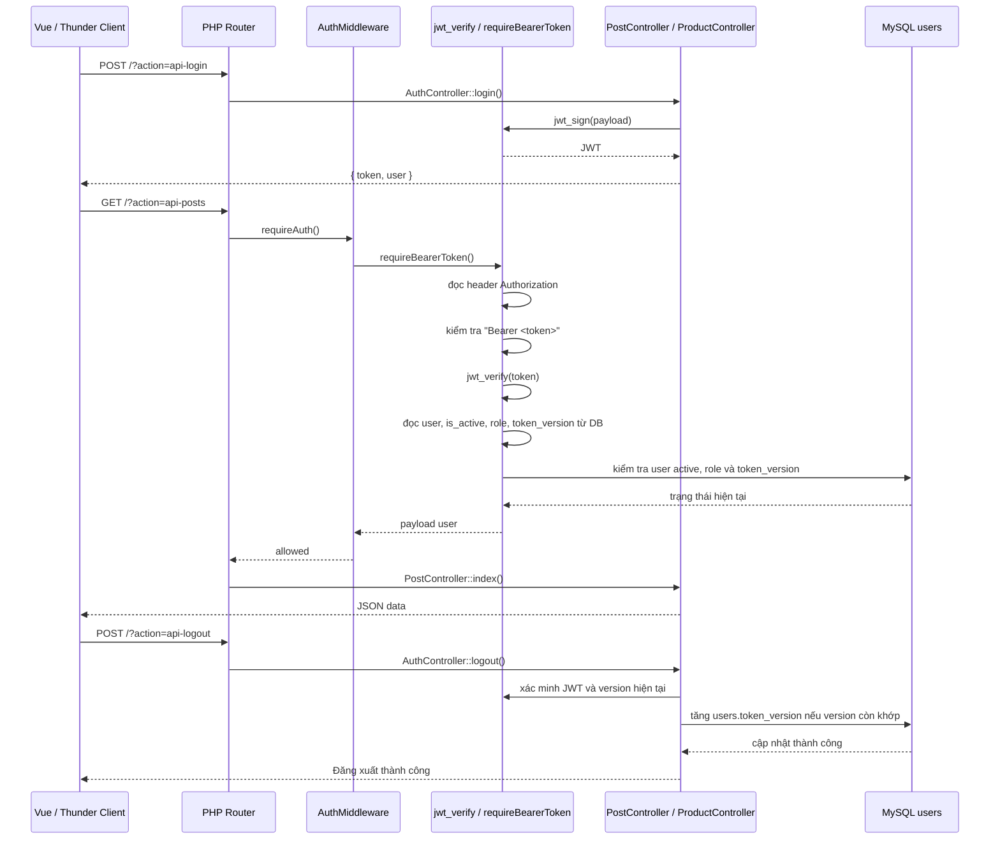

# Auth & Middleware Guide

Tài liệu này mô tả cơ chế xác thực hiện tại của project: JWT + Bearer token + middleware guard theo kiểu tối giản, phù hợp cho PHP MVC mini app.

## Mục tiêu

- Không cần framework auth phức tạp
- Không cần Composer package
- Dễ debug, dễ hiểu
- Hỗ trợ API protected và frontend Vue
- Không lưu JWT thô trong DB; chỉ lưu `token_version` để thu hồi các phiên cũ

## Luồng auth



## Cơ chế thực thi

### 1. Login

Khi client gửi request login:

```http
POST /BE/?action=api-login
Content-Type: application/json
```

Body ví dụ:

```json
{
  "email": "admin@example.com",
  "password": "123456"
}
```

Backend kiểm tra email/password. Nếu đúng, server tạo JWT với payload như:

```php
[
  'sub' => 1,
  'email' => 'admin@example.com',
  'role' => 'admin',
  'token_version' => 0
]
```

Dùng hàm:

```php
$token = jwt_sign([
    'sub' => $user['id'],
    'email' => $user['email'],
    'role' => $user['role'],
    'token_version' => (int) $user['token_version'],
]);
```

## 2. Frontend lưu token

Frontend lưu token và thông tin user vào localStorage:

```js
setAuthSession(data.token, data.user)
```

Ví dụ trong [FE/src/helpers/auth/session.js](FE/src/helpers/auth/session.js):

```js
localStorage.setItem('auth_token', token)
localStorage.setItem('auth_user', JSON.stringify(user))
```

Sau đó Axios interceptor tự gửi header:

```js
config.headers.Authorization = `Bearer ${token}`
```

## 3. Middleware kiểm tra token

Mỗi route protected đều gọi:

```php
(new AuthMiddleware())->requireAuth();
```

Trong [BE/routes/index.php](BE/routes/index.php):

```php
case 'api-posts':
    (new AuthMiddleware())->requireAuth();
    (new PostController)->index();
    break;
```

Middleware gọi `requireBearerToken()` từ helper.

## 4. requireBearerToken()

Hàm này đọc header:

```http
Authorization: Bearer <token>
```

và thực hiện các bước sau:

1. đọc `$_SERVER['HTTP_AUTHORIZATION']`
2. fallback nếu header không nằm ở biến chuẩn
3. kiểm tra regex dạng `Bearer ...`
4. xác minh chữ ký và thời hạn bằng `jwt_verify()`
5. đọc user trong DB; yêu cầu `is_active=1`, role và `token_version` vẫn khớp JWT
6. nếu token thiếu/sai/hết hạn/đã thu hồi hoặc user không hoạt động → trả 401 JSON

Ví dụ:

```php
if (!preg_match('/^Bearer\s+(.+)$/i', $authHeader, $matches)) {
    response_json([
        'status' => 'error',
        'message' => 'Unauthorized: thiếu Bearer token'
    ], 401);
}
```

## 5. jwt_verify()

Hàm verify JWT làm 3 việc chính:

1. tách token thành 3 phần: `header.payload.signature`
2. rebuild chữ ký bằng secret key `JWT_SECRET`
3. so sánh chữ ký và kiểm tra `exp`

Nếu token sai hoặc hết hạn thì trả lỗi:

```json
{
  "status": "error",
  "message": "Unauthorized: Chữ ký token không hợp lệ"
}
```

## 6. Vì sao không lưu JWT thô trong users?

Backend không lưu cả chuỗi JWT. Bảng `users` chỉ có số nguyên `token_version`:

- Login đưa `token_version` hiện tại vào JWT.
- Mỗi protected request kiểm tra chữ ký, `exp`, `is_active`, role và version hiện tại trong DB.
- Logout tăng version; mọi JWT cũ của user lập tức không còn khớp.

Đây là cách thu hồi đơn giản cho mini project. Đổi lại, mỗi protected request cần đọc user từ DB và logout sẽ kết thúc tất cả phiên của user, không chỉ một thiết bị.

## 7. Logout

Logout yêu cầu Bearer JWT hợp lệ. Backend đọc `sub` và `token_version`, sau đó tăng version có điều kiện trong DB bằng `User::revokeTokenVersion()`:

```sql
UPDATE users
SET token_version = token_version + 1
WHERE id = :id
  AND token_version = :current_version
  AND is_active = 1;
```

Migration [BE/database/migrations/20261109_add_user_token_version.sql](BE/database/migrations/20261109_add_user_token_version.sql) thêm cột `token_version` với mặc định `0`.

Sau khi tăng version, token hiện tại và mọi JWT cũ cùng user sẽ nhận HTTP 401 ở request tiếp theo. FE vẫn xóa JWT/user khỏi localStorage và chuyển trang. Login tiếp theo phát JWT có version mới.

Token cũ được phát trước migration và chưa có claim `token_version` được xem là version `0`; chúng tiếp tục dùng được cho tới khi user logout hoặc token hết hạn.

## 8. Response chuẩn

Khi thiếu token:

```json
{
  "status": "error",
  "message": "Unauthorized: thiếu Bearer token"
}
```

Khi token hợp lệ:

```json
{
  "status": "success",
  "posts": [
    { "id": 1, "title": "..." }
  ]
}
```

## 9. File quan trọng

- [BE/configs/helper.php](BE/configs/helper.php): `jwt_sign`, `jwt_verify`, `requireBearerToken`, `response_json`
- [BE/extensions/AuthMiddleware.php](BE/extensions/AuthMiddleware.php): middleware wrapper
- [BE/routes/index.php](BE/routes/index.php): route protected
- [BE/controllers/AuthController.php](BE/controllers/AuthController.php): login/logout API
- [FE/src/helpers/auth/session.js](FE/src/helpers/auth/session.js): lưu token/user
- [FE/src/helpers/api/client.js](FE/src/helpers/api/client.js): tự gắn Authorization

## 10. Kết luận

Cơ chế auth hiện tại là phiên bản tối giản cho mini project:

- JWT HS256
- Bearer token
- Middleware guard kiểm tra JWT và trạng thái/version user trong DB
- Logout thu hồi mọi JWT cũ bằng `token_version`
- Không cần thư viện phức tạp

Nếu cần thu hồi riêng từng thiết bị, có thể mở rộng sang token ID/denylist hoặc refresh-token sessions. Hiện tại `token_version` chủ ý thu hồi tất cả phiên của user cùng lúc.
