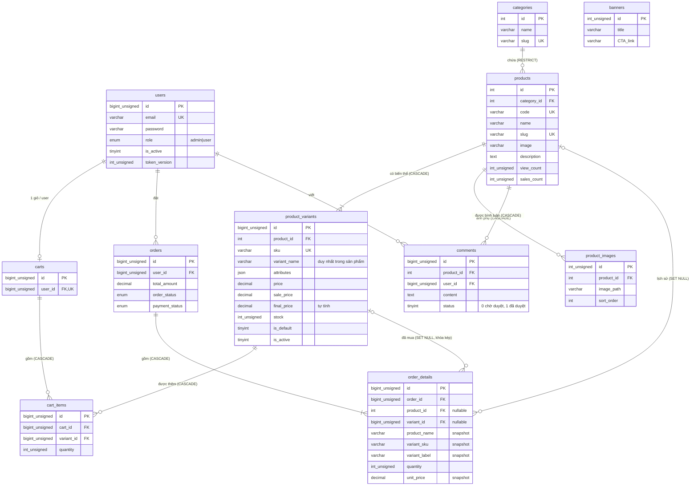

# Database `du-an-1` (shop tóc, MySQL 8.0, utf8mb4_unicode_ci)

Sản phẩm được tách thành 2 tầng:
- `products`: thông tin chung (tên, danh mục, mô tả, ảnh). **Không** có giá, giá giảm, tồn kho.
- `product_variants`: từng biến thể bán được. Giá, giá giảm, tồn kho nằm ở đây, kèm cột JSON `attributes` để mô tả thuộc tính mềm dẻo.

Mọi sản phẩm có ít nhất 1 biến thể. Giỏ hàng và đơn hàng luôn trỏ vào **biến thể**, không trỏ trực tiếp vào sản phẩm để lấy giá.

## 1. Sơ đồ quan hệ (ERD)

Bảng `banners` và `schema_migrations` không có quan hệ với bảng nào.

## 2. Các bảng thay đổi / mới

### 2.1 `products` (thông tin chung)

| Cột | Kiểu | Ràng buộc | Ý nghĩa |
|---|---|---|---|
| id | INT | PK, AUTO_INCREMENT | Khóa chính |
| category_id | INT | NOT NULL, FK → categories.id (RESTRICT) | Danh mục |
| code | VARCHAR(100) | NOT NULL, UNIQUE, không rỗng | Mã sản phẩm |
| name | VARCHAR(255) | NOT NULL, không rỗng | Tên sản phẩm |
| slug | VARCHAR(255) | NOT NULL, UNIQUE, không rỗng | Đường dẫn thân thiện |
| image | VARCHAR(255) | NULL | Ảnh đại diện |
| description | TEXT | NULL | Mô tả chung |
| view_count | INT UNSIGNED | NOT NULL, default 0 | Lượt xem |
| sales_count | INT UNSIGNED | NOT NULL, default 0 | Lượt bán (tổng mọi biến thể) |
| created_at | TIMESTAMP | NOT NULL, default now | Ngày tạo |
| updated_at | TIMESTAMP | NOT NULL, tự cập nhật | Ngày sửa |

### 2.2 `product_variants` (biến thể: giá, kho, thuộc tính JSON)

| Cột | Kiểu | Ràng buộc | Ý nghĩa |
|---|---|---|---|
| id | BIGINT UNSIGNED | PK, AUTO_INCREMENT | Khóa chính |
| product_id | INT | NOT NULL, FK → products.id (CASCADE) | Sản phẩm cha |
| sku | VARCHAR(100) | NOT NULL, UNIQUE toàn hệ thống, không rỗng | Mã SKU |
| variant_name | VARCHAR(255) | NOT NULL, UNIQUE theo (product_id, variant_name) | Tên hiển thị, ví dụ `Hũ 113g` |
| attributes | JSON | NOT NULL, default `{}`, phải là JSON object | Thuộc tính mềm dẻo, ví dụ `{"dung_tich":"113g","mui_huong":"Thảo dược"}`. Không chứa giá/kho |
| price | DECIMAL(10,2) | NOT NULL, >= 0 | Giá niêm yết (VND) |
| sale_price | DECIMAL(10,2) | NULL; nếu có thì >= 0 và < price | Giá khuyến mãi, NULL = không giảm |
| final_price | DECIMAL(10,2) | GENERATED STORED = COALESCE(sale_price, price) | Giá bán thực tế, dùng để sắp xếp/lọc |
| stock | INT UNSIGNED | NOT NULL, default 0 | Tồn kho (UNSIGNED nên không trừ xuống âm được) |
| is_default | TINYINT(1) | NOT NULL, 0/1 | 1 = biến thể mặc định |
| is_active | TINYINT(1) | NOT NULL, default 1, 0/1 | 1 = đang bán, 0 = ngừng bán |
| default_product_id | INT | GENERATED VIRTUAL, UNIQUE | Cột kỹ thuật ép mỗi sản phẩm tối đa 1 biến thể mặc định. Không ghi trực tiếp |
| created_at / updated_at | TIMESTAMP | NOT NULL | Thời điểm tạo / sửa |

Ràng buộc bổ sung: biến thể mặc định phải đang bán (`is_default = 0 OR is_active = 1`). Có thêm UNIQUE `(id, product_id)` để làm đích cho khóa ngoại kép của `order_details`.
Index: `(product_id, is_active, final_price)`, `(final_price)`.

### 2.3 `cart_items` (dòng giỏ hàng, trỏ vào biến thể)

| Cột | Kiểu | Ràng buộc | Ý nghĩa |
|---|---|---|---|
| id | BIGINT UNSIGNED | PK | Khóa chính |
| cart_id | BIGINT UNSIGNED | NOT NULL, FK → carts.id (CASCADE) | Giỏ hàng |
| variant_id | BIGINT UNSIGNED | NOT NULL, FK → product_variants.id (CASCADE) | Biến thể trong giỏ |
| quantity | INT UNSIGNED | NOT NULL, default 1, >= 1 | Số lượng |
| created_at / updated_at | TIMESTAMP | NOT NULL | Thời điểm tạo / sửa |

UNIQUE `(cart_id, variant_id)`: mỗi biến thể chỉ có 1 dòng trong 1 giỏ (muốn thêm nữa thì tăng quantity).

### 2.4 `order_details` (chi tiết đơn, có snapshot)

| Cột | Kiểu | Ràng buộc | Ý nghĩa |
|---|---|---|---|
| id | BIGINT UNSIGNED | PK | Khóa chính |
| order_id | BIGINT UNSIGNED | NOT NULL, FK → orders.id (CASCADE) | Đơn hàng |
| product_id | INT | NULL, FK → products.id (SET NULL) | Sản phẩm đã mua, NULL nếu đã bị xóa |
| variant_id | BIGINT UNSIGNED | NULL, FK kép (SET NULL) | Biến thể đã mua, NULL nếu đã bị xóa |
| product_name | VARCHAR(255) | NOT NULL | Snapshot tên sản phẩm |
| variant_sku | VARCHAR(100) | NULL | Snapshot SKU |
| variant_label | VARCHAR(255) | NULL | Snapshot tên biến thể (NULL với đơn cũ) |
| quantity | INT UNSIGNED | NOT NULL, >= 1 | Số lượng |
| unit_price | DECIMAL(10,2) | NOT NULL, >= 0 | Snapshot đơn giá thực tế lúc mua |
| created_at / updated_at | TIMESTAMP | NOT NULL | Thời điểm tạo / sửa |

Khóa ngoại kép `(variant_id, product_id)` → `product_variants(id, product_id)` bảo đảm biến thể thuộc đúng sản phẩm của dòng đơn. Khi sản phẩm hoặc biến thể bị xóa, `variant_id` và `product_id` về NULL nhưng dòng đơn vẫn còn, đọc tên/SKU/giá từ các cột snapshot.

### 2.5 View `v_product_catalog` (cho trang danh sách)

Cột: id, category_id, code, name, slug, image, description, view_count, sales_count, created_at, updated_at, và các cột tính từ **biến thể đang bán**:
`variant_count`, `min_final_price`, `max_final_price`, `total_stock`, `in_stock` (1 nếu còn ít nhất 1 biến thể còn hàng). Sản phẩm không có biến thể đang bán thì giá là NULL.

## 3. Các bảng giữ nguyên

| Bảng | Cột chính |
|---|---|
| `users` | id BIGINT UNSIGNED PK; email UNIQUE; password (hash); role ENUM('admin','user') default 'user'; is_active default 0; token_version INT UNSIGNED default 0; verification_token CHAR(64) UNIQUE; verification_expires_at; password_reset_token CHAR(64) UNIQUE; password_reset_expires_at; created_at; updated_at |
| `categories` | id INT PK; name; slug UNIQUE; created_at; updated_at |
| `banners` | id INT UNSIGNED PK; title; image; content TEXT; CTA_link VARCHAR(2048); created_at; updated_at |
| `product_images` | id INT UNSIGNED PK; product_id FK → products (CASCADE); image_path; sort_order default 0; created_at; updated_at. Index (product_id, sort_order) |
| `comments` | id BIGINT UNSIGNED PK; product_id FK → products (CASCADE); user_id FK → users (CASCADE); content TEXT; status TINYINT(1) default 0 (0 chờ duyệt, 1 đã duyệt); created_at; updated_at |
| `carts` | id BIGINT UNSIGNED PK; user_id UNIQUE, FK → users (CASCADE); created_at; updated_at |
| `orders` | id BIGINT UNSIGNED PK; user_id FK → users; recipient_name VARCHAR(100); recipient_phone VARCHAR(20); shipping_address VARCHAR(500); total_amount DECIMAL(12,2); order_status ENUM('pending','confirmed','shipping','delivered','cancelled') default 'pending'; payment_status ENUM('unpaid','paid') default 'unpaid'; created_at; updated_at |
| `schema_migrations` | migration VARCHAR(255) PK; applied_at. Do `run.php` quản lý |

## 4. Hành vi khi xóa dữ liệu

| Xóa | Kết quả |
|---|---|
| Danh mục còn sản phẩm | **Bị chặn** (RESTRICT) |
| Sản phẩm | Xóa luôn biến thể, ảnh phụ, bình luận; dòng đơn giữ lại (product_id, variant_id = NULL) |
| Biến thể | Xóa dòng giỏ chứa nó; dòng đơn giữ lại (variant_id, product_id = NULL) |
| Giỏ hàng | Xóa các dòng giỏ |
| Đơn hàng | Xóa các dòng chi tiết đơn |
| User | Xóa giỏ, bình luận. Bị chặn nếu còn đơn hàng |

## 5. Quy tắc DB tự bảo đảm

- SKU duy nhất; tên biến thể duy nhất trong cùng sản phẩm; mỗi sản phẩm tối đa 1 biến thể mặc định và nó phải đang bán.
- Giá >= 0, giá giảm < giá gốc, `attributes` phải là JSON object, tồn kho không âm.
- Số lượng trong giỏ và đơn >= 1; mỗi biến thể 1 dòng trong 1 giỏ.
- Dòng đơn chỉ gắn được biến thể thuộc đúng sản phẩm.

## 6. Quy tắc ứng dụng phải tự làm

- Tạo sản phẩm mới phải tạo luôn ít nhất 1 biến thể mặc định trong cùng transaction.
- Hiển thị giá: dùng `final_price` (giá gạch ngang = `price` khi `sale_price` không NULL). Trang danh sách dùng `v_product_catalog`.
- Trừ kho nguyên tử: `UPDATE product_variants SET stock = stock - :qty WHERE id = :id AND stock >= :qty AND is_active = 1`, rồi kiểm tra số dòng bị ảnh hưởng = 1.
- Tạo đơn: ghi `unit_price = final_price`, `product_name`, `variant_sku`, `variant_label` tại thời điểm mua; `orders.total_amount` tính trong cùng transaction.
- Không bao giờ lưu giá hoặc tồn kho trong `attributes`.
