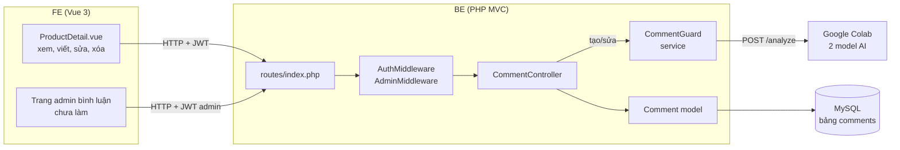

# 01. Kiến trúc

## 1. Các thành phần

## 2. File liên quan

| Tầng | File | Vai trò |
| --- | --- | --- |
| Router | `BE/routes/index.php` | 7 case `api-product-comments`, `api-comment-*`, `api-admin-comment*`. Gọi middleware rồi controller. |
| Middleware | `BE/extensions/AuthMiddleware.php` | Kiểm tra Bearer JWT, trả payload (`sub` = ID user). |
| Middleware | `BE/extensions/AdminMiddleware.php` | Gọi `AuthMiddleware` rồi kiểm tra `role = admin`. |
| Controller | `BE/controllers/CommentController.php` | Validate request, gọi kiểm duyệt (`moderate`), gọi model, trả JSON. |
| Service | `BE/commentGuardServices/CommentGuard.php` | Gọi Colab bằng cURL, kiểm tra và chuẩn hóa kết quả AI. |
| Model | `BE/models/Comment.php` | Truy vấn bảng `comments` bằng PDO prepared statement. |
| Cấu hình | `BE/configs/config.php` | Hằng `COMMENT_GUARD_ENABLED`, `COMMENT_GUARD_URL`, `COMMENT_GUARD_KEY`, `COMMENT_GUARD_TIMEOUT`. |
| Autoload | `BE/index.php` | Nạp class từ `models/`, `controllers/`, `extensions/`, `geminiServices/`, `commentGuardServices/`. |
| Migration | `BE/database/migrations/20261122_01_add_comments_ai_labels.sql` | Thêm 3 cột nhãn AI. |
| FE | `FE/src/views/products/ProductDetail.vue` | Hiện danh sách, form viết, sửa, xóa bình luận. |

## 3. Phân chia trách nhiệm

| Ai | Làm gì | Không làm gì |
| --- | --- | --- |
| Router | Chọn controller theo `?action=`, gọi middleware | Không truy vấn DB, không chứa nghiệp vụ |
| `CommentController` | Kiểm tra method, body, độ dài; lấy user ID từ JWT; quyết định `status` theo kết quả AI | Không viết SQL, không gọi cURL trực tiếp |
| `CommentGuard` | Gửi HTTP tới Colab, kiểm tra JSON trả về, ném lỗi khi Colab có vấn đề | Không biết gì về DB hay `status` |
| `Comment` model | INSERT/UPDATE/SELECT/DELETE, kiểm tra quyền sở hữu bằng `WHERE user_id = :user_id` | Không gọi AI, không quyết định hiện/ẩn |

Vì sao tách `CommentGuard` riêng: controller chỉ cần gọi `analyze($content)`; nếu sau này đổi sang dịch vụ AI khác thì chỉ sửa service, controller giữ nguyên.

## 4. Phân quyền

| Endpoint | Ai gọi được | Kiểm tra ở đâu |
| --- | --- | --- |
| `api-product-comments` | Mọi người | Không cần token |
| `api-comment-create` | User đã đăng nhập | `requireAuth()` ở router |
| `api-comment-update`, `api-comment-delete` | Chủ bình luận | `requireAuth()` ở router + `WHERE user_id = :user_id` trong model |
| `api-admin-comments`, `api-admin-comment-approve`, `api-admin-comment-delete` | Admin | `requireAdmin()` ở router |

User ID luôn lấy từ `sub` trong JWT đã xác minh, **không** lấy từ body. Nhờ vậy user không giả danh người khác được. Admin gọi `api-comment-update` trên bình luận của user vẫn bị 404, vì API đó chỉ dành cho chủ bình luận.
