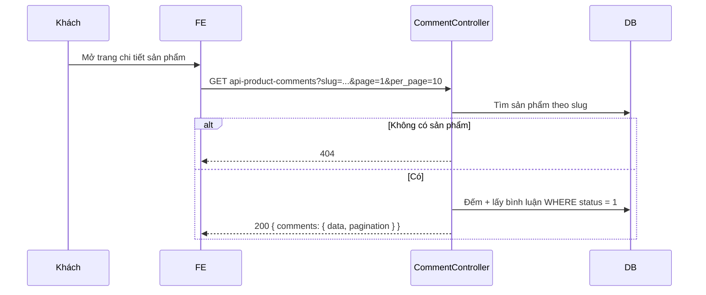
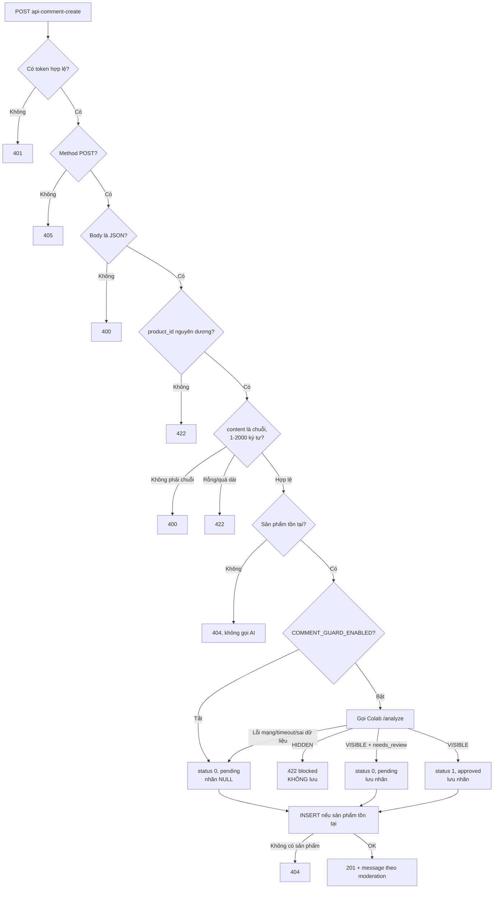
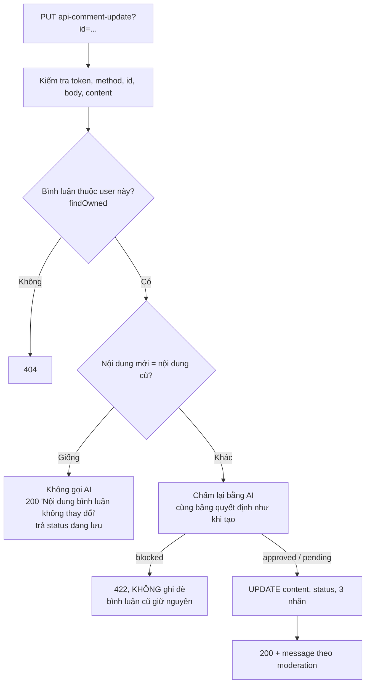
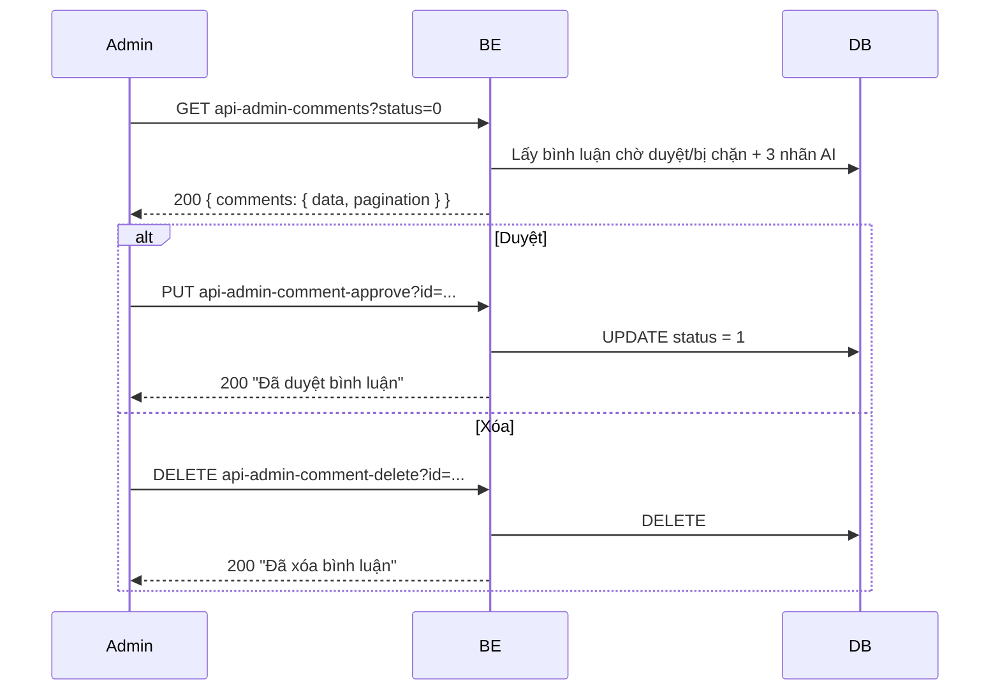

# 02. Luồng nghiệp vụ

## 1. Khách xem bình luận (công khai)

Chỉ bình luận `status = 1` được trả về. Bình luận bị chặn hoặc chờ duyệt không bao giờ lộ ra API công khai.

## 2. Tạo bình luận (có chốt chặn AI)

Thứ tự có chủ ý:
1. **Validate và kiểm tra sản phẩm trước, gọi AI sau**: dữ liệu sai hoặc sản phẩm không tồn tại thì trả lỗi ngay, không tốn lượt gọi Colab. Lúc INSERT vẫn kiểm tra sản phẩm lần nữa, phòng admin xóa sản phẩm trong lúc đang chờ AI.
2. **Gọi AI trước khi INSERT**: để lưu `status` và 3 nhãn trong cùng một câu lệnh, không phải INSERT rồi UPDATE.
3. **Câu bị AI chặn không được lưu** (từ 22/11/2026): trả 422, FE giữ nguyên ô nhập để khách sửa rồi gửi lại. Nếu lưu thì mỗi lần khách thử lại sẽ để một dòng rác bị ẩn trong DB. Nội dung và nhãn vẫn có trong log API.
4. **Câu không bị chặn luôn được lưu**, kể cả khi AI lỗi: AI chỉ quyết định `status` (hiện ngay hay chờ duyệt).

## 3. Sửa bình luận

- Kiểm tra quyền sở hữu **trước** khi gọi AI: bình luận của người khác trả 404 luôn, không tốn lượt gọi.
- Sửa câu đã được duyệt thành câu chửi: bị từ chối (422), bình luận cũ vẫn hiện với nội dung cũ. Sửa câu đang chờ duyệt thành câu lịch sự: được hiện.
- Đây là lý do không thể "đăng câu sạch cho được duyệt rồi sửa thành câu chửi".

## 4. Xóa bình luận (user)

`DELETE api-comment-delete?id=...`: xóa cứng nếu bình luận thuộc user (`WHERE id = :id AND user_id = :user_id`). Không gọi AI. Không thuộc user hoặc không tồn tại: 404.

## 5. Admin duyệt và xóa

- Admin **có quyền duyệt cả câu bị AI chặn**. AI chỉ là bước lọc tự động, quyết định cuối cùng thuộc về người. Khi duyệt, 3 nhãn AI được giữ nguyên để sau này biết câu đó từng bị AI chặn.
- Admin phân biệt "bị AI chặn" và "chờ duyệt" bằng `moderation_label`: `OFFENSIVE`/`HATE` là bị chặn; `CLEAN` là AI không chắc; `NULL` là chưa chấm (AI lỗi hoặc đang tắt, hoặc bình luận từ trước khi có AI).
