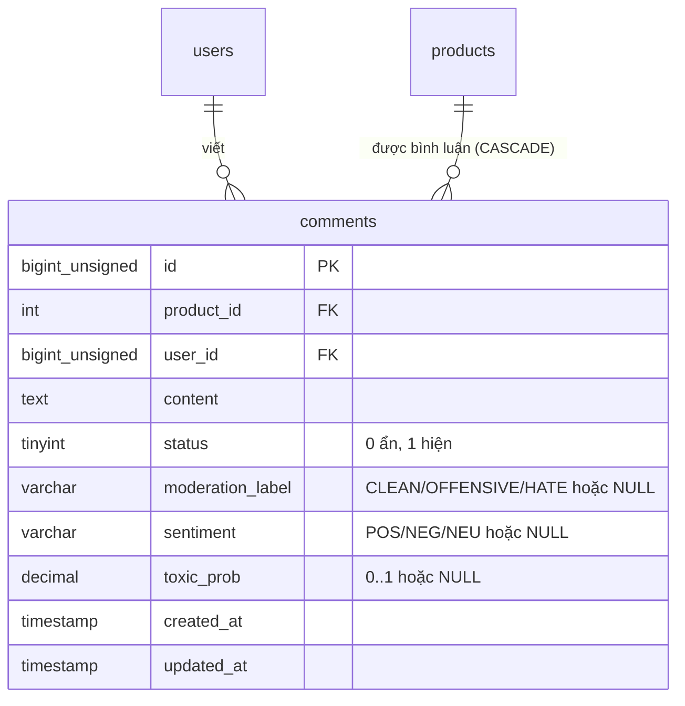

# 03. Cơ sở dữ liệu

## 1. Bảng `comments`



| Cột | Kiểu | Ý nghĩa |
| --- | --- | --- |
| `id` | `BIGINT UNSIGNED` PK | ID bình luận |
| `product_id` | `INT` FK → `products.id` | Xóa sản phẩm thì xóa luôn bình luận (`ON DELETE CASCADE`) |
| `user_id` | `BIGINT UNSIGNED` FK → `users.id` | Người viết. Xóa user thì xóa luôn bình luận |
| `content` | `TEXT` | Nội dung, đã `trim`, tối đa 2000 ký tự (kiểm tra ở controller) |
| `status` | `TINYINT(1)` mặc định 0 | **Cột quyết định hiện/ẩn.** 1 = hiện công khai, 0 = ẩn |
| `moderation_label` | `VARCHAR(20)` NULL | Nhãn model 1 (kiểm duyệt) |
| `sentiment` | `VARCHAR(10)` NULL | Nhãn model 2 (cảm xúc) |
| `toxic_prob` | `DECIMAL(5,4)` NULL | Xác suất độc hại 0.0000–1.0000 |
| `created_at`, `updated_at` | `TIMESTAMP` | Tự điền và tự cập nhật |

Chỉ mục: `idx_comments_product_created (product_id, created_at, id)` cho danh sách công khai, `idx_comments_user_id (user_id)`.

## 2. Ý nghĩa giá trị NULL của 3 cột nhãn

| `moderation_label` | `sentiment` | `toxic_prob` | Nghĩa |
| --- | --- | --- | --- |
| `CLEAN` | `POS`/`NEG`/`NEU` | có số | AI đã chấm, câu sạch |
| `OFFENSIVE`/`HATE` | `NULL` | có số | AI đã chấm, câu bị chặn. Model 2 không chạy nên `sentiment` NULL |
| `NULL` | `NULL` | `NULL` | **Chưa chấm**: bình luận từ trước 22/11/2026, hoặc lúc gửi AI bị lỗi/đang tắt |

`NULL` khác `CLEAN`. Nhờ vậy sau này có thể chấm bù đúng những bình luận chưa chấm.

## 3. Vì sao 3 cột, không gộp 1

- Một câu có thể vừa `CLEAN` vừa `NEG` (ví dụ "Hàng tệ quá, thất vọng"). Gộp vào 1 cột thì mất một trong hai thông tin.
- Admin cần lọc theo 2 hướng khác nhau: câu độc hại để xử lý, câu khách chê để chăm sóc.
- `toxic_prob` giúp chỉnh ngưỡng theo dữ liệu thật. Ví dụ thấy nhiều câu chê lịch sự rơi vào 0.4–0.65 thì biết nên dời ngưỡng.

Không lưu `sentiment_score` (hầu như luôn ≥ 0.9, ít giá trị) và `needs_review` (đã thể hiện qua `status = 0`).

Dùng `VARCHAR` thay vì `ENUM`: Colab có thể thêm nhãn mới mà không phải viết migration đổi `ENUM`.

## 4. Migration

File: `BE/database/migrations/20261122_01_add_comments_ai_labels.sql`.

- MySQL không có `ADD COLUMN IF NOT EXISTS`, nên file kiểm tra cột trong `information_schema.COLUMNS` rồi mới `ALTER TABLE` bằng `PREPARE`. Chạy nhiều lần không lỗi.
- Đã chạy trên DB local ngày 22/11/2026 bằng `php BE/database/run.php`, và chạy lại lần 2 thẳng file SQL để chắc chạy lặp không lỗi.

Cách chạy trên máy khác:

```powershell
# Cách 1: chạy mọi migration chưa áp dụng (ghi nhận trong bảng schema_migrations)
php BE/database/run.php

# Cách 2: chỉ chạy file này
Get-Content -Raw .\BE\database\migrations\20261122_01_add_comments_ai_labels.sql | mysql --host=localhost --port=3306 --user=root
```

Trước khi chạy cách 1 nên xem có migration nào khác đang chờ, vì `run.php` chạy **tất cả** file chưa có trong `schema_migrations`.

## 5. Câu truy vấn theo từng thao tác

| Thao tác | Model | SQL chính |
| --- | --- | --- |
| Xem công khai | `getByProductSlug` | `SELECT ... WHERE product_id = :product_id AND status = 1 ORDER BY created_at DESC, id DESC LIMIT :limit OFFSET :offset` |
| Tạo | `createForProductId` | Kiểm tra sản phẩm, rồi `INSERT (product_id, user_id, content, status, moderation_label, sentiment, toxic_prob)` |
| Kiểm tra chủ | `findOwned` | `SELECT content, status, moderation_label WHERE id = :id AND user_id = :user_id` |
| Sửa | `updateOwned` | `UPDATE SET content, status, moderation_label, sentiment, toxic_prob WHERE id = :id AND user_id = :user_id` |
| User xóa | `deleteOwned` | `DELETE WHERE id = :id AND user_id = :user_id` |
| Admin xem | `getAdminList` | `SELECT ... + 3 nhãn, JOIN products, users [WHERE status = :status]` |
| Admin duyệt | `approveAdmin` | `UPDATE SET status = 1 WHERE id = :id` (giữ nguyên nhãn) |
| Admin xóa | `deleteAdmin` | `DELETE WHERE id = :id` |

Mọi câu dùng prepared statement + `bindValue`, không nối chuỗi vào SQL, để chống SQL injection. `toxic_prob` được bind dạng chuỗi số (`'0.9973'`) vì PDO không có kiểu riêng cho `DECIMAL`.
