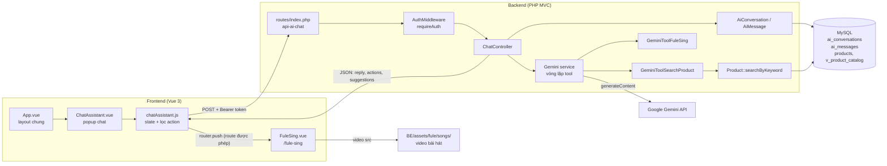

# 01. Kiến trúc hệ thống

## 1. Các thành phần

| Thành phần | Vị trí | Vai trò |
| --- | --- | --- |
| Popup chat | `FE/src/components/chat/ChatAssistant.vue` | Giao diện khung chat, nằm ở layout chung `App.vue` |
| State chat | `FE/src/helpers/ai/chatAssistant.js` | Giữ danh sách tin nhắn, `conversation_id`, gọi API, lọc lệnh điều hướng |
| Trang sân khấu | `FE/src/views/FuleSing.vue` | Phát video bài hát của Louis, route `/fule-sing` |
| Router API | `BE/routes/index.php` | Điều phối `?action=api-ai-chat`, yêu cầu đăng nhập |
| Controller | `BE/controllers/ChatController.php` | Validate request, kiểm tra quyền, gọi Gemini, lưu lịch sử, trả JSON |
| Service Gemini | `BE/geminiServices/Gemini.php` | Gọi Gemini API (xoay vòng nhiều API key, tự chuyển key khi hết hạn mức), vòng lặp tool, tách gợi ý và lệnh điều hướng |
| System prompt | `BE/geminiServices/GeminiPrompt.php` | Quy tắc trả lời, danh xưng, cách gọi tool |
| Lớp cha tool | `BE/geminiServices/GeminiTool.php` | Khai báo chuẩn cho mọi tool, hàm tạo lệnh điều hướng |
| Tool tra sản phẩm | `BE/geminiServices/GeminiToolSearchProduct.php` | Tool `search_product` |
| Tool hát | `BE/geminiServices/GeminiToolFuleSing.php` | Tool `fule_sing`, chứa playlist |
| Model sản phẩm | `BE/models/Product.php` (`searchByKeyword`) | Truy vấn sản phẩm cho tool |
| Model hội thoại | `BE/models/AiConversation.php` | Kiểm tra quyền sở hữu hội thoại |
| Model lượt chat | `BE/models/AiMessage.php` | Đọc lịch sử, lưu lượt mới trong transaction |
| Bảng DB | `ai_conversations`, `ai_messages` | Lưu hội thoại (xem [03-co-so-du-lieu.md](03-co-so-du-lieu.md)) |

## 2. Sơ đồ kiến trúc tổng thể

## 3. Phân tầng và nguyên tắc

- **Controller** chỉ lo HTTP: đọc body, kiểm tra kiểu dữ liệu, trả mã lỗi, gọi service và model.
- **Service Gemini** không biết gì về HTTP. Nó nhận câu hỏi, chạy vòng lặp tool và trả mảng kết quả.
- **Tool** là lớp bọc mỏng. Tool không viết SQL trực tiếp; nó gọi hàm của Model (`Product::searchByKeyword`).
- **Model** chỉ truy cập DB, dùng PDO và prepared statement.
- **FE** không tin dữ liệu điều hướng từ server một cách trực tiếp: mọi lệnh đều đi qua danh sách route cho phép (xem [07-bao-mat.md](07-bao-mat.md)).

## 4. Vì sao chia như vậy

| Quyết định | Lý do |
| --- | --- |
| Lịch sử lưu ở server, không ở client | Client không thể tự chèn kết quả tool giả vào lịch sử. Tool ghi dữ liệu sau này sẽ an toàn hơn. |
| Tool không viết SQL | Mọi truy vấn nằm trong Model, dễ kiểm tra, đúng quy tắc của `BE/CLAUDE.md`. |
| Điều hướng do server quyết định | AI không tự ghi URL. Quy tắc "1 kết quả → chi tiết, nhiều → danh sách" nằm trong code, không phụ thuộc vào cách AI diễn đạt. |
| Lệnh điều hướng tách khỏi nội dung gửi AI | AI không thấy và không sửa được lệnh; không làm lộ `slug` không cần thiết. |
| Gợi ý sinh cùng câu trả lời | Không tốn thêm lần gọi Gemini nào. |
| Popup nằm ở layout chung | Hội thoại không mất khi chuyển trang. |
