# 02. Luồng nghiệp vụ

Phần này là các sơ đồ quan trọng nhất. Mỗi luồng được vẽ theo đúng code hiện tại.

## 2.1. Luồng tổng: một lượt hỏi đáp

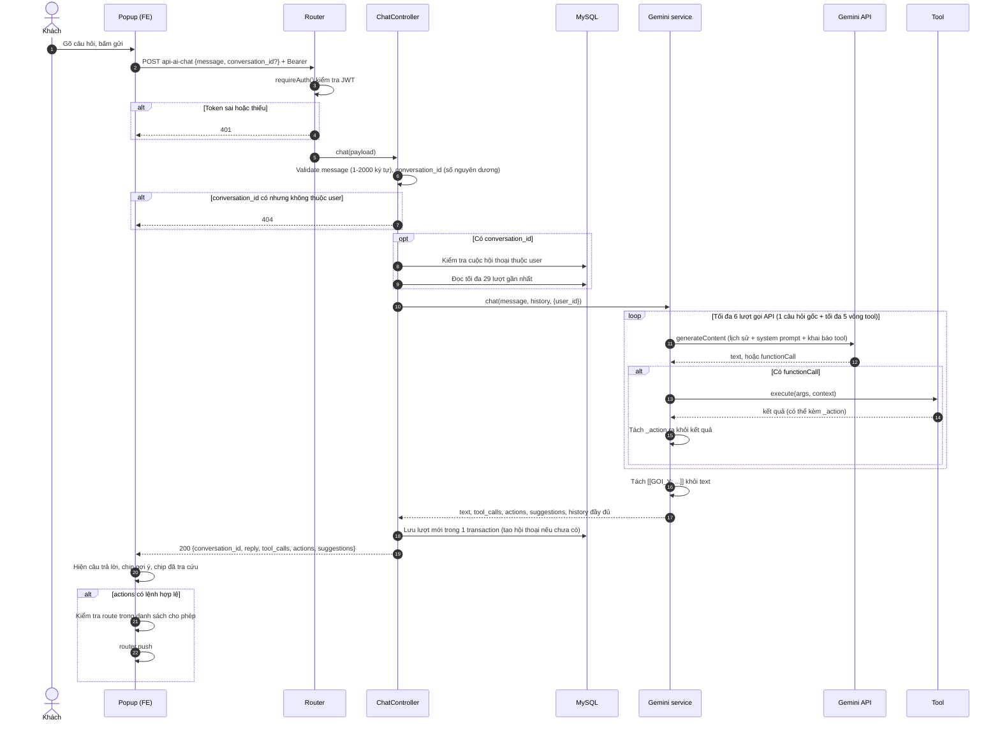

## 2.2. Luồng quyết định của server sau khi nhận request

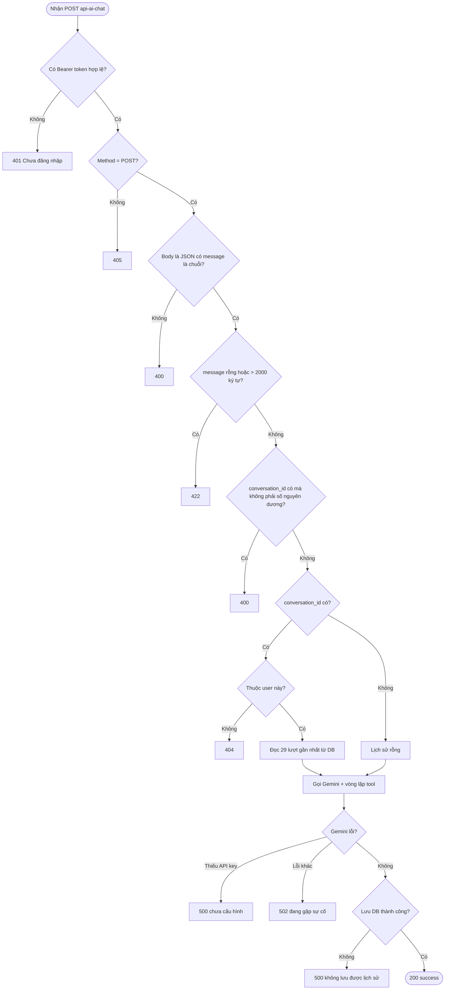

Điểm quan trọng: **cuộc hội thoại mới chỉ được tạo sau khi Gemini trả lời thành công.** Nếu Gemini lỗi, không có bản ghi rỗng nào được để lại.

## 2.3. Luồng gọi tool bên trong Gemini service

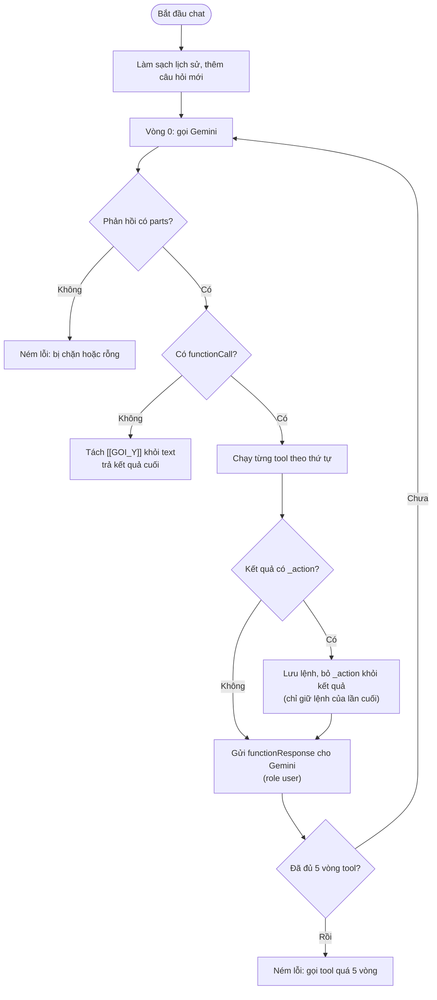

Lưu ý: functionResponse gửi lại cho AI **không còn** `_action`, nên AI không biết và không thể sửa lệnh điều hướng.

## 2.4. Nghiệp vụ: hỏi tra cứu sản phẩm

Ví dụ khách hỏi "Vinh Râu".

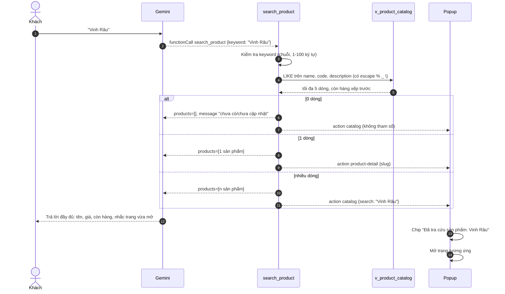

## 2.5. Nghiệp vụ: yêu cầu hát

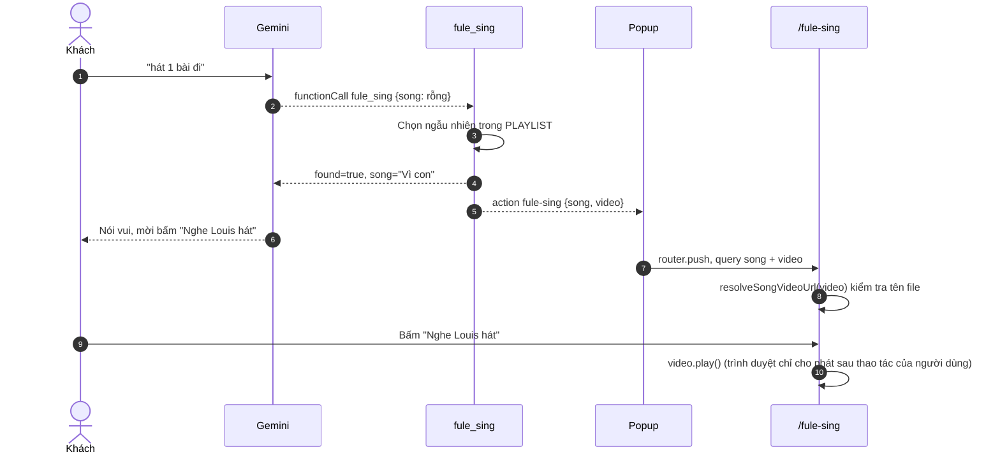

Trường hợp khách nhờ bài không có trong playlist:

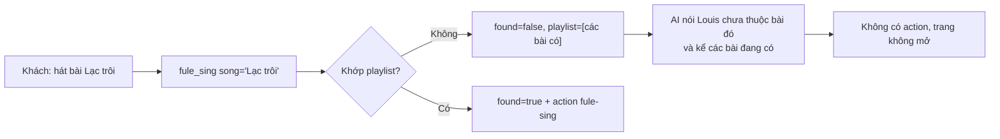

## 2.6. Nghiệp vụ: hội thoại tiếp nối

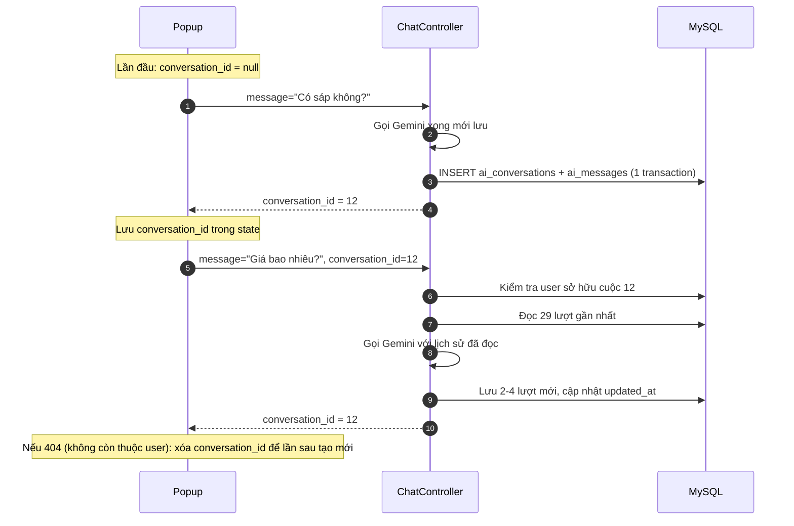

## 2.7. Nghiệp vụ: gợi ý theo ngữ cảnh

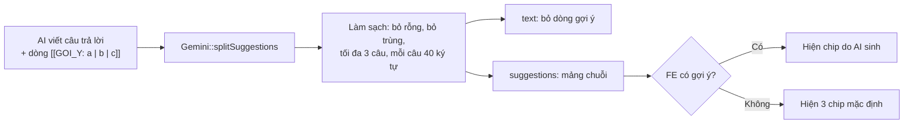

Dòng gợi ý được **giữ nguyên trong lịch sử DB** để lượt sau AI thấy đúng định dạng đã dùng.

## 2.8. Nghiệp vụ: xử lý lỗi ở FE

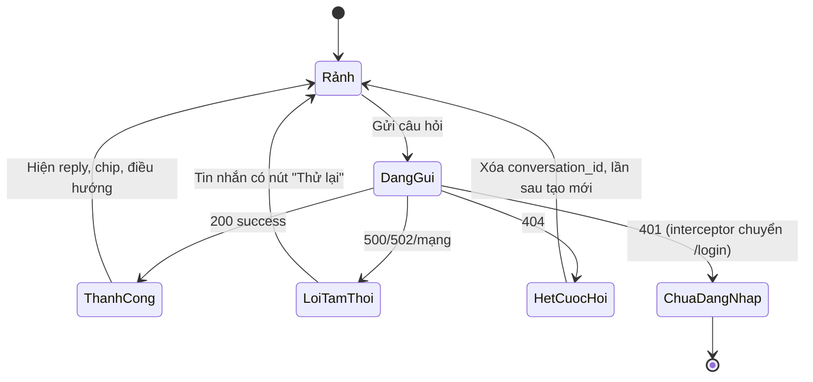

## 2.9. Nghiệp vụ: đăng nhập và quay lại

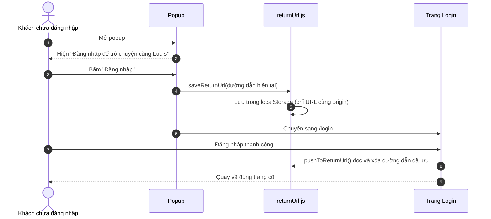

## 2.10. Vòng đời trạng thái của một lượt chat trong popup

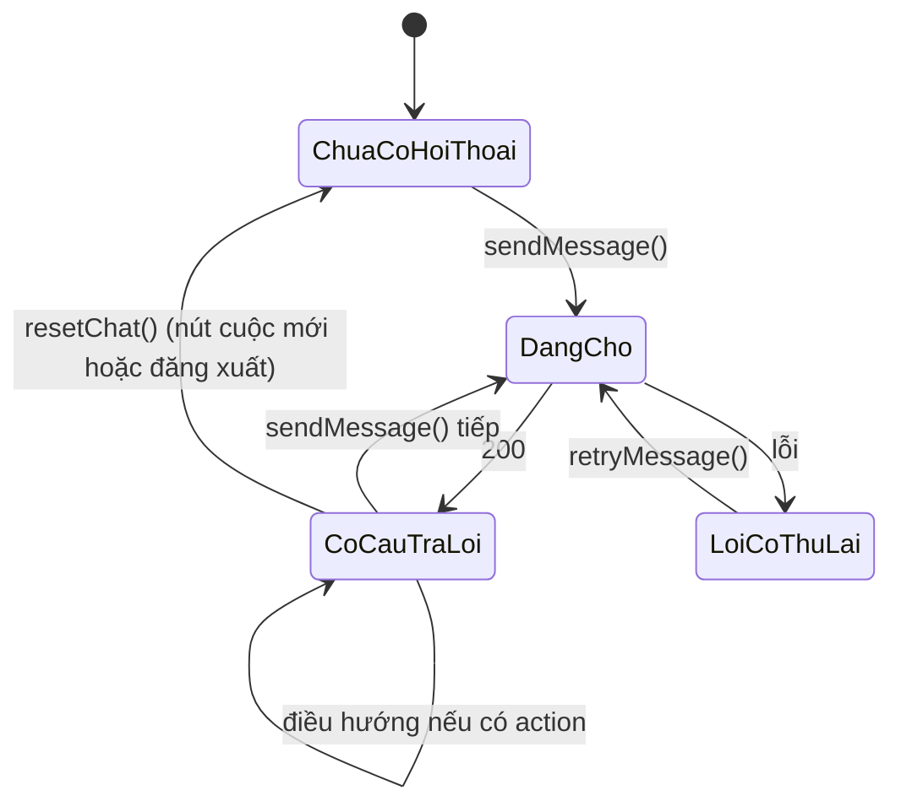
