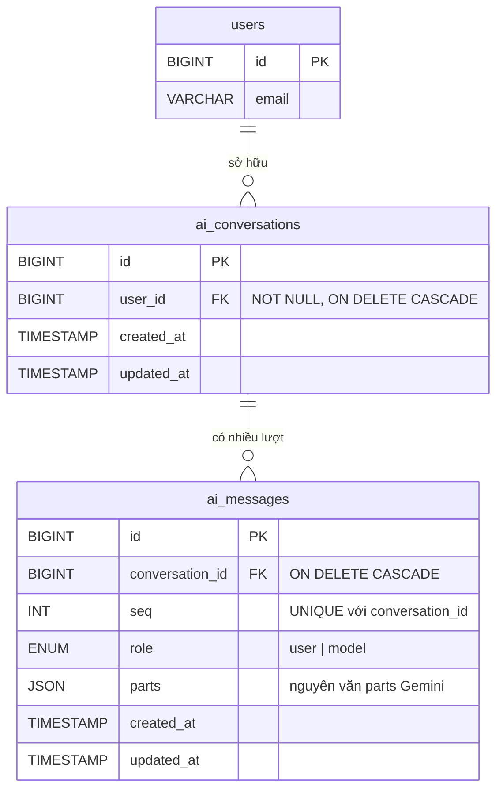
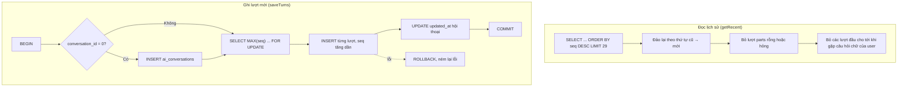

# 03. Cơ sở dữ liệu

Migration: `BE/database/migrations/20261115_01_create_ai_chat_tables.sql`. Đã chạy trên DB local (MySQL 8.0.30).

## 1. Sơ đồ quan hệ

## 2. Bảng `ai_conversations`

| Cột | Kiểu | Ràng buộc | Ý nghĩa |
| --- | --- | --- | --- |
| `id` | BIGINT UNSIGNED | PK, AUTO_INCREMENT | Mã cuộc hội thoại, FE dùng làm `conversation_id` |
| `user_id` | BIGINT UNSIGNED | NOT NULL, FK `users.id` ON DELETE CASCADE, có index | Chủ sở hữu, lấy từ JWT `sub` |
| `created_at` | TIMESTAMP | DEFAULT CURRENT_TIMESTAMP | Lúc bắt đầu |
| `updated_at` | TIMESTAMP | ON UPDATE CURRENT_TIMESTAMP | Lúc có lượt mới gần nhất |

Vì sao bảng nhỏ: nhiệm vụ chính là **xác định chủ sở hữu**. Mọi thao tác đọc/ghi đều kiểm tra `user_id` khớp người đang đăng nhập.

## 3. Bảng `ai_messages`

| Cột | Kiểu | Ràng buộc | Ý nghĩa |
| --- | --- | --- | --- |
| `id` | BIGINT UNSIGNED | PK | Mã lượt |
| `conversation_id` | BIGINT UNSIGNED | NOT NULL, FK ON DELETE CASCADE | Thuộc cuộc nào |
| `seq` | INT UNSIGNED | NOT NULL, UNIQUE cùng `conversation_id` | Thứ tự 1, 2, 3... không phụ thuộc thời gian |
| `role` | ENUM('user','model') | NOT NULL | Người nói, theo định dạng Gemini |
| `parts` | JSON | NOT NULL, CHECK `JSON_TYPE(parts) = 'ARRAY'` | Nguyên văn mảng parts |
| `created_at` | TIMESTAMP | DEFAULT CURRENT_TIMESTAMP | Lúc lưu |
| `updated_at` | TIMESTAMP | ON UPDATE CURRENT_TIMESTAMP | Cập nhật gần nhất |

### Nội dung cột `parts`

Một lượt có thể chứa một trong các dạng sau:

| Dạng | Ví dụ | Khi nào |
| --- | --- | --- |
| Chữ | `[{"text": "Có sáp không?"}]` | Câu hỏi của khách, câu trả lời của AI |
| Gọi tool | `[{"functionCall": {"name": "search_product", "args": {"keyword": "sáp"}}, "thoughtSignature": "..."}]` | AI yêu cầu chạy tool |
| Kết quả tool | `[{"functionResponse": {"name": "search_product", "response": {"products": [...]}}}]` | Server gửi lại kết quả (role user) |

Lý do lưu nguyên văn JSON: AI cần thấy đúng `functionCall` và `thoughtSignature` khi nhận lại lịch sử. Tách thành cột riêng sẽ dễ làm sai.

## 4. Ví dụ dữ liệu của một cuộc hội thoại

Cuộc hội thoại id 12, khách hỏi "Có sáp không?":

| seq | role | parts (rút gọn) |
| --- | --- | --- |
| 1 | user | `[{"text": "Có sáp không?"}]` |
| 2 | model | `[{"functionCall": {"name": "search_product", "args": {"keyword": "sáp"}}, "thoughtSignature": "..."}]` |
| 3 | user | `[{"functionResponse": {"name": "search_product", "response": {"products": [...]}}}]` |
| 4 | model | `[{"text": "Cửa hàng có 3 loại sáp..."}]` |

Lượt 3 mang role `user` vì tài liệu Gemini quy định kết quả tool được gửi lại với role `user`.

## 5. Luồng đọc và ghi

Vì sao đọc 29 lượt chứ không phải 30: AI còn thêm câu hỏi mới vào cuối. Nếu đọc đủ 30 thì tổng 31 vượt giới hạn, và Gemini sẽ cắt mất cả một lượt hỏi đáp cũ.

## 6. Ràng buộc và lý do

| Ràng buộc | Tác dụng |
| --- | --- |
| FK `user_id` ON DELETE CASCADE | Xóa user thì xóa hội thoại |
| FK `conversation_id` ON DELETE CASCADE | Xóa hội thoại thì xóa lượt |
| UNIQUE (`conversation_id`, `seq`) | Không có hai lượt trùng thứ tự |
| CHECK `JSON_TYPE(parts) = 'ARRAY'` | `parts` luôn là mảng, đúng định dạng Gemini |
| `FOR UPDATE` khi lấy MAX(seq) | Hai request cùng lúc không lấy trùng số thứ tự |
| Transaction khi ghi | Lỗi giữa chừng không để lại hội thoại rỗng hay lịch sử thiếu |

## 7. Chưa có trong thiết kế hiện tại

- Chưa có cột tiêu đề hội thoại. Chưa có API liệt kê hội thoại của user.
- Chưa có chính sách xóa hội thoại cũ tự động. Dữ liệu tăng dần theo số lượt chat.
- Chưa có bảng ghi nhận tool call riêng. Thông tin đó nằm trong `parts`.
