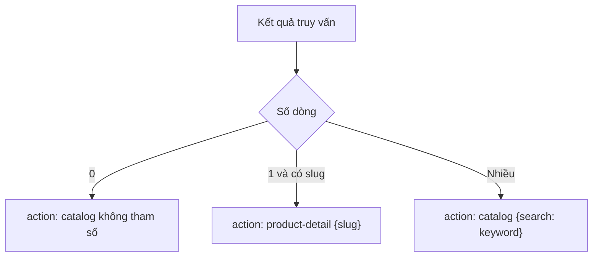
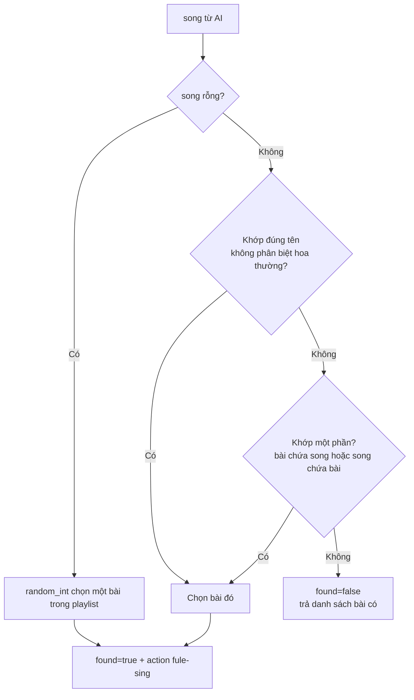
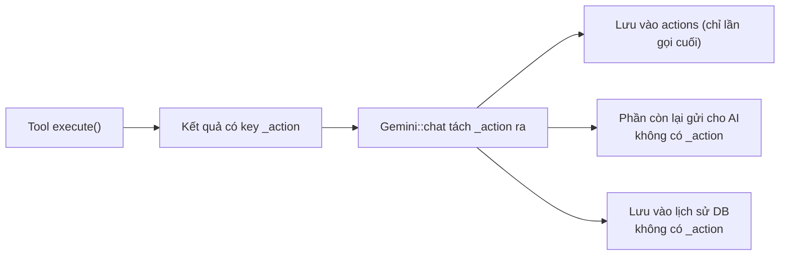

# 05. Tool và cơ chế lệnh điều hướng

## 1. Tool là gì

Gemini không đọc được database. Khi cần dữ liệu, AI trả về yêu cầu "gọi hàm X với tham số Y". Server chạy hàm đó, gửi kết quả lại, và AI viết câu trả lời dựa trên kết quả.

Mỗi tool kế thừa `GeminiTool` và viết 4 phương thức:

| Phương thức | Việc làm |
| --- | --- |
| `name()` | Tên tool, chỉ chữ, số, gạch dưới |
| `description()` | Mô tả khi nào nên gọi, AI dựa vào đây để quyết định |
| `parameters()` | JSON Schema của tham số |
| `execute($args, $context)` | Chạy nghiệp vụ, trả mảng kết quả |

## 2. Danh sách tool hiện có

| Tool | File | Tham số | Đọc/ghi | Lệnh điều hướng |
| --- | --- | --- | --- | --- |
| `search_product` | `GeminiToolSearchProduct.php` | `keyword` (bắt buộc) | Đọc `v_product_catalog` | `product-detail` hoặc `catalog` |
| `fule_sing` | `GeminiToolFuleSing.php` | `song` (không bắt buộc) | Không đọc DB, dùng mảng `PLAYLIST` | `fule-sing` |

## 3. Tool `search_product`

### 3.1. Đầu vào

- `keyword`: chuỗi, sau khi trim không rỗng, tối đa 100 ký tự. Sai kiểu hoặc quá dài thì tool ném `InvalidArgumentException` và AI nhận thông báo lỗi.

### 3.2. Truy vấn

Gọi `Product::searchByKeyword($keyword, 5)`:
- Tìm `LIKE %keyword%` trên `name`, `code`, `description` của `v_product_catalog`.
- Escape `%`, `_`, `\` trong từ khóa để không bị hiểu thành ký tự đại diện.
- Sắp xếp: còn hàng trước, sau đó mới nhất.
- Giới hạn 5 dòng.

### 3.3. Đầu ra gửi cho AI

```json
{
  "products": [
    { "id": 3, "name": "Tinh Dầu Dưỡng Tóc Moroccanoil Treatment", "code": "MOROCCANOIL",
      "category": "Dưỡng tóc", "price_from": 290000, "price_to": 720000, "in_stock": true,
      "variant_count": 2,
      "variants": [
        { "name": "Chai 100ml", "sku": "MOROCCANOIL", "price": 720000, "original_price": 750000, "stock": 25, "is_default": true },
        { "name": "Chai 25ml", "sku": "MOROCCANOIL-25ML", "price": 290000, "original_price": null, "stock": 40, "is_default": false }
      ] }
  ]
}
```

- `price_from`, `price_to`: giá thấp nhất và cao nhất của các phiên bản đang bán (đã tính giảm giá), lấy từ `v_product_catalog`.
- `variants`: các phiên bản đang bán (`is_active = 1`) lấy từ bảng `product_variants` bằng `Product::getActiveVariantsByProductIds()`, một truy vấn cho cả 5 sản phẩm. Mặc định đứng đầu, sau đó theo giá tăng dần, tối đa 5 phiên bản mỗi sản phẩm.
- `price` là giá bán thực tế; `original_price` là giá niêm yết, chỉ có khi đang giảm giá. `stock` là số lượng lúc tra cứu, 0 nghĩa là phiên bản đó hết hàng.
- `variant_count` là tổng số phiên bản đang bán; lớn hơn số phần tử `variants` nghĩa là danh sách đã bị cắt.
- Gửi kèm phiên bản trong cùng kết quả (không tách tool riêng) để không tốn thêm request Gemini, vì gói miễn phí giới hạn số request mỗi phút.

Không gửi cho AI: `slug`, ảnh, mô tả, thuộc tính JSON của phiên bản.

Khi không có kết quả: `products: []` kèm `message` dặn AI báo cửa hàng chưa có hoặc chưa cập nhật sản phẩm đó.

### 3.4. Quyết định điều hướng



Quy tắc này nằm trong code PHP. AI không tham gia quyết định, nên không thể "đoán" sai trang để mở.

## 4. Tool `fule_sing`

### 4.1. Playlist

```php
const PLAYLIST = [
    'Vì con' => 'vi-con.mp4',
];
```

Key là tên bài hiển thị. Value là tên file video trong `BE/assets/fule/songs/`. Thêm bài: chép file video vào thư mục, thêm một dòng vào mảng.

### 4.2. Logic chọn bài



Khớp một phần dùng `str_contains` theo hai chiều, nên "bài vì con" và "vì con" đều ra "Vì con".

### 4.3. Đầu ra

- Tìm được: `found=true`, `song`, `message`, `playlist`, và action `fule-sing` với `query.song` và `query.video`.
- Không tìm được: `found=false`, `message` ("Louis Dé Fule chưa thuộc bài..."), `playlist`. Không có action, trang không mở.

## 5. Cơ chế lệnh điều hướng `_action`



Ba điểm bảo đảm:
1. AI không thấy `_action`, nên không biết có lệnh điều hướng và không sửa được.
2. Lịch sử DB không chứa `_action`, nên tải lại hội thoại không tạo lại lệnh cũ.
3. Chỉ giữ lệnh của **lần gọi tool cuối**. Nếu AI gọi tìm nhiều lần, trang mở sẽ khớp với lần cuối mà câu trả lời dựa vào.

## 6. Hàm tạo lệnh điều hướng

`GeminiTool::navigateAction($route, $query, $params)` dùng chung cho mọi tool:
- Trả `{type: 'navigate', route, query, params}`.
- Mảng rỗng được đổi thành object rỗng `{}` để FE luôn nhận cùng một kiểu.

## 7. Khai báo tool trong controller

```php
$result = (new Gemini())
    ->addTool(new GeminiToolSearchProduct())
    ->addTool(new GeminiToolFuleSing())
    ->chat($message, $history, ['user_id' => $userId]);
```

`addTool` từ chối tên tool sai định dạng hoặc đăng ký trùng. `$context` chỉ là thông tin server truyền xuống, không lấy từ client.

## 8. Quy tắc viết tool mới

1. Kế thừa `GeminiTool`, viết 4 phương thức.
2. Mọi tham số từ AI phải kiểm tra như dữ liệu người dùng nhập.
3. Truy vấn DB đặt trong Model, không viết SQL trong tool.
4. Lỗi do tham số sai: ném `InvalidArgumentException` với thông báo rõ. Lỗi khác bị thay bằng thông báo chung.
5. Muốn mở trang: dùng `navigateAction()`, và route phải được thêm vào danh sách cho phép ở FE.
6. Thêm mô tả vào system prompt nếu AI cần biết khi nào gọi.

## 9. Ví dụ thực tế

Khách: "hát 1 bài đi anh Fule ơi"

```text
Lượt 2 (model): functionCall fule_sing {song: null}
Lượt 3 (user):  functionResponse fule_sing {found: true, song: "Vì con", message: "..."}
Lượt 4 (model): "Tuyệt vời! Louis Dé Fule xin gửi tặng quý ông bài Vì con..."
Response:       actions = [{route: "fule-sing", query: {song: "Vì con", video: "vi-con.mp4"}}]
```

Trong lượt 3 không có `_action`. Nó chỉ xuất hiện ở trường `actions` của response.
