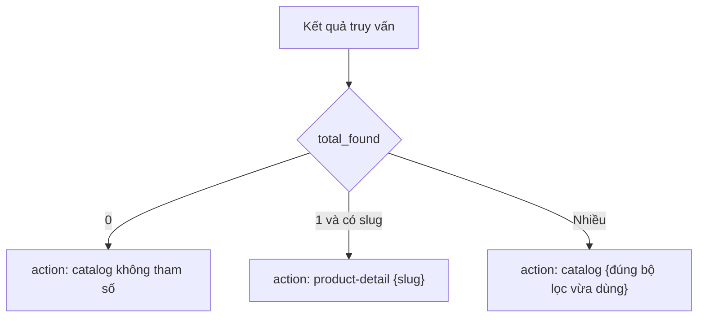
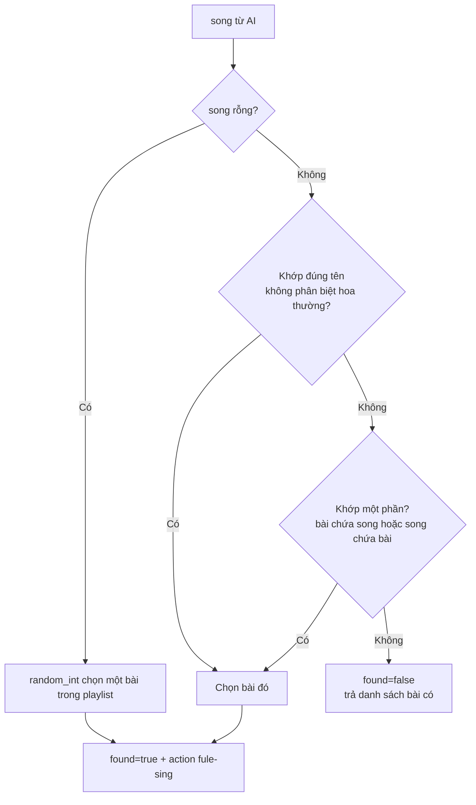
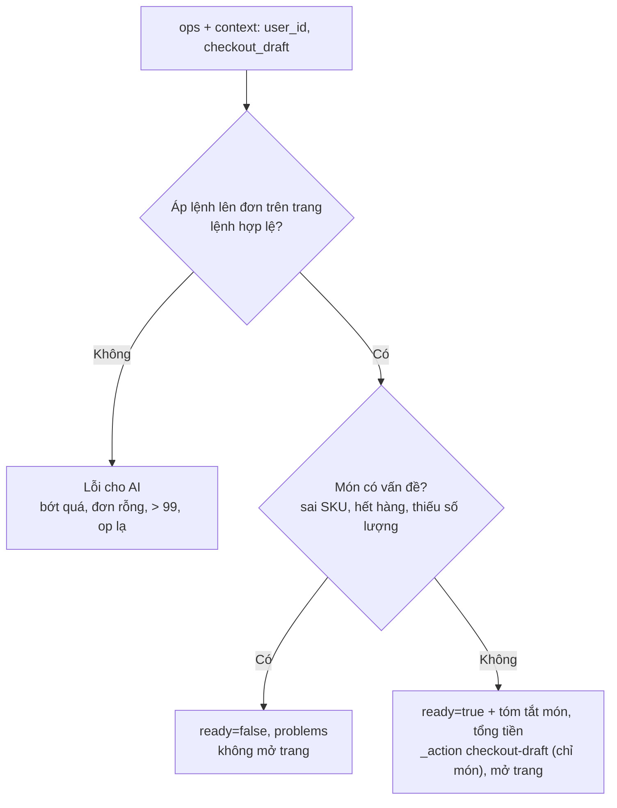
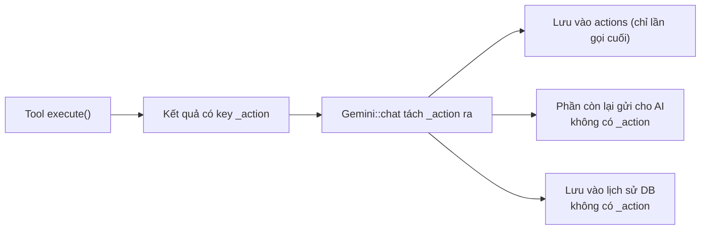

# 05. Tool và cơ chế lệnh điều hướng

## 1. Tool là gì

Gemini không đọc được database. Khi cần dữ liệu, AI trả về yêu cầu "gọi hàm X với tham số Y". Server chạy hàm đó, gửi kết quả lại, và AI viết câu trả lời dựa trên kết quả.

Mỗi tool kế thừa `GeminiTool` và viết 4 phương thức:

| Phương thức | Việc làm |
| --- | --- |
| `name()` | Tên tool, chỉ chữ, số, gạch dưới |
| `description()` | Mô tả khi nào nên gọi, AI dựa vào đây để quyết định |
| `parameters()` | JSON Schema của tham số |
| `execute($args, $context)` | Chạy nghiệp vụ, trả mảng kết quả |

## 2. Danh sách tool hiện có

| Tool | File | Tham số | Đọc/ghi | Lệnh điều hướng |
| --- | --- | --- | --- | --- |
| `search_product` | `GeminiToolSearchProduct.php` | `keyword`, `category`, `min_price`, `max_price`, `hold`, `shine`, `tags`, `sort` (đều không bắt buộc, giống bộ lọc catalog) | Đọc `v_product_catalog`, `product_variants` | `product-detail` hoặc `catalog` (kèm bộ lọc) |
| `fule_sing` | `GeminiToolFuleSing.php` | `song` (không bắt buộc) | Không đọc DB, dùng mảng `PLAYLIST` | `fule-sing` |
| `create_order_draft` | `GeminiToolCreateOrderDraft.php` | `ops`: danh sách lệnh `add`/`set`/`subtract`/`remove` (bắt buộc; không có tham số thông tin cá nhân) | Đọc `product_variants`, `products` (không ghi, không đọc hồ sơ) | `checkout-draft` |

## 3. Tool `search_product`

Từ 23/11/2026 tool dùng **đúng bộ lọc của trang catalog**: tham số được kiểm tra bằng `BE/extensions/CatalogFilter.php` (dùng chung với `api-products`), rồi truy vấn bằng `Product::getFiltered()`. Trợ lý và trang catalog luôn ra cùng kết quả.

### 3.1. Đầu vào

Mọi tham số đều không bắt buộc, kết hợp được với nhau:

| Tham số | Kiểu | Ý nghĩa |
| --- | --- | --- |
| `keyword` | string | Tìm rộng (OR) trong tên, mã, mô tả, `metadata` của sản phẩm (giá trị thuộc tính + cụm chữ "giữ nếp …", "bóng …") và SKU, tên phiên bản đang bán (tối đa 100 ký tự). So khớp **cả cụm liền nhau**, nên prompt bắt AI chỉ đưa **thực thể cốt lõi** đã sửa chính tả: "con sáp nào được dùng bởi Sơn Tùng MTP" → `Sơn Tùng MTP`; "sáp KervinMurphy" → `Kevin Murphy` (chữ "sáp" sang `category`) |
| `category` | string | **Tên** danh mục (AI chỉ biết tên). Tool đổi sang slug bằng `Product::findCategorySlug()`: trùng hẳn tên/slug, hoặc khớp một phần (từ 3 ký tự) nếu chỉ đúng 1 danh mục chứa chữ đó |
| `min_price`, `max_price` | number | Khoảng giá bán (VND) |
| `hold` | integer | Độ giữ nếp: 1 = nhẹ, 2 = trung bình, 3 = mạnh |
| `shine` | integer | Độ bóng: 0 = không bóng (mờ), 1 = bóng nhẹ, 2 = bóng vừa, 3 = bóng cao |
| `tags` | string[] | Tối đa 5 đặc điểm (loại tóc, kiểu tóc, dung tích, mùi hương), phải khớp tất cả |
| `sort` | `newest` \| `oldest` | Mặc định mới nhất |

Tham số sai (hold ngoài thang, danh mục không có, giá âm, quá 5 tag...) thì `CatalogFilter` ném `InvalidArgumentException`; `Gemini::runTool` gửi câu báo lỗi cho AI để nó tự sửa và gọi lại.

### 3.2. Truy vấn

`Product::getFiltered($filters, 1, 5)` (xem `docs/trang-thai-du-an.md`, mục kế hoạch 23/11):

- Giá, giữ nếp, độ bóng: sản phẩm khớp khi có **ít nhất 1 biến thể đang bán** thỏa cả 3 cùng lúc (`EXISTS`).
- Tag: `products.metadata LIKE %tag%`, mọi tag (AND). Không phân biệt hoa thường và dấu.
- Escape `%`, `_`, `\` trong từ khóa và tag. Tag có dấu phẩy được tách thành nhiều tag (cùng cách với URL catalog), nên kết quả của tool luôn khớp trang catalog nó mở.
- Xếp hạng chung với catalog: còn hàng trước, rồi theo `sort`. Nhờ vậy 5 kết quả gửi AI không bị lấp đầy bởi hàng hết.

### 3.3. Đầu ra gửi cho AI

```json
{
  "total_found": 2,
  "applied_filters": ["Độ giữ nếp: Mạnh", "Độ bóng: Không bóng (mờ)", "Đặc điểm: tóc dày"],
  "products": [
    { "id": 83, "name": "Glanzen Clay Wax", "code": "FULE-001", "category": "Gel, Sáp vuốt tóc",
      "description": "Sáp vuốt tóc nam Glanzen Clay Wax ... (tối đa 300 ký tự)",
      "sales_count": 10, "price_from": 268000, "price_to": 399000, "in_stock": true, "variant_count": 2,
      "variants": [
        { "name": "Mặc định", "sku": "FULE-001", "price": 268000, "original_price": null, "stock": 99, "is_default": true,
          "hold": "Mạnh", "shine": "Không bóng (mờ)",
          "attributes": { "Dung tích": "113 g", "Phù hợp": "Tóc trung bình đến dày cứng, tóc nhiều dầu", "Kiểu tóc": "Undercut, mohican" } }
      ] }
  ]
}
```

- `total_found`: tổng số sản phẩm khớp (có thể lớn hơn 5 sản phẩm gửi kèm).
- `applied_filters`: điều kiện đã dùng bằng chữ, để AI nhắc lại với khách.
- `description` (cắt 300 ký tự), `sales_count`: để AI giải thích và trả lời "loại nào bán chạy".
- `variants`: tối đa 5 phiên bản đang bán mỗi sản phẩm, lấy bằng `Product::getActiveVariantsByProductIds()` (một truy vấn cho cả 5 sản phẩm). Mỗi phiên bản có `hold`, `shine` (nhãn, `null` = cửa hàng chưa cập nhật, AI không được đoán) và `attributes` dạng `{nhãn: giá trị}` (bỏ giá trị trống).
- `price` là giá bán thực tế; `original_price` chỉ có khi đang giảm giá; `stock` = 0 là hết hàng.

Không gửi cho AI: `slug`, ảnh, `metadata`.

Khi không có kết quả: `products: []`, `total_found: 0` kèm `message` dặn AI báo chưa có sản phẩm như vậy và gợi ý nới bớt tiêu chí.

Prompt (`GeminiPrompt.php`, mục "Tư vấn theo nhu cầu") dạy AI đổi câu của khách thành tham số: "giữ nếp mạnh" → `hold = 3`, "không bóng" → `shine = 0`, "dưới 500 nghìn" → `max_price = 500000`, loại tóc / kiểu tóc → `tags`.

### 3.4. Quyết định điều hướng



Nhiều kết quả thì mở catalog với đúng bộ lọc (`CatalogFilter::toQuery()`, mọi giá trị là chuỗi), nên khách thấy cùng danh sách với câu trả lời. FE nhận các khóa `search, category, min_price, max_price, hold, shine, tags, sort` (whitelist trong `FE/src/helpers/ai/chatAssistant.js`).

Quy tắc này nằm trong code PHP. AI không tham gia quyết định, nên không thể "đoán" sai trang để mở.

### 3.5. Ép AI chọn keyword đúng và tự thử lại

Vấn đề: `keyword` so khớp **cả cụm liền nhau** (LIKE `%cụm%`). AI hay đưa nguyên câu hoặc cụm thừa chữ
("dùng bởi Sơn Tùng MTP", "sáp Kevin Murphy") nên không ra gì, hoặc giữ lỗi gõ của khách ("KervinMurphy").

Cách làm: nhắc cùng một quy tắc ở **3 chỗ**, mỗi chỗ đúng thời điểm AI ra quyết định.

| # | Chỗ | AI đọc lúc nào | Nội dung |
|---|-----|----------------|----------|
| 1 | `GeminiPrompt.php`, mục "Cách chọn keyword cho search_product" | Mọi lượt (system prompt) | Luật đầy đủ: lý do (khớp cả cụm), chỉ giữ thực thể cốt lõi 1-3 từ, phần bỏ đi chuyển sang đâu (loại sản phẩm → `category`, nhu cầu → `hold`/`shine`/giá/`tags`), sửa chính tả tên riêng, ví dụ đúng / sai đặt cạnh nhau |
| 2 | `GeminiToolSearchProduct.php`, `description` của tham số `keyword` | Lúc điền tham số để gọi tool | Bản tóm tắt 1 câu + 4 ví dụ mẫu ("Sơn Tùng MTP", "Kevin Murphy", "Reuzel", "CLAYMATION-113G") |
| 3 | `GeminiToolSearchProduct.php`, `message` khi `total_found = 0` | Lúc đọc kết quả rỗng | Chỉ cách gọi lại: bỏ `category`, rút keyword còn 1-2 từ đặc trưng, thử có dấu / không dấu, tối đa 2 lần; hết cách mới báo khách "chưa có" |

Mẹo viết prompt rút ra:
- Nói **lý do** (khớp cả cụm) chứ không chỉ ra lệnh: AI làm theo ổn định hơn.
- Ví dụ **đúng kèm sai** ("`Sơn Tùng MTP` (KHÔNG phải `dùng bởi Sơn Tùng MTP`)") hiệu quả nhất.
- Chữ bị bỏ khỏi keyword phải có **chỗ để đi** (category, hold, tags...), nếu không AI sẽ cố nhét lại vào keyword.

**Thử lại diễn ra ngay trong vòng lặp tool** của `Gemini::chat()`, khách không phải hỏi lại:

```text
Vòng 0: câu hỏi          -> Gemini: functionCall search_product {keyword: "Kevin Murphy", category: "Sáp"}
        tool chạy         -> total_found 0 + message "bỏ category / rút keyword... gọi lại"
Vòng 1: functionResponse  -> Gemini đọc message: functionCall search_product {keyword: "Kevin Murphy"}
        tool chạy         -> total_found 2
Vòng 2: functionResponse  -> Gemini trả chữ, hết vòng lặp, câu trả lời về FE
```

- Khách chỉ thấy **một** câu trả lời cuối; mỗi lần gọi tool có một chip dưới câu trả lời.
- "Tối đa 2 lần" chỉ là **lời dặn AI**, code không đếm. Giới hạn cứng là `Gemini::MAX_TOOL_ROUNDS = 5`; vượt thì ném lỗi, khách nhận 502.
- Trang được mở theo **lần gọi tool cuối** (mục 5), nên lần rỗng trước đó không làm mở sai trang.
- Kiểm chứng 23/11/2026 bằng chat thật với Gemini: 4/4 câu ra keyword đúng ngay lần gọi đầu.

## 4. Tool `fule_sing`

### 4.1. Playlist

```php
const PLAYLIST = [
    'Vì con' => 'vi-con.mp4',
];
```

Key là tên bài hiển thị. Value là tên file video trong `BE/assets/fule/songs/`. Thêm bài: chép file video vào thư mục, thêm một dòng vào mảng.

### 4.2. Logic chọn bài



Khớp một phần dùng `str_contains` theo hai chiều, nên "bài vì con" và "vì con" đều ra "Vì con".

### 4.3. Đầu ra

- Tìm được: `found=true`, `song`, `message`, `playlist`, và action `fule-sing` với `query.song` và `query.video`.
- Không tìm được: `found=false`, `message` ("Louis Dé Fule chưa thuộc bài..."), `playlist`. Không có action, trang không mở.

## 4b. Tool `create_order_draft` (lên đơn nháp)

> Tóm tắt ngắn. Tài liệu đầy đủ (luồng mọi tình huống, thuật toán, API xác nhận, giao diện, bảo mật, kiểm thử, vấn đáp) nằm ở [len-don-nhanh/](len-don-nhanh/README.md).

Tool **không tạo đơn**. Nó áp các lệnh của AI lên đơn nháp đang mở, tra giá và tồn kho rồi gửi đơn nháp (chỉ món) cho FE; khách tự bấm xác nhận thì đơn mới được tạo.

### Đầu vào

- `ops`: 1-20 lệnh `{ op, sku, quantity }`, `op` là `add` (mua/thêm N), `set` (đổi thành N), `subtract` (bớt N), `remove` (bỏ món). AI chỉ gửi thay đổi khách vừa nói, **không** gửi lại cả đơn. SKU lấy từ `search_product` hoặc đơn nháp đang mở. Số lượng là số nguyên 1-99.
- Gốc để áp lệnh là đơn nháp khách đang thấy (`$context['checkout_draft']`, FE gửi kèm mỗi lượt, server đã tra DB); chưa có đơn nháp thì gốc là đơn rỗng.
- Không có tham số tên, SĐT, địa chỉ, và tool không đọc hồ sơ. Người nhận do FE tự điền (`api-profile`). Louis không hỏi thông tin cá nhân trong chat.
- User ID lấy từ `$context['user_id']` (JWT), không bao giờ lấy từ AI.

### Kết quả



- Phần gửi cho AI chỉ có tên món, số lượng cuối cùng, thành tiền, tổng tiền. **Không có** tên, SĐT, địa chỉ.
- `_action.draft` chỉ có món và tổng tiền, **không có** người nhận. FE tự lấy người nhận từ hồ sơ hoặc giữ thông tin khách đã sửa trên trang.

### Xác nhận đơn: `api-order-checkout-items`

| Mục | Nội dung |
| --- | --- |
| Method | POST, cần Bearer token (`requireAuth` ở router) |
| Body | `items: [{ sku, quantity }]`, `recipient_name`, `recipient_phone`, `shipping_address` (do form trên trang gửi), `payment_method` (`cod`/`sepay`), `expected_total` (không bắt buộc) |
| 201 | `{ status, message, order: { id, total_amount, order_status, payment_status, payment_method } }` |
| 409 | Hết hàng, ngừng bán, không đủ số lượng; hoặc giá đã đổi (kèm `total_amount` mới) |
| 422 / 400 / 405 / 401 | Dữ liệu sai / body sai kiểu / sai method / thiếu token |

`Order::checkoutItems` khóa các dòng biến thể (`FOR UPDATE`), tính lại giá từ DB, so với `expected_total`, rồi ghi đơn qua `insertOrderRows` (dùng chung với checkout từ giỏ). Giỏ hàng không bị đụng tới.

## 5. Cơ chế lệnh điều hướng `_action`



Ba điểm bảo đảm:

1. AI không thấy `_action`, nên không biết có lệnh điều hướng và không sửa được.
2. Lịch sử DB không chứa `_action`, nên tải lại hội thoại không tạo lại lệnh cũ.
3. Chỉ giữ lệnh của **lần gọi tool cuối**. Nếu AI gọi tìm nhiều lần, trang mở sẽ khớp với lần cuối mà câu trả lời dựa vào.

## 6. Hàm tạo lệnh điều hướng

`GeminiTool::navigateAction($route, $query, $params)` dùng chung cho mọi tool:

- Trả `{type: 'navigate', route, query, params}`.
- Mảng rỗng được đổi thành object rỗng `{}` để FE luôn nhận cùng một kiểu.

## 7. Khai báo tool trong controller

```php
$result = (new Gemini())
    ->addTool(new GeminiToolSearchProduct())
    ->addTool(new GeminiToolFuleSing())
    ->addTool(new GeminiToolCreateOrderDraft())
    ->chat($message, $history, ['user_id' => $userId]);
```

`addTool` từ chối tên tool sai định dạng hoặc đăng ký trùng. `$context` chỉ là thông tin server truyền xuống, không lấy từ client.

## 8. Quy tắc viết tool mới

1. Kế thừa `GeminiTool`, viết 4 phương thức.
2. Mọi tham số từ AI phải kiểm tra như dữ liệu người dùng nhập.
3. Truy vấn DB đặt trong Model, không viết SQL trong tool.
4. Lỗi do tham số sai: ném `InvalidArgumentException` với thông báo rõ. Lỗi khác bị thay bằng thông báo chung.
5. Muốn mở trang: dùng `navigateAction()`, và route phải được thêm vào danh sách cho phép ở FE.
6. Thêm mô tả vào system prompt nếu AI cần biết khi nào gọi.

## 9. Ví dụ thực tế

Khách: "hát 1 bài đi anh Fule ơi"

```text
Lượt 2 (model): functionCall fule_sing {song: null}
Lượt 3 (user):  functionResponse fule_sing {found: true, song: "Vì con", message: "..."}
Lượt 4 (model): "Tuyệt vời! Louis Dé Fule xin gửi tặng quý ông bài Vì con..."
Response:       actions = [{route: "fule-sing", query: {song: "Vì con", video: "vi-con.mp4"}}]
```

Trong lượt 3 không có `_action`. Nó chỉ xuất hiện ở trường `actions` của response.
