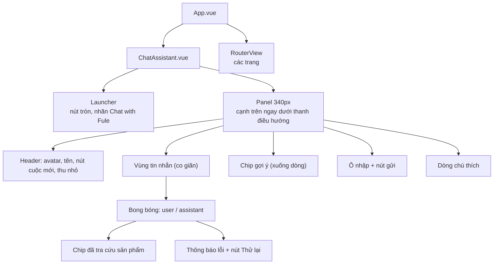
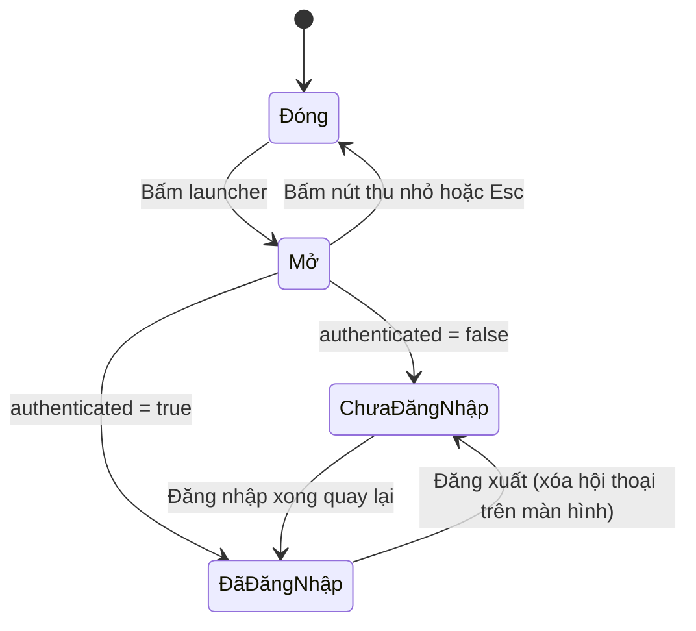
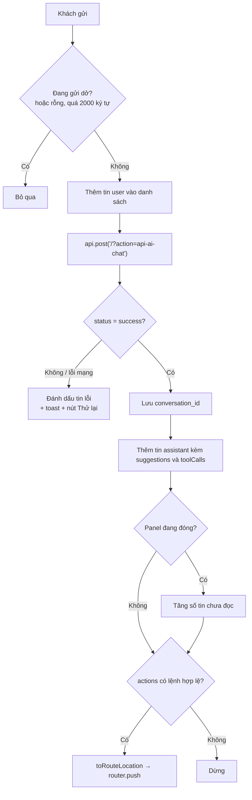
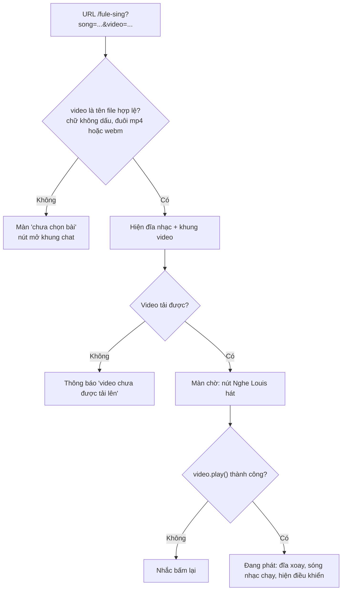

# 06. Giao diện (Frontend)

## 1. Thành phần

| File | Vai trò |
| --- | --- |
| `FE/src/components/chat/ChatAssistant.vue` | Popup: launcher, panel, tin nhắn, chip, ô nhập |
| `FE/src/helpers/ai/chatAssistant.js` | State dùng chung, gọi API, lọc lệnh điều hướng |
| `FE/src/App.vue` | Nhúng popup ở layout chung, truyền `:authenticated="checkAuth"` |
| `FE/src/views/ai/FuleSing.vue` | Trang sân khấu `/fule-sing` |
| `FE/src/helpers/media/videoUrl.js` | Dựng URL video, kiểm tra tên file |
| `FE/src/helpers/media/imageUrl.js` | Hàm `resolveSystemImageUrl` cho avatar (`BE/assets/system/`) |
| `FE/src/views/ai/AiCheckout.vue` | Trang "Lên đơn nhanh cho quý ông" `/ai-checkout`: hiệu ứng điền đơn, khách chỉnh rồi xác nhận |
| `FE/src/helpers/ai/checkoutDraft.js` | Giữ đơn nháp trong bộ nhớ (`setCheckoutDraft`, `clearCheckoutDraft`, `useCheckoutDraft`) |
| `FE/src/router/index.js` | Đăng ký route `fule-sing` (không cần đăng nhập) và `ai-checkout` (cần đăng nhập) |

## 2. Vì sao state nằm ngoài component

`chatAssistant.js` khai báo `messages`, `conversationId`, `isOpen` bằng `ref` ở cấp module, không nằm trong component. Nhờ vậy:

- Chuyển trang không làm mất hội thoại, vì popup nằm trong `App.vue` và không bị hủy khi đổi route.
- Trang `/fule-sing` mở được popup và đọc cùng state.

## 3. Sơ đồ thành phần giao diện

## 4. Trạng thái của panel

Lưu ý: bấm ra ngoài panel **không** đóng popup. Đây là quyết định của chủ dự án.

## 5. Trạng thái khi chưa đăng nhập

Panel hiện:

- Avatar Louis, tiêu đề "Đăng nhập để trò chuyện cùng Louis".
- Nút "Đăng nhập": lưu đường dẫn hiện tại bằng `saveReturnUrl` rồi chuyển sang `/login`. Sau khi đăng nhập, `pushToReturnUrl` đưa khách về đúng trang cũ.
- Link "Chưa có tài khoản? Đăng ký".

## 6. Luồng gửi tin nhắn ở FE

404 khi gửi: FE xóa `conversation_id` để lần sau tạo hội thoại mới.

## 7. Lọc lệnh điều hướng ở FE

`toRouteLocation(action)` trả về đích điều hướng hoặc `null`:

| Bước | Kiểm tra | Nếu sai |
| --- | --- | --- |
| 1 | `type === 'navigate'` | `null` |
| 2 | `route` có trong `ALLOWED_ROUTES` | `null` |
| 3 | Chỉ giữ tham số khai báo cho route đó | Tham số lạ bị bỏ |
| 4 | Mỗi giá trị là chuỗi khác rỗng | Giá trị đó bị bỏ |
| 5 | Tham số bắt buộc có đủ (ví dụ `slug`) | `null` |

Danh sách cho phép hiện tại:

| Route | Tham số query | Tham số params |
| --- | --- | --- |
| `catalog` | `search`, `category`, `min_price`, `max_price`, `hold`, `shine`, `tags`, `sort` (đúng bộ lọc của trang catalog) | — |
| `product-detail` | — | `slug` (bắt buộc) |
| `fule-sing` | `song`, `video` | — |

FE gọi `router.push` theo **tên route**, không bao giờ nhận chuỗi URL từ server.

## 8. Chip gợi ý

**Chip "trợ lý đã làm gì"** (dưới mỗi câu trả lời, không bấm được): hiện `tool_calls[].summary` do BE tạo
(`BE/geminiServices/GeminiToolSummary.php`), ví dụ "Đã tra cứu sản phẩm: Danh mục: Pomade; Độ giữ nếp: Trung bình",
"Đã cập nhật đơn nháp: thêm 2 × CLAYMATION", "Đã bỏ đơn nháp", "Đã chọn bài hát: “…”". FE chỉ hiển thị, không giữ bảng nhãn;
bỏ chip trùng; câu dài thì xuống dòng. Tin cũ chưa có `summary` vẫn hiện "Đã tra cứu sản phẩm: “từ khóa”" như trước.

**Chip gợi ý câu hỏi** (bấm được):

- Nếu tin assistant gần nhất có `suggestions`, hiện các câu đó.
- Nếu không, hiện ba chip mặc định: "Hát 1 bài", "Tôi muốn xem sản phẩm "sáp Vinh Râu"", "Tôi muốn xem các sản phẩm Sáp".
- Bấm chip = gửi câu đó như tin nhắn mới.
- Chip có `flex-wrap`, không cuộn ngang, nên không bị cắt chữ.

## 9. Trang `/fule-sing`

Bố cục:

- Desktop: đĩa nhạc bên trái (tối đa 300px), video bên phải. Khoảng cách 40px.
- Mobile (dưới 768px): video ở trên, đĩa ở dưới (tối đa 240px).
- Đĩa xoay 8 giây mỗi vòng. Nếu người dùng bật "giảm chuyển động" thì đĩa đứng yên.

Lý do phải bấm nút để phát: trình duyệt không cho tự phát video có tiếng.

## 10. Avatar

Ảnh `fule.webp` lấy từ `BE/assets/system/` qua `resolveSystemImageUrl`. Nếu ảnh lỗi, `@error` chuyển sang hiển thị chữ "L".

Lưu ý: thư mục `BE/assets/system/` chưa được git theo dõi. Khi commit cần thêm ảnh.

## 11. Nhãn và văn bản

| Vị trí | Nội dung |
| --- | --- |
| Nhãn khi rê chuột vào launcher | "Chat with Fule" |
| Câu mở đầu | "Bông dua quý ông! Tôi là Louis Dé Fule…" |
| Nút trang sân khấu | "Nghe Louis hát" |
| Dòng chú thích | "Louis dùng AI nên có thể nhầm. Giá và tồn kho chính xác xem tại trang sản phẩm." |

## Đơn nháp và trang lên đơn nhanh

Luồng khi tool `create_order_draft` trả `ready=true`:

1. BE gửi `actions: [{ type: 'checkout-draft', draft: {...} }]`.
2. `requestReply()` trong `chatAssistant.js` gọi `setCheckoutDraft(draft)`. Hàm này kiểm tra định dạng, sai thì bỏ qua lệnh.
3. Hợp lệ thì trả location `{ name: 'ai-checkout' }`, `ChatAssistant.vue` gọi `router.push` như các lệnh khác. URL không có query.
4. `AiCheckout.vue` đọc đơn nháp, chạy hiệu ứng, rồi mở khóa cho khách chỉnh số lượng (1 đến tồn kho) và thông tin nhận hàng. Giá bị khóa.
5. Bấm "Xác nhận đặt hàng": gọi `api-order-checkout-items` với SKU, số lượng, người nhận, phương thức thanh toán và `expected_total`. Chọn SePay thì tiếp tục `startOnlinePayment()`.

Vì sao không đưa đơn nháp lên URL hay localStorage:

- Đơn nháp có tên, số điện thoại, địa chỉ. Đưa lên URL thì lộ ở thanh địa chỉ, lịch sử trình duyệt, log server và header `Referer`.
- `checkoutDraft.js` giữ đơn trong `ref` cấp module: còn khi chuyển trang trong web, mất khi tải lại trang. Trang không có đơn nháp thì hiện màn "Chưa có đơn nháp" kèm nút mở chat.
- Đơn nháp bị xóa khi đặt hàng thành công và khi đăng xuất (watch `authenticated` trong `ChatAssistant.vue`).
