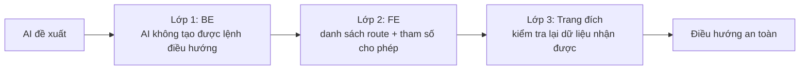

# 07. Bảo mật, rủi ro và kết quả kiểm thử

## 1. Các lớp bảo vệ

Mục tiêu: AI không thể đưa người dùng tới một trang tùy ý, không đọc được dữ liệu người khác, và không ghi dữ liệu thay người dùng.

### Lớp 1: BE, AI không tự tạo lệnh

- Lệnh điều hướng chỉ do code PHP tạo (`navigateAction`). Tên route ghi cứng trong code tool.
- `slug` lấy từ DB, `video` lấy từ mảng `PLAYLIST`. AI chỉ ảnh hưởng tới từ khóa tìm kiếm và tên bài.
- Key `_action` bị tách ra trước khi gửi kết quả cho AI và trước khi lưu lịch sử.
- Lịch sử hội thoại nằm ở server nên client không chèn được lệnh giả.

### Lớp 2: FE, danh sách cho phép

`toRouteLocation()` chỉ chấp nhận route trong `ALLOWED_ROUTES`, chỉ giữ tham số đã khai báo, và yêu cầu tham số bắt buộc. Điều hướng luôn theo tên route, không theo URL.

### Lớp 3: Trang đích

| Trang | Kiểm tra |
| --- | --- |
| `/fule-sing` | `resolveSongVideoUrl` chỉ nhận `[A-Za-z0-9._-]` với đuôi mp4/webm, ghép vào thư mục bài hát. Chuỗi như `../` không qua được. |
| `/catalog?search=` | Từ khóa vào prepared statement, không ghép vào SQL. |
| `/product-detail/:slug` | Slug sai trả 404 từ API. |
| Trang yêu cầu đăng nhập | `meta.requiresAuth` vẫn áp dụng như điều hướng thường. |

### Các lớp khác

| Vấn đề | Cách xử lý |
| --- | --- |
| Đọc hội thoại người khác | Mọi truy cập kiểm tra `user_id` khớp `sub` của JWT. Không đúng thì 404 (không lộ việc hội thoại có tồn tại). |
| Giả mạo `user_id` | `user_id` không lấy từ body. Tool nhận `user_id` qua `$context` do server đặt. |
| SQL injection | Prepared statement mọi nơi. Ký tự `% _ \` trong LIKE được escape. |
| Lộ thông tin lỗi | Lỗi chi tiết ghi vào log, client chỉ nhận thông báo chung. |
| Lộ API key | Key gửi qua header `x-goog-api-key`, không đưa vào URL hay log. |
| Lộ cấu hình | Không in giá trị `.env` ra response, log hay comment. |
| Tin nhắn quá dài | Giới hạn 2000 ký tự ở controller và maxlength ở ô nhập. |
| Lời AI giả mạo "đã làm" | Prompt cấm nói đã thêm giỏ/đặt hàng vì chưa có tool tương ứng. |

## 2. Rủi ro đã biết

| Rủi ro | Mức | Ghi chú |
| --- | --- | --- |
| Chưa có rate limit cho `api-ai-chat` | Trung bình | Mỗi request tốn tiền gọi Google. Có thể bị lạm dụng bằng tài khoản thật. |
| Gói miễn phí Gemini giới hạn 5 request/phút | Cao khi demo | Hội thoại có tool tốn 2 request. Gặp lỗi 429 sẽ thành 502 cho khách. |
| AI có thể nhầm giá hoặc tình trạng hàng | Trung bình | Giá lấy từ tool, nhưng AI diễn đạt có thể sai. Có dòng chú thích nhắc khách xem trang sản phẩm. |
| Dữ liệu giá bất thường | Cần kiểm tra | Sản phẩm id 5 có phiên bản giá 300đ, có thể nhập nhầm. |
| Chưa có API lấy lại lịch sử | Thấp | F5 làm mất tin hiển thị, dù DB vẫn còn. |
| Nhiều model PDO trong một request | Thấp | `BaseModel` mở kết nối riêng mỗi model. Chưa gây sự cố nhưng nên gộp sau. |
| Quy tắc lịch sử hợp lệ nằm ở hai nơi | Thấp | `AiMessage::getRecent` và `Gemini::trimHistory` đều có. Nên gộp về một hàm. |
| Bảng hội thoại tăng không giới hạn | Thấp | Chưa có chính sách dọn dẹp. |
| Bộ ký tự `utf8` của `BaseModel` | Đã xử lý | `AiMessage` tự đặt `utf8mb4`. Các model khác dùng `BaseModel` vẫn `utf8`. |
| `BE/assets/system/` chưa được git theo dõi | Thấp | Cần thêm khi commit. |

## 3. Kết quả kiểm thử đã thực hiện

| Hạng mục | Cách kiểm thử | Kết quả |
| --- | --- | --- |
| Cú pháp PHP | `php -l` các file đã sửa | Đạt |
| Build FE | `npm run build` | Đạt, nhiều lần |
| Lưu và đọc lại lịch sử | Script trên DB local, có emoji | Đạt |
| Lưu lỗi giữa chừng | Sai role trong `saveTurns` | Không để lại hội thoại rỗng |
| Thiếu user khi tạo mới | `saveTurns(0, ..., 0)` | Ném `InvalidArgumentException` |
| Lượt `parts` rỗng | Chèn lượt `[]` trong DB test | Bị bỏ khi đọc |
| Tách gợi ý | Gemini giả lập, 5 kiểu văn bản | Đạt |
| Tool `search_product` | Gemini giả lập, DB thật | 1 kết quả → chi tiết; nhiều → catalog; 0 → catalog trống |
| Tool `fule_sing` | Gemini giả lập | Ngẫu nhiên, đúng tên, khớp một phần, không có bài, sai kiểu |
| Gọi Gemini thật | Script có thật | Model gọi `fule_sing` đúng sau khi sửa prompt |
| Đọc lượt đã lưu | `SELECT` trên `ai_messages` | Xác nhận dữ liệu lưu đúng thứ tự |

## 4. Chưa kiểm thử

- Endpoint qua HTTP với JWT thật bằng Thunder Client (cần đăng nhập và Gemini đang hoạt động).
- Giao diện trên trình duyệt: chưa có ảnh chụp xác nhận cho bản mới nhất.
- Kiểm tra 404 khi gửi `conversation_id` của user khác qua HTTP.
- Kiểm tra 429 và thông báo cho khách.
- Video bài hát thật: chưa có file `vi-con.mp4`.
- Chế độ mobile dưới 390px.

## 5. Khuyến nghị trước khi nộp

1. Thêm rate limit theo user cho `api-ai-chat`, ví dụ 10 request mỗi phút.
2. Xử lý riêng lỗi 429: thông báo "Louis đang bận, thử lại sau ít giây" thay vì lỗi chung.
3. Kiểm tra dữ liệu giá của sản phẩm id 5.
4. Thêm file video vào `BE/assets/fule/songs/` nếu muốn demo đầy đủ.
5. Commit cả `BE/assets/system/fule.webp`.
