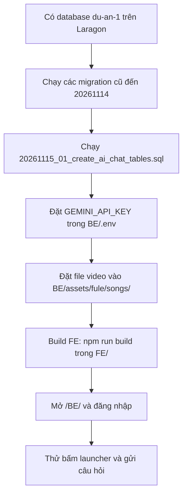

# 08. Vận hành, cấu hình và cách mở rộng

## 1. Yêu cầu môi trường

| Thành phần | Phiên bản đã dùng |
| --- | --- |
| PHP | 8.1 (Laragon) |
| MySQL | 8.0.30 |
| Node.js | Để build FE (`npm run build` trong `FE/`) |
| Tài khoản Google AI Studio | Để lấy API key |

## 2. Cấu hình

### 2.1. Biến môi trường trong `BE/.env`

Chỉ liệt kê tên biến. Không ghi giá trị thật vào tài liệu.

| Tên biến | Bắt buộc | Mô tả |
| --- | --- | --- |
| `GEMINI_API_KEY` | Có | Key lấy từ Google AI Studio. Thiếu thì API trả 500 "chưa cấu hình". Ghi được nhiều key cách nhau bằng dấu phẩy (`key1,key2,key3`): mỗi lần gọi Gemini dùng key kế tiếp, key bị 429/401/403 (hoặc 400 "API key not valid") thì thử ngay key khác. Key nên thuộc các project khác nhau vì hạn mức miễn phí tính theo project. |
| `GEMINI_MODEL` | Không | Để trống thì dùng `gemini-2.5-flash`. Chỉ chấp nhận chữ, số, dấu chấm, gạch ngang. |

Tên biến được khai báo trong `BE/.env.example`. File `.env` thật không được commit.

### 2.2. Hằng số trong code

| Hằng | File | Giá trị | Ý nghĩa |
| --- | --- | --- | --- |
| `TIMEOUT_SECONDS` | `Gemini.php` | 30 | Thời gian chờ tối đa một request tới Google |
| `MAX_TOOL_ROUNDS` | `Gemini.php` | 5 | Số vòng gọi tool tối đa |
| `MAX_HISTORY` | `Gemini.php` | 30 | Số lượt lịch sử tối đa gửi cho AI |
| `MAX_MESSAGE_LENGTH` | `ChatController.php` | 2000 | Độ dài câu hỏi |
| `MAX_RESULTS` | `GeminiToolSearchProduct.php` | 5 | Số sản phẩm tối đa cho AI |
| `MAX_KEYWORD_LENGTH` | `GeminiToolSearchProduct.php` | 100 | Độ dài từ khóa |
| `MAX_SUGGESTIONS` | `Gemini.php` | 3 | Số gợi ý tối đa |
| `MAX_SUGGESTION_LENGTH` | `Gemini.php` | 40 | Độ dài mỗi gợi ý |
| `PLAYLIST` | `GeminiToolFuleSing.php` | 1 bài | Danh sách bài hát |

Lệnh tương đương trong FE: `ALLOWED_ROUTES` trong `FE/src/helpers/ai/chatAssistant.js`.

## 3. Cài đặt từ đầu



Migration có thể chạy lặp lại nhờ `CREATE TABLE IF NOT EXISTS`.

Cách chạy migration bằng PHP (không cần MySQL CLI), dùng thông tin trong `config.php`:

```php
$pdo = new PDO(sprintf('mysql:host=%s;port=%s;dbname=%s;charset=utf8mb4', DB_HOST, DB_PORT, DB_NAME), DB_USERNAME, DB_PASSWORD, DB_OPTIONS);
$pdo->exec(file_get_contents('BE/database/migrations/20261115_01_create_ai_chat_tables.sql'));
```

Mỗi thành viên cần tự chạy migration trên DB của mình. Nếu thiếu bảng, API trả 500 "Không lưu được lịch sử hội thoại".

## 4. Kiểm tra nhanh sau khi cài

| Bước | Kết quả mong đợi |
| --- | --- |
| Gọi `api-ai-chat` không có token | 401 |
| Gọi bằng GET | 405 |
| Gửi `message` rỗng, có token | 422 |
| Gửi `conversation_id` của người khác | 404 |
| Gửi "Có sáp nào không?" | 200, có `reply` và `conversation_id` |
| Gửi "hát 1 bài đi" | 200, `actions` có `fule-sing` |
| Mở `/fule-sing` không có tham số | Hiện màn "chưa chọn bài" |

## 5. Cách thêm bài hát

1. Chép file video vào `BE/assets/fule/songs/`. Tên file chỉ dùng chữ không dấu, số, `.`, `-`, `_`, đuôi mp4 hoặc webm.
2. Thêm dòng vào `PLAYLIST` trong `GeminiToolFuleSing.php`:
   ```php
   'Tên bài' => 'ten-file.mp4',
   ```
3. Không cần sửa FE. Tool đọc mảng khi chạy.

## 6. Cách thêm tool mới

1. Tạo file `BE/geminiServices/GeminiToolXxx.php`, kế thừa `GeminiTool`, viết 4 phương thức (xem [05-tools.md](05-tools.md)).
2. Đăng ký trong `ChatController::chat()`: `->addTool(new GeminiToolXxx())`.
3. Nếu tool cần mở trang: thêm route vào `ALLOWED_ROUTES` trong `chatAssistant.js` và thêm route vào `router/index.js`.
4. Nếu AI cần biết khi nào gọi: cập nhật `GeminiPrompt::system()`.
5. Nếu tool ghi dữ liệu: kiểm tra `user_id` từ `$context`, không tin tham số AI gửi.
6. Kiểm tra `php -l`, test với Gemini giả lập, rồi test với Gemini thật.

## 7. Cách thêm route điều hướng mới

Cần sửa đồng thời ba nơi:

| Nơi | Việc cần làm |
| --- | --- |
| `BE` tool | Tạo lệnh bằng `navigateAction('ten-route', $query, $params)` |
| `FE/src/helpers/ai/chatAssistant.js` | Thêm vào `ALLOWED_ROUTES` với danh sách tham số |
| `FE/src/router/index.js` | Đăng ký route có `name` trùng tên đó |

Thiếu bất kỳ nơi nào, lệnh sẽ bị bỏ hoặc trang không mở.

## 8. Quy trình kiểm tra trước khi commit

- `php -l` cho mọi file PHP đã sửa.
- `npm run build` trong `FE/`.
- Test tool với Gemini giả lập để xác nhận logic.
- Test tối thiểu một câu với Gemini thật.
- `git status` để chắc không có file ngoài phạm vi.
- Thêm vào commit: `BE/assets/system/fule.webp`, các file migration và file mới.

Commit message gợi ý: `feat: chat AI Louis Dé Fule với tool tra sản phẩm và hát`.

## 9. Lỗi thường gặp

| Triệu chứng | Nguyên nhân | Cách xử lý |
| --- | --- | --- |
| 500 "Trợ lý AI chưa được cấu hình" | Thiếu `GEMINI_API_KEY` | Đặt biến trong `BE/.env` |
| 502 khi gửi nhiều câu liên tiếp | Mọi key đều hết quota gói miễn phí | Đợi khoảng 1 phút, hoặc thêm key thuộc project khác vào `GEMINI_API_KEY`. Log `[Gemini] Key số i/n lỗi HTTP 429` cho biết key thứ mấy hết lượt (không ghi key), `[ChatController]` ghi lỗi cuối cùng |
| 500 "Không lưu được lịch sử" | Chưa chạy migration | Chạy migration `20261115_01` |
| Trang `/fule-sing` báo "video chưa được tải lên" | Chưa có file mp4 | Đặt file đúng tên trong `assets/fule/songs/` |
| Avatar hiện chữ "L" | Thiếu `BE/assets/system/fule.webp` hoặc sai đường dẫn | Kiểm tra file và URL base |
| Chip gợi ý không đổi | Lỗi tách gợi ý hoặc AI không viết dòng `[[GOI_Y]]` | Xem log, hoặc để chip mặc định |
| Điều hướng không xảy ra | Route không có trong danh sách cho phép ở FE | Đối chiếu bảng ở mục 7 |
| Hội thoại mới không hiện trong lần F5 | Chưa có API lấy lại lịch sử | Đã biết, xem mục 7 của 09 |
