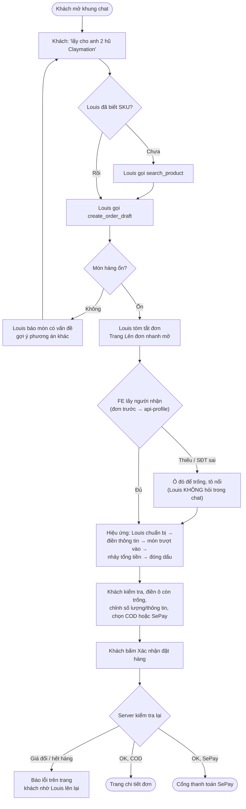
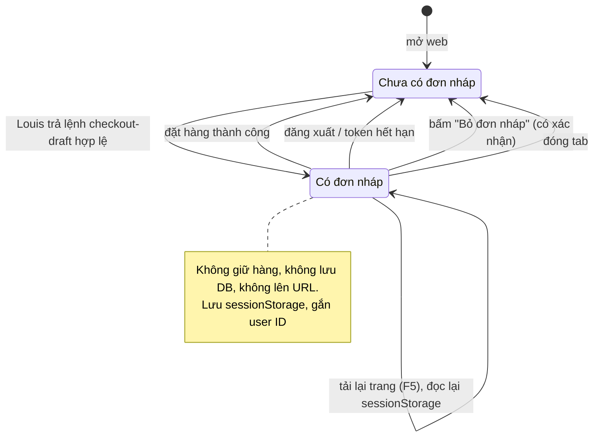
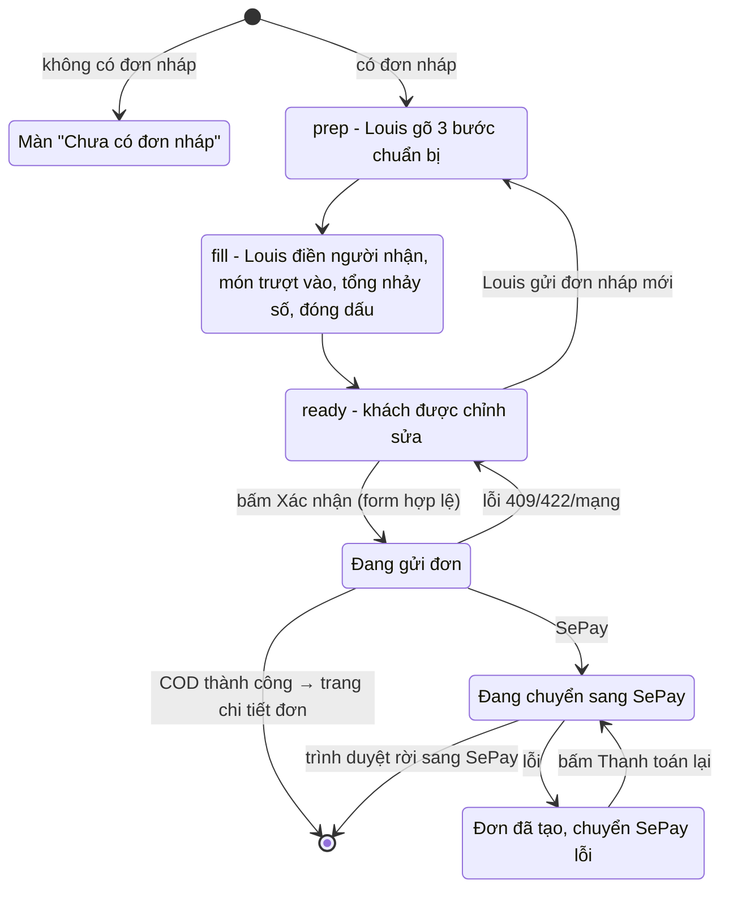

# 01. Nghiệp vụ

## 1. Bài toán

Trước khi có tính năng này, Louis chỉ tư vấn: khách hỏi sản phẩm, Louis trả lời rồi mở trang sản phẩm. Muốn mua, khách phải tự: chọn phiên bản → thêm vào giỏ → vào giỏ → vào checkout → điền tên, SĐT, địa chỉ → đặt hàng. Nhiều bước, dễ bỏ ngang.

Mục tiêu: khách chỉ cần **nói** "lấy cho anh 2 hũ Claymation", Louis lo phần còn lại, khách chỉ **kiểm tra và bấm một nút**.

## 2. Nguyên tắc nghiệp vụ

| # | Nguyên tắc | Lý do |
| --- | --- | --- |
| 1 | AI chỉ lên **đơn nháp**, không tạo đơn | AI có thể hiểu sai (nhầm phiên bản, số lượng) hoặc bị khách gài câu lệnh. Tạo đơn là trừ tồn kho ngay, sai thì giữ hàng ảo. |
| 2 | Đơn thật chỉ tạo khi **khách bấm "Xác nhận đặt hàng"** | Mọi đơn đều do chính khách quyết định, có bằng chứng thao tác. |
| 3 | Giá luôn lấy từ DB, tính lại lúc xác nhận | Giá có thể đổi giữa lúc xem và lúc bấm; FE có thể bị sửa. |
| 4 | Giá đổi thì **không** tự tạo đơn với giá mới | Khách phải thấy giá mới trước khi bị tính tiền. |
| 5 | Trang tự điền thông tin giao hàng từ hồ sơ (`api-profile`) hoặc giữ thông tin khách đã sửa; thiếu thì để trống, khách **tự điền trên trang** | Khách đã điền hồ sơ thì không phải gõ lại. |
| 5b | Thông tin người nhận **tách hẳn khỏi luồng AI**: tool không đọc, không nhận, không trả; Louis không hỏi trong chat | Thông tin cá nhân không đi qua AI ở bất kỳ đường nào do hệ thống chủ động. |
| 6 | Thông tin khách điền trên trang **chỉ dùng cho đơn này**, không ghi đè hồ sơ | Sửa hồ sơ là việc khách tự làm ở trang Hồ sơ. |
| 7 | Đơn nháp không giữ hàng, chỉ sống trong tab đang mở (sessionStorage) | Không làm mất hàng của khách khác; đóng tab, đăng xuất hoặc đặt xong là mất, không để dữ liệu cá nhân nằm lại lâu trên máy. |
| 7b | Khách bỏ đơn nháp bằng nút "Bỏ đơn nháp" trên trang (có hỏi xác nhận); Louis không có tool xóa đơn nháp | Thao tác xóa dữ liệu do chính khách bấm, AI không tự xóa nhầm. |
| 8 | Không đụng tới giỏ hàng | Giỏ có thể đang chứa món khác khách chưa muốn mua. |
| 9 | Khách chọn phương thức thanh toán trên trang, không chọn trong chat | Nút chọn rõ ràng hơn, tránh AI hiểu nhầm. |
| 10 | Chỉnh sửa trên trang được gửi kèm lượt chat sau | **Tăng trải nghiệm**: khách kết hợp bấm trên trang và nói với Louis mà không bên nào ghi đè công sức của bên kia. |

## 3. Các tình huống của khách (use case)

| # | Tình huống | Kết quả mong đợi |
| --- | --- | --- |
| UC1 | Khách nói muốn mua, hồ sơ đủ tên/SĐT/địa chỉ | Louis tóm tắt đơn, trang "Lên đơn nhanh" mở với hiệu ứng |
| UC2 | Hồ sơ thiếu tên, SĐT hoặc địa chỉ | Trang vẫn mở; ô thiếu để trống, viền đồng nét đứt kèm lời nhắc; Louis nhắc khách điền trên trang, **không hỏi trong chat** |
| UC3 | Khách tự gõ SĐT/địa chỉ vào chat | Louis không nhắc lại, không dùng; mời khách điền vào ô trên trang |
| UC4 | SĐT trong hồ sơ sai định dạng | FE để trống ô SĐT như trường hợp thiếu, khách nhập lại trên trang |
| UC4b | `api-profile` lỗi | Trang vẫn chạy với dữ liệu tạm từ `localStorage` (hoặc ô trống), toast nhờ khách tự điền |
| UC5 | Món hết hàng / không đủ số lượng / SKU sai | Louis báo từng món, gợi ý phiên bản khác hoặc giảm số lượng; không mở trang |
| UC6 | Sản phẩm có nhiều phiên bản, khách không nói rõ | Louis chọn phiên bản mặc định và nói rõ để khách đổi |
| UC7 | Khách muốn đổi số lượng/món sau khi có đơn nháp | Khách tự chỉnh trên trang, hoặc nói với Louis để lên đơn nháp mới |
| UC7b | Khách vừa chỉnh trên trang (số lượng, địa chỉ) rồi nhắn Louis thêm món | Đơn mới giữ đúng số lượng và thông tin khách đã chỉnh, chỉ thêm món mới ([11-dong-bo-don-nhap.md](11-dong-bo-don-nhap.md)) |
| UC8 | Khách xác nhận, chọn COD | Đơn được tạo, chuyển sang trang chi tiết đơn |
| UC9 | Khách xác nhận, chọn SePay | Đơn được tạo, chuyển sang cổng SePay |
| UC10 | Chuyển sang SePay bị lỗi | Đơn giữ nguyên, nút đổi thành "Thanh toán lại", không tạo đơn thứ hai |
| UC11 | Giá đổi giữa lúc xem và lúc bấm | Báo lỗi kèm tổng mới, không tạo đơn |
| UC12 | Có người mua hết món cuối trước khi khách bấm | Báo lỗi hết hàng, không tạo đơn |
| UC13 | Khách tải lại trang (F5) khi đang có đơn nháp | Đơn nháp và thông tin khách đã sửa còn nguyên (sessionStorage), không gọi lại `api-profile` |
| UC13b | Khách mở link `/ai-checkout` khi chưa có đơn nháp (hoặc đã đóng tab) | Trang hiện "Chưa có đơn nháp", mời trò chuyện với Louis |
| UC14 | Khách muốn bỏ đơn nháp | Khách bấm "Bỏ đơn nháp" trên trang, xác nhận hộp thoại → đơn nháp bị xóa, về trang sản phẩm. Hỏi Louis thì Louis hướng dẫn bấm nút này |
| UC14b | Đơn thật đã tạo nhưng chuyển SePay lỗi | Nút "Bỏ đơn nháp" bị ẩn (không còn đơn nháp để bỏ); khách bấm "Thanh toán lại" hoặc hủy đơn ở trang chi tiết đơn |
| UC15 | Khách đăng xuất | Đơn nháp bị xóa khỏi bộ nhớ |
| UC16 | Khách chỉ hỏi giá, chưa muốn mua | Louis **không** lên đơn, chỉ tra cứu |

## 4. Hành trình của khách

## 5. Vòng đời của đơn nháp

Đơn nháp **không có trong DB**. Nó chỉ sống trong bộ nhớ trình duyệt (`checkoutDraft.js`).

## 6. Trạng thái của trang "Lên đơn nhanh"

## 7. Giới hạn nghiệp vụ

| Giới hạn | Giá trị | Đặt ở đâu |
| --- | --- | --- |
| Số món khác nhau tối đa mỗi đơn | 10 | `Order::MAX_DIRECT_ITEMS` (BE), `MAX_ITEMS` (FE) |
| Số lượng tối đa mỗi món | 99, và không quá tồn kho | `Order::MAX_ITEM_QUANTITY` (BE), `MAX_QUANTITY` (FE) |
| Tên người nhận | 1-100 byte | Tool, API, form FE |
| Địa chỉ | 1-500 byte | Tool, API, form FE |
| Số điện thoại | Di động Việt Nam 10 số (03, 05, 07, 08, 09), chấp nhận `+84` | `VietnamPhone::normalize` (BE), `validateVietnamPhone` (FE) |
| Phương thức thanh toán | `cod` (mặc định) hoặc `sepay` | API |
