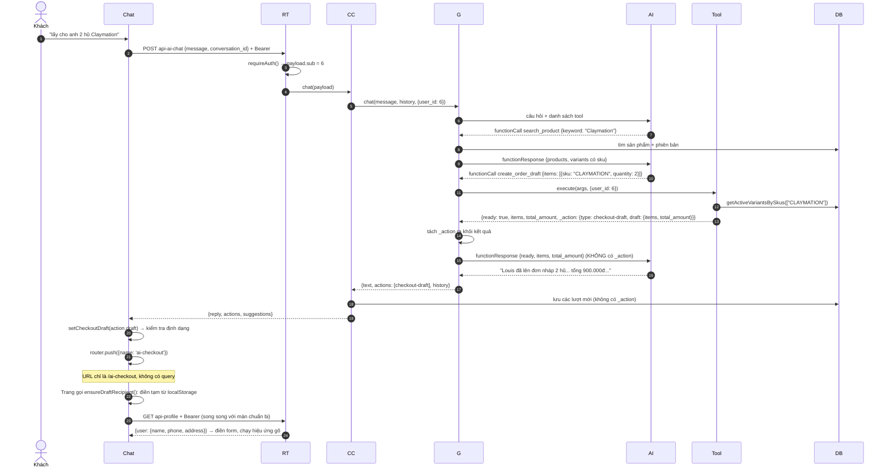
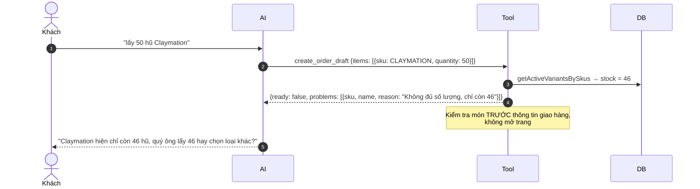
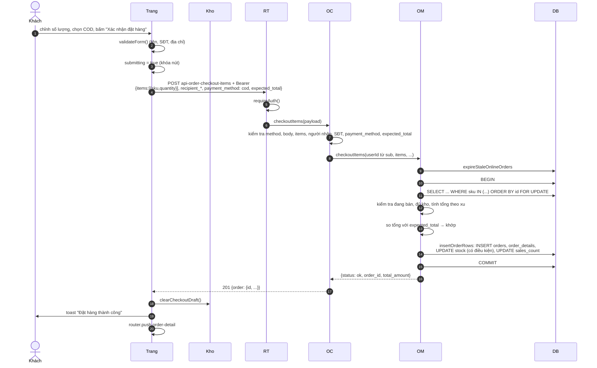
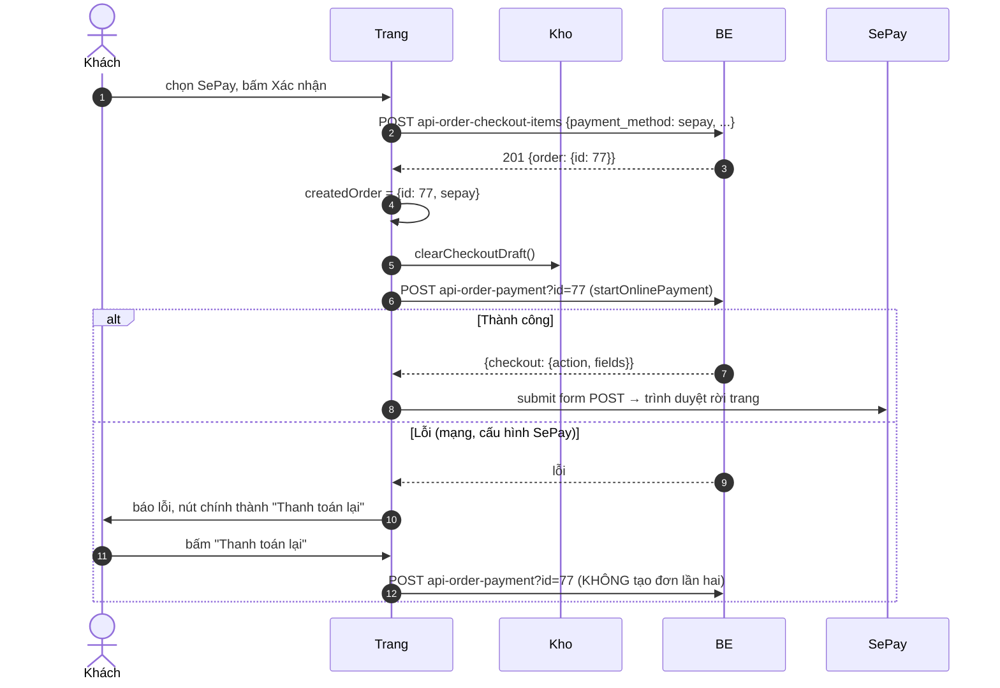
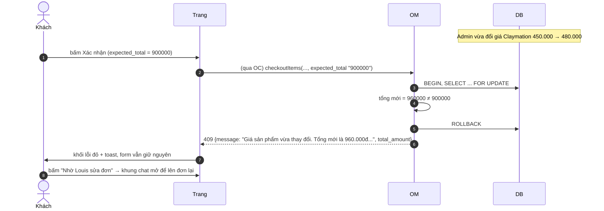
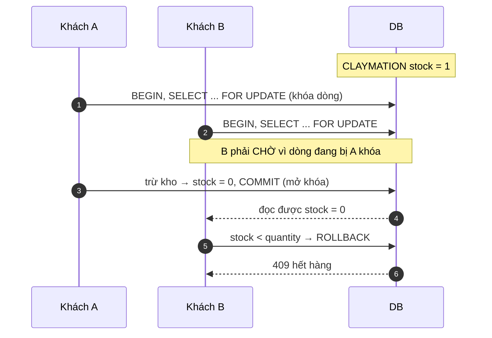
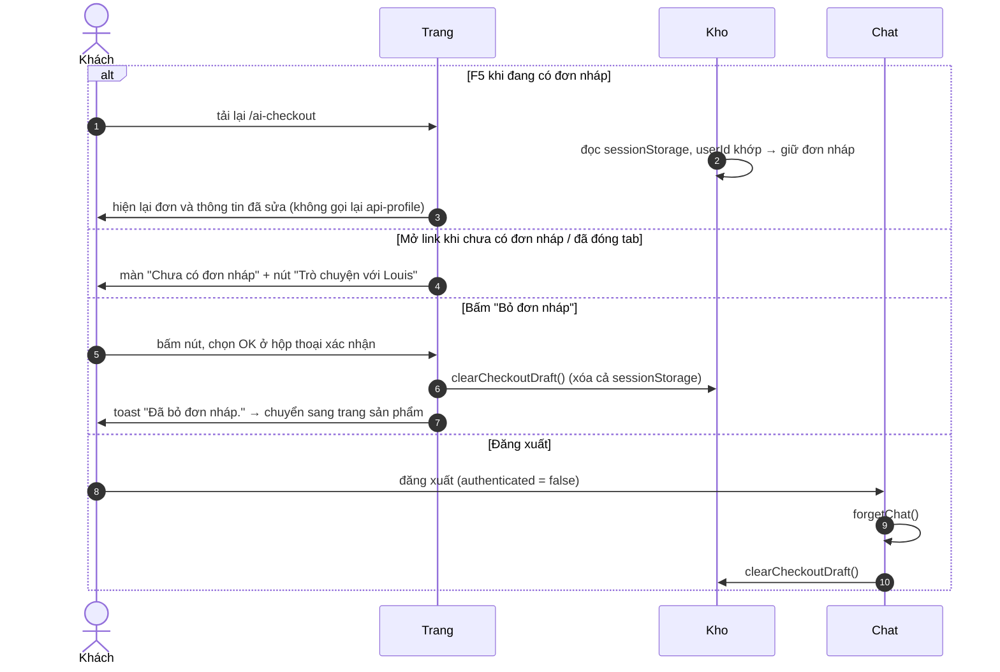
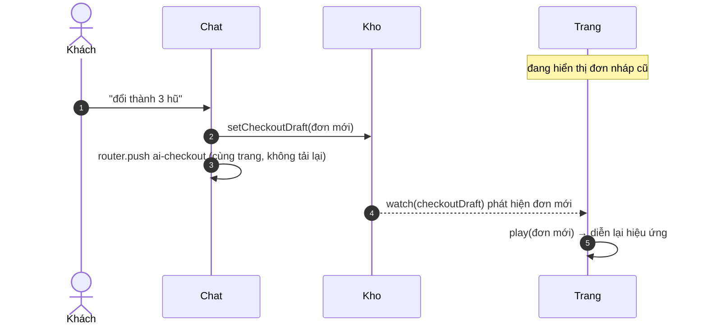

# 03. Luồng xử lý

Mỗi mục là một tình huống, có sơ đồ tuần tự (sequence diagram). Muốn xem JSON thật ở từng bước, đọc [12-mo-phong-json.md](12-mo-phong-json.md). Ký hiệu chung:

| Tên trong sơ đồ | Là |
| --- | --- |
| K | Khách |
| Chat | `ChatAssistant.vue` + `chatAssistant.js` |
| Kho | `checkoutDraft.js` |
| Trang | `AiCheckout.vue` |
| RT | `routes/index.php` + `AuthMiddleware` |
| CC | `ChatController` |
| G | `Gemini::chat` |
| AI | Gemini API |
| Tool | `GeminiToolCreateOrderDraft` |
| OC | `OrderController::checkoutItems` |
| OM | `Order::checkoutItems` |
| DB | MySQL |

## 1. Lên đơn thành công

Tool chỉ lo món hàng. Người nhận do FE tự lấy từ hồ sơ (bước 23-25), không đi qua luồng AI.



Sau bước 22, trang `/ai-checkout` mở và chạy hiệu ứng (xem [06-frontend.md](06-frontend.md)). Từ đầu tới cuối, tên/SĐT/địa chỉ chỉ đi đường `api-profile` → FE → form → `api-order-checkout-items`.

## 2. Hồ sơ thiếu thông tin → trang vẫn mở, khách tự điền

Louis **không hỏi** tên, SĐT, địa chỉ trong chat, và cũng không biết hồ sơ thiếu gì (tool không đọc hồ sơ).

```mermaid
sequenceDiagram
    autonumber
    actor K as Khách
    participant AI
    participant Tool
    participant Trang
    participant BE as api-profile

    K->>AI: "mua 1 chai Got2b"
    AI->>Tool: create_order_draft {items}
    Tool-->>AI: {ready: true, items, total_amount} + _action (chỉ món)
    AI-->>K: "Đơn nháp đã mở, quý ông kiểm tra thông tin nhận hàng rồi bấm Xác nhận"
    Trang->>BE: GET api-profile
    BE-->>Trang: {name: "Lê Văn An", phone: null, address: null}
    Trang->>K: hiệu ứng gõ tên, bỏ qua ô trống;<br/>ô trống viền đồng nét đứt + "Hồ sơ chưa có số điện thoại..."
    K->>Trang: tự điền SĐT, địa chỉ
    Note over Trang: Thông tin đi thẳng form → api-order-checkout-items,<br/>không qua Gemini
```

Nếu `api-profile` lỗi (mạng, server): trang vẫn chạy với dữ liệu tạm từ `localStorage` (hoặc ô trống), hiện toast vàng nhờ khách tự điền.

## 3. SĐT trong hồ sơ sai định dạng

```mermaid
sequenceDiagram
    autonumber
    participant Trang
    participant BE as api-profile
    actor K as Khách

    Trang->>BE: GET api-profile
    BE-->>Trang: {phone: "0123"}
    Trang->>Trang: normalizeVietnamPhone("0123") → null → ô SĐT để trống
    Trang->>K: ô SĐT trống, nhắc điền
    K->>Trang: nhập lại; validateVietnamPhone kiểm tra ngay dưới ô
```

Khách tự gõ SĐT vào chat: Louis không dùng, mời khách điền trên trang (prompt). Gemini vẫn đọc được câu đó vì là tin nhắn của khách, xem [08-bao-mat.md, mục 3](08-bao-mat.md).

## 4. Món có vấn đề (sai SKU, hết hàng, không đủ số lượng)



## 5. Khách xác nhận, chọn COD



## 6. Khách xác nhận, chọn SePay (có lỗi chuyển trang)



Đơn SePay chưa thanh toán sẽ được trả lại hàng sau `SEPAY_PAYMENT_TIMEOUT_MINUTES` (30 phút) bởi `expireStaleOnlineOrders`, giống luồng checkout từ giỏ.

## 7. Giá đổi hoặc hết hàng lúc xác nhận (409)



Hết hàng giữa chừng đi đường tương tự, trả 409 "Có món đã hết hàng...".

## 8. Hai khách tranh nhau món cuối



Khóa theo thứ tự `id` tăng dần ở mọi transaction để không bị deadlock (hai giao dịch chờ nhau mãi).

## 9. Khách tải lại trang, bỏ đơn nháp hoặc đăng xuất



## 10. Louis gửi đơn nháp mới khi khách đang ở trang lên đơn

Từ khi có đồng bộ, đơn mới được lên từ **đúng trạng thái trên trang**: số lượng gửi kèm cho Louis, người nhận khách đã sửa được FE tự chép sang đơn mới. Sơ đồ đầy đủ ở [11-dong-bo-don-nhap.md, mục 2](11-dong-bo-don-nhap.md).


