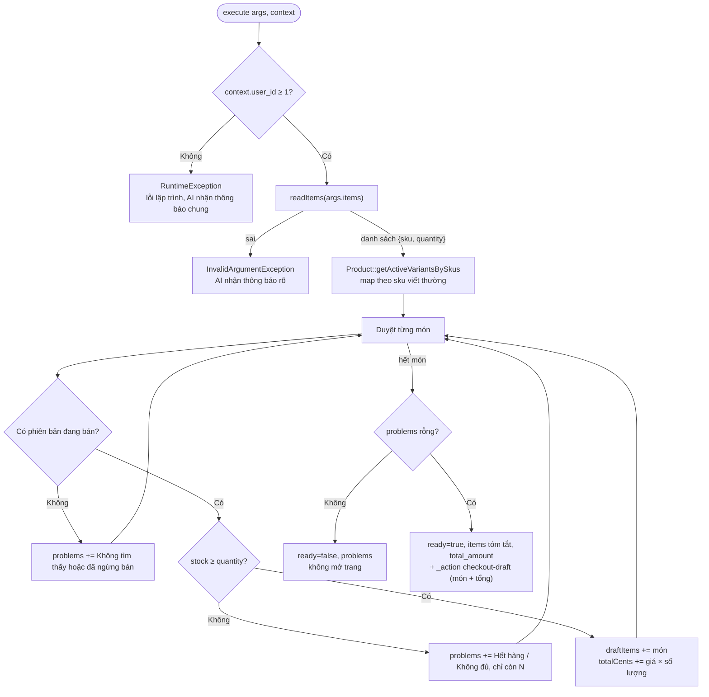
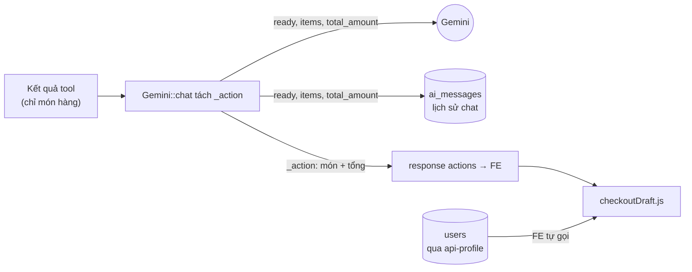
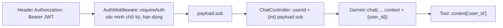

# 04. Tool `create_order_draft` (BE)

File: `BE/geminiServices/GeminiToolCreateOrderDraft.php`. Kế thừa `GeminiTool`, đăng ký trong `ChatController::chat` bằng `->addTool(new GeminiToolCreateOrderDraft())`.

## 1. Tool làm gì, không làm gì

Tool **chỉ lo món hàng**. Thông tin người nhận (tên, SĐT, địa chỉ) **tách hẳn** khỏi tool và AI: FE tự lấy từ hồ sơ qua `api-profile` để điền form (xem [06-frontend.md](06-frontend.md)).

| Làm | Không làm |
| --- | --- |
| Đọc giá, tồn kho phiên bản theo SKU | Ghi bất cứ gì vào DB |
| Kiểm tra số lượng, SKU, phiên bản đang bán | Tạo đơn, trừ kho, giữ hàng |
| Trả đơn nháp (chỉ món + tổng tiền) cho FE qua `_action` | Đọc hồ sơ, nhận hay trả tên/SĐT/địa chỉ |

## 2. Khai báo cho Gemini

### 2.1. `name()` và `description()`

- Tên: `create_order_draft`.
- Mô tả (AI đọc để quyết định khi nào gọi): lên đơn nháp khi khách muốn mua; cần SKU lấy từ `search_product`; thông tin nhận hàng do website tự điền trên trang từ hồ sơ, AI **không được hỏi** trong chat; tool **không** tạo đơn thật.

### 2.2. `parameters()` (JSON Schema)

```json
{
  "type": "object",
  "properties": {
    "items": {
      "type": "array",
      "items": {
        "type": "object",
        "properties": {
          "sku": { "type": "string" },
          "quantity": { "type": "integer" }
        },
        "required": ["sku", "quantity"]
      }
    }
  },
  "required": ["items"]
}
```

- **Không có** tham số `user_id`: AI không có cách nào chọn khách.
- **Không có** tham số tên, SĐT, địa chỉ: AI không có đường chuyển thông tin cá nhân vào đơn, nên cũng không có lý do để hỏi khách. AI có cố gửi `recipient_phone`... thì tool bỏ qua (đã test).

## 3. Thuật toán `execute($args, $context)`



`user_id` vẫn được kiểm tra để chắc chắn tool chỉ chạy cho người đã đăng nhập, dù tool không còn đọc hồ sơ.

## 4. `readItems()`: kiểm tra danh sách món

| Kiểm tra | Sai thì |
| --- | --- |
| `items` là mảng và không rỗng | "Thiếu danh sách món (items). Hãy tìm sản phẩm bằng search_product để lấy SKU trước." |
| Không quá `Order::MAX_DIRECT_ITEMS` (10) món | "Một đơn tối đa 10 món." |
| `sku` là chuỗi, sau `trim` không rỗng, ≤ 100 byte | "SKU không hợp lệ. Dùng đúng SKU trong kết quả search_product." |
| `quantity` là số nguyên 1-99. Chấp nhận `2.0` (Gemini đôi khi gửi số thực) nhưng từ chối `2.5`. Thiếu thì mặc định 1 | "Số lượng mỗi món phải từ 1 đến 99." |
| SKU trùng (không phân biệt hoa thường) | **Cộng dồn** số lượng (tối đa 99), vì khách có thể nói "thêm 1 hộp nữa" |

Lỗi tham số ném `InvalidArgumentException`. `Gemini::runTool` gửi đúng thông báo đó cho AI để AI tự sửa (ví dụ gọi lại `search_product`).

## 5. Hai dạng kết quả

### 5.1. Món có vấn đề

```json
{
  "ready": false,
  "problems": [
    { "sku": "KHONG-CO-SKU", "reason": "Không tìm thấy hoặc đã ngừng bán" },
    { "sku": "CLAYMATION", "name": "Sáp Vuốt Tóc Hanz de Fuko Claymation - Hũ 56g", "reason": "Không đủ số lượng, chỉ còn 46" }
  ],
  "message": "Chưa lên được đơn nháp vì có món gặp vấn đề. Báo khách từng món ..."
}
```

Không có `_action`: không mở trang.

### 5.2. Sẵn sàng

Phần **AI nhận** (sau khi `Gemini::chat` tách `_action`):

```json
{
  "ready": true,
  "items": [
    { "name": "Sáp Vuốt Tóc Hanz de Fuko Claymation - Hũ 56g", "quantity": 2, "line_total": 900000 }
  ],
  "total_amount": 900000,
  "message": "Đơn nháp đã mở trên website. Website tự điền thông tin nhận hàng từ hồ sơ của khách; khách kiểm tra, điền ô còn thiếu nếu có, có thể chỉnh số lượng, chọn cách thanh toán rồi tự bấm \"Xác nhận đặt hàng\". Đơn CHƯA được tạo. Không hỏi thông tin cá nhân trong chat."
}
```

Phần **FE nhận** (trong `actions` của response `api-ai-chat`):

```json
{
  "type": "checkout-draft",
  "draft": {
    "items": [
      {
        "sku": "CLAYMATION",
        "name": "Sáp Vuốt Tóc Hanz de Fuko Claymation",
        "variant_name": "Hũ 56g",
        "image": "default.jpg",
        "quantity": 2,
        "price": 450000,
        "original_price": 480000,
        "stock": 46
      }
    ],
    "total_amount": 900000
  }
}
```

**Không có** `recipient`. FE tự điền người nhận.

| Trường | Ý nghĩa |
| --- | --- |
| `price` | Giá bán thực tế (`final_price`, đã giảm nếu có) |
| `original_price` | Giá niêm yết, chỉ có khi đang giảm giá, FE gạch ngang |
| `stock` | Tồn kho lúc lên đơn, tối đa 99. FE dùng làm giới hạn nút +. Lúc xác nhận BE kiểm tra lại |
| `image` | Tên file ảnh sản phẩm, FE dựng URL bằng `resolveImageUrl` |
| `total_amount` | Tổng theo số lượng ban đầu. Cộng theo **xu** (số nguyên) để không sai số |

## 6. Dữ liệu đi đâu



Không đường nào trong luồng AI (tool, `_action`, prompt, `ai_messages`) chứa tên, SĐT, địa chỉ do hệ thống đưa vào.

Chỉ giữ lệnh của **lần gọi tool cuối** trong một lượt. Nếu AI gọi `search_product` rồi `create_order_draft`, trang lên đơn được mở (không phải trang danh sách).

## 7. `Product::getActiveVariantsBySkus($skus)`

- Nhận tối đa 20 SKU (chuỗi không rỗng, bỏ trùng).
- Prepared statement với tham số `:sku0, :sku1, ...` cho `IN (...)` (chống SQL injection).
- Chỉ lấy phiên bản `is_active = 1`, JOIN `products` để lấy tên và ảnh.
- **Không khóa dòng**: chỉ đọc để xem trước. Lúc xác nhận, `Order::checkoutItems` mới khóa và kiểm tra lại.
- Trả `[sku => dòng]`. Tool tự map lại theo SKU viết thường.
- Cũng được `ChatController::describeDraftItems` dùng để tra SKU của đơn nháp khách gửi kèm (xem [11-dong-bo-don-nhap.md](11-dong-bo-don-nhap.md)).

## 8. `user_id` đến từ đâu



AI chỉ điền được `items`. Dù khách nhắn "lên đơn cho user 5", tool vẫn dùng ID trong token.
