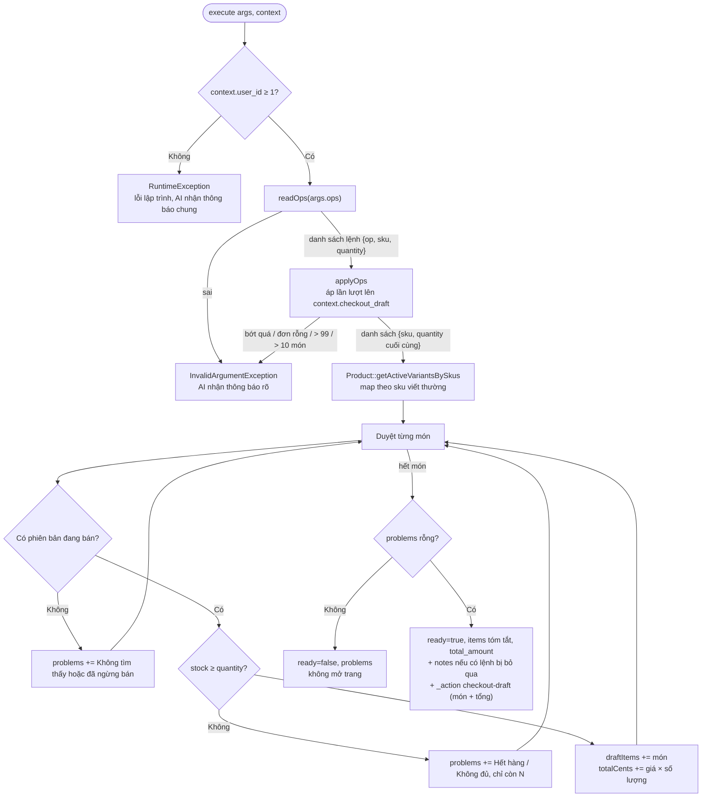
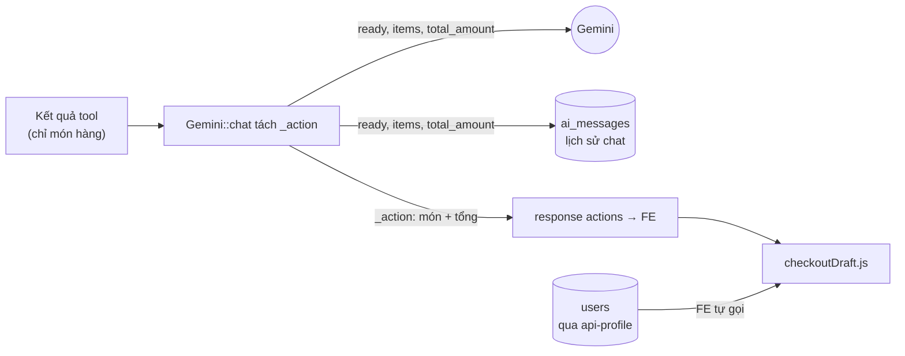
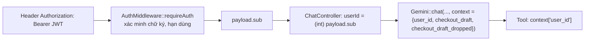

# 04. Tool `create_order_draft` (BE)

File: `BE/geminiServices/GeminiToolCreateOrderDraft.php`. Kế thừa `GeminiTool`, đăng ký trong `ChatController::chat` bằng `->addTool(new GeminiToolCreateOrderDraft())`.

## 1. Tool làm gì, không làm gì

Tool **chỉ lo món hàng**. Thông tin người nhận (tên, SĐT, địa chỉ) **tách hẳn** khỏi tool và AI: FE tự lấy từ hồ sơ qua `api-profile` để điền form (xem [06-frontend.md](06-frontend.md)).

| Làm | Không làm |
| --- | --- |
| Đọc giá, tồn kho phiên bản theo SKU | Ghi bất cứ gì vào DB |
| Kiểm tra số lượng, SKU, phiên bản đang bán | Tạo đơn, trừ kho, giữ hàng |
| Trả đơn nháp (chỉ món + tổng tiền) cho FE qua `_action` | Đọc hồ sơ, nhận hay trả tên/SĐT/địa chỉ |

## 2. Khai báo cho Gemini

### 2.1. `name()` và `description()`

- Tên: `create_order_draft`.
- Mô tả (AI đọc để quyết định khi nào gọi): lên đơn nháp hoặc sửa đơn nháp đang mở; gửi danh sách **lệnh** mô tả thay đổi khách vừa yêu cầu, **không** gửi lại cả đơn và **không** tự cộng trừ; món khách không nhắc tới website tự giữ; cần SKU lấy từ `search_product` hoặc đơn nháp đang mở; thông tin nhận hàng do website tự điền, AI **không được hỏi** trong chat; tool **không** tạo đơn thật.

### 2.2. `parameters()` (JSON Schema): thiết kế lệnh

AI không gửi "đơn mới trông thế nào" (snapshot) mà gửi "khách muốn đổi gì" (command). Server lấy đơn nháp trên trang làm gốc rồi áp từng lệnh.

> **Tóm tắt cần nhớ**
>
> - **Cũ:** Gemini vừa hiểu câu, vừa nhớ trạng thái, vừa tính toán, rồi điền thẳng kết quả. Một bước sai là cả đơn sai.
> - **Mới:** Gemini chỉ dịch câu thành **nhãn + số khách nói**. Tool (BE) lấy **trạng thái đơn hiện tại ở FE** rồi áp nhãn để ra kết quả.
>
> Mỗi bên làm đúng phần mình giỏi: **Gemini giỏi hiểu ngôn ngữ, code PHP giỏi nhớ chính xác và tính toán.**
>
> Giải thích kèm sơ đồ và code mẫu: [13-giai-thich-de-hieu.md](13-giai-thich-de-hieu.md).

```json
{
  "type": "object",
  "properties": {
    "ops": {
      "type": "array",
      "items": {
        "type": "object",
        "properties": {
          "op": { "type": "string", "enum": ["add", "set", "subtract", "remove"] },
          "sku": { "type": "string" },
          "quantity": { "type": "integer" }
        },
        "required": ["op", "sku"]
      }
    }
  },
  "required": ["ops"]
}
```

| `op` | Khách nói | `quantity` | Server làm |
| --- | --- | --- | --- |
| `add` | "mua 2 hộp", "thêm 5 hộp nữa" | Số thêm (không nói thì 1) | Số đang có (chưa có thì 0) + N |
| `set` | "đổi thành 3", "lấy 3 hộp thôi" | Số cuối, bắt buộc | = N |
| `subtract` | "bớt 2" | Số bớt, bắt buộc | Số đang có − N |
| `remove` | "bỏ Vinh Râu" | Không cần | Xóa món |

Ví dụ, trang có Claymation 5, Vinh Râu 3:

| Khách nói | AI gửi | Kết quả |
| --- | --- | --- |
| "thêm 5 hộp Claymation" | `[{add, CLAYMATION, 5}]` | Claymation 10, Vinh Râu 3 (món không nhắc tới tự giữ) |
| "bỏ Vinh Râu, thêm 1 Got2b, Claymation để 2 hộp thôi" | `[{remove, VINH-RAU}, {add, GOT2B, 1}, {set, CLAYMATION, 2}]` | Claymation 2, Got2b 1 |
| "đổi Claymation sang hũ 56g" | `[{remove, CLAYMATION-113G}, {add, CLAYMATION, 5}]` | Claymation (56g) 5, Vinh Râu 3 |

Vì sao không bắt AI gửi cả đơn như bản đầu: AI phải tự dựng lại trạng thái, nên hay lấy nhầm số cũ trong lịch sử chat (trang 5 hộp, "thêm 5" mà AI gửi 6 = 1 cũ + 5) hoặc quên món khách không nhắc tới. Xem [11-dong-bo-don-nhap.md](11-dong-bo-don-nhap.md) mục 6.6.

- **Không có** tham số `user_id`: AI không có cách nào chọn khách.
- **Không có** tham số tên, SĐT, địa chỉ: AI không có đường chuyển thông tin cá nhân vào đơn, nên cũng không có lý do để hỏi khách. AI có cố gửi `recipient_phone`... thì tool bỏ qua (đã test).

## 3. Thuật toán `execute($args, $context)`



`user_id` vẫn được kiểm tra để chắc chắn tool chỉ chạy cho người đã đăng nhập, dù tool không còn đọc hồ sơ.

## 4. `readOps()`: kiểm tra từng lệnh

| Kiểm tra | Sai thì |
| --- | --- |
| `ops` là mảng và không rỗng | "Thiếu danh sách lệnh (ops). Mỗi lệnh gồm op (add, set, subtract, remove), sku, quantity." |
| Không quá 20 lệnh (`MAX_OPS`) | "Tối đa 20 lệnh mỗi lần." |
| `op` thuộc allowlist `add`, `set`, `subtract`, `remove` | "op chỉ nhận add, set, subtract hoặc remove." |
| `sku` là chuỗi, sau `trim` không rỗng, ≤ 100 byte | "SKU không hợp lệ. Dùng đúng SKU trong kết quả search_product hoặc trong đơn nháp đang mở." |
| `quantity` (trừ `remove`) là số nguyên 1-99. Chấp nhận `2.0` (Gemini đôi khi gửi số thực) nhưng từ chối `2.5`. `add` thiếu số thì là 1; `set`, `subtract` bắt buộc | "Lệnh set cần quantity là số nguyên từ 1 đến 99." |

Lỗi tham số ném `InvalidArgumentException`. `Gemini::runTool` gửi đúng thông báo đó cho AI để AI tự sửa (ví dụ gọi lại `search_product`). Lịch sử chat cũ còn lời gọi tool dạng `items` (thiết kế trước); nếu AI bắt chước gửi `items` thì nhận lỗi "Thiếu danh sách lệnh (ops)" và gọi lại đúng dạng.

### 4.1. `applyOps()`: áp lệnh lên đơn trên trang

Gốc là đơn nháp khách đang thấy, lấy từ `context['checkout_draft']` (do `ChatController` truyền, đã tra DB). Chưa có đơn nháp thì gốc là đơn rỗng, nên lần mua đầu cũng chỉ là `add`/`set`. Nếu trong cùng lượt đã có lần gọi tool thành công thì gốc là **đơn làm việc** của lượt đó (mục 4.2).

```php
foreach ($ops as $op) {                         // áp đúng thứ tự khách nói
    $current = $draft[$sku]['quantity'] ?? 0;   // chưa có thì 0
    add      → $current + N
    set      → N
    subtract → $current - N   (= 0 thì bỏ món; < 0 thì lỗi)
    remove   → xóa món
}
```

| Trên trang | AI gửi | Kết quả |
| --- | --- | --- |
| Clay 5, Vinh 3 | `add Clay 5` | Clay 10, Vinh 3 |
| Clay 5, Vinh 3 | `subtract Clay 2` | Clay 3, Vinh 3 |
| Clay 5, Vinh 3 | `set Vinh 1` | Clay 5, Vinh 1 |
| Clay 5, Vinh 3 | `remove Vinh` | Clay 5 |
| (rỗng) | `add Clay 2`, `add Got2b 1` | Clay 2, Got2b 1 |
| Clay 5, Vinh 3 | `remove XYZ` (không có) | Giữ nguyên, kèm `notes` "SKU XYZ không có trong đơn nên không cần bỏ." |
| Clay 2, Vinh 3 | `subtract Clay 2` (bớt đúng bằng số đang có) | Vinh 3 (bỏ Clay, giống `remove`) |
| Clay 5 | `subtract Clay 7` | Lỗi cho AI: "đơn chỉ có 5, không bớt được 7. Hỏi lại khách muốn bớt bao nhiêu." |
| Clay 5 | `subtract Got2b 1` | Lỗi cho AI: "không có trong đơn nháp nên không bớt được." |
| Clay 5, Vinh 3 | `remove` cả hai | Lỗi cho AI: "đơn không còn món nào... hướng dẫn khách bấm nút 'Bỏ đơn nháp'." |
| Clay 5 | `add Clay 95` | Lỗi cho AI: "tổng số lượng 100 vượt giới hạn 99 mỗi món." |

- SKU so sánh không phân biệt hoa thường. Món cũ giữ cách viết SKU của trang (lấy từ DB) và giữ chỗ cũ; món mới nằm cuối.
- `subtract` có nghĩa nhất quán: bớt **đúng bằng** số đang có ("có 2, bớt 2") là hết món, nên bỏ món. Bớt **quá** số đang có ("có 5, bớt 7") thường là khách nói nhầm, nên **báo lỗi** để AI hỏi lại. Bỏ món mà đơn rỗng thì vẫn báo lỗi "đơn không còn món nào".
- Hàm không có AI, không đọc DB, test được bằng script (xem [09-kiem-thu.md](09-kiem-thu.md) mục 1.7).

### 4.2. Đơn làm việc của một lượt chat (gọi tool nhiều lần)

Trong một lượt, Gemini có thể gọi tool **nhiều lần**: gọi song song ("thêm 1 B" và "thêm 1 C" thành 2 lời gọi), hoặc gọi lại sau khi nhận lỗi. `Gemini::chat` chỉ gửi cho FE đơn của **lần gọi cuối**.

Nếu lần nào cũng tính lại từ đơn trên trang, lần sau sẽ xóa mất kết quả lần trước:

| Trang: A 2 | Không có đơn làm việc (lỗi cũ) | Có đơn làm việc (hiện tại) |
| --- | --- | --- |
| Lần 1: `add B 1` | A 2, B 1 | A 2, B 1 → **ghi nhận** |
| Lần 2: `add C 1` | A 2, C 1 (**mất B**) | A 2, B 1, C 1 |
| FE nhận | A 2, C 1 ✗ | A 2, B 1, C 1 ✓ |

Cách làm (thuộc tính `$workingDraft` của class tool):

```php
$base = $this->workingDraft ?? $context['checkout_draft'];   // lần đầu: đơn trên trang
$items = $this->applyOps($ops, $base);
// ... tra kho, giá; có problems thì return (KHÔNG ghi nhận) ...
$this->workingDraft = /* đơn vừa lên thành công */;            // lần sau áp tiếp lên đây
```

- Chỉ ghi nhận khi lên đơn **thành công**. Lần gọi lỗi (lệnh sai, thiếu kho) không làm đổi gốc.
- `ChatController` tạo tool **mới cho mỗi request**, nên đơn làm việc chỉ sống trong một lượt của một khách, không lẫn sang lượt sau hay người khác.

### 4.3. Món trên trang bị loại vì ngừng bán

`describeDraftItems` chỉ giữ SKU còn bán. Món vừa bị admin tắt sẽ không có trong gốc, nên không có trong đơn mới. Để món **không biến mất âm thầm**:

- `ChatController` đếm số món bị loại và truyền `context['checkout_draft_dropped']`.
- Lần đầu lên đơn thành công trong lượt, tool thêm vào `notes` cho AI: "N món trong đơn nháp trên trang đã ngừng bán hoặc không còn tìm thấy, nên không có trong đơn mới. Báo khách biết...". Chỉ báo một lần mỗi lượt.
- Chỉ truyền **số lượng món**, không truyền SKU: SKU là chuỗi client gửi, chép vào kết quả tool có thể bị lợi dụng để chèn câu lệnh cho AI.

## 5. Hai dạng kết quả

### 5.1. Món có vấn đề

```json
{
  "ready": false,
  "problems": [
    { "sku": "KHONG-CO-SKU", "reason": "Không tìm thấy hoặc đã ngừng bán" },
    { "sku": "CLAYMATION", "name": "Sáp Vuốt Tóc Hanz de Fuko Claymation - Hũ 56g", "reason": "Không đủ số lượng, chỉ còn 46" }
  ],
  "message": "Chưa lên được đơn nháp vì có món gặp vấn đề. Báo khách từng món ..."
}
```

Không có `_action`: không mở trang.

### 5.2. Sẵn sàng

Phần **AI nhận** (sau khi `Gemini::chat` tách `_action`):

```json
{
  "ready": true,
  "items": [
    { "name": "Sáp Vuốt Tóc Hanz de Fuko Claymation - Hũ 56g", "quantity": 2, "line_total": 900000 }
  ],
  "total_amount": 900000,
  "message": "Đơn nháp đã mở trên website với ĐÚNG các món và số lượng trong items (báo khách theo số này). Website tự điền thông tin nhận hàng từ hồ sơ của khách; khách kiểm tra, điền ô còn thiếu nếu có, có thể chỉnh số lượng, chọn cách thanh toán rồi tự bấm \"Xác nhận đặt hàng\". Đơn CHƯA được tạo. Không hỏi thông tin cá nhân trong chat."
}
```

`items` là số **cuối cùng** sau khi áp lệnh; `message` dặn AI báo khách đúng theo số này. Có lệnh bị bỏ qua (ví dụ `remove` món không có trong đơn) thì AI nhận thêm `notes`, ví dụ `["SKU XYZ không có trong đơn nên không cần bỏ."]`.

Phần **FE nhận** (trong `actions` của response `api-ai-chat`):

```json
{
  "type": "checkout-draft",
  "draft": {
    "items": [
      {
        "sku": "CLAYMATION",
        "name": "Sáp Vuốt Tóc Hanz de Fuko Claymation",
        "variant_name": "Hũ 56g",
        "image": "default.jpg",
        "quantity": 2,
        "price": 450000,
        "original_price": 480000,
        "stock": 46
      }
    ],
    "total_amount": 900000
  }
}
```

**Không có** `recipient`. FE tự điền người nhận.

| Trường | Ý nghĩa |
| --- | --- |
| `price` | Giá bán thực tế (`final_price`, đã giảm nếu có) |
| `original_price` | Giá niêm yết, chỉ có khi đang giảm giá, FE gạch ngang |
| `stock` | Tồn kho lúc lên đơn, tối đa 99. FE dùng làm giới hạn nút +. Lúc xác nhận BE kiểm tra lại |
| `image` | Tên file ảnh sản phẩm, FE dựng URL bằng `resolveImageUrl` |
| `total_amount` | Tổng theo số lượng ban đầu. Cộng theo **xu** (số nguyên) để không sai số |

## 6. Dữ liệu đi đâu



Không đường nào trong luồng AI (tool, `_action`, prompt, `ai_messages`) chứa tên, SĐT, địa chỉ do hệ thống đưa vào.

Chỉ giữ lệnh của **lần gọi tool cuối** trong một lượt. Nếu AI gọi `search_product` rồi `create_order_draft`, trang lên đơn được mở (không phải trang danh sách).

## 7. `Product::getActiveVariantsBySkus($skus)`

- Nhận tối đa 20 SKU (chuỗi không rỗng, bỏ trùng).
- Prepared statement với tham số `:sku0, :sku1, ...` cho `IN (...)` (chống SQL injection).
- Chỉ lấy phiên bản `is_active = 1`, JOIN `products` để lấy tên và ảnh.
- **Không khóa dòng**: chỉ đọc để xem trước. Lúc xác nhận, `Order::checkoutItems` mới khóa và kiểm tra lại.
- Trả `[sku => dòng]`. Tool tự map lại theo SKU viết thường.
- Cũng được `ChatController::describeDraftItems` dùng để tra SKU của đơn nháp khách gửi kèm (xem [11-dong-bo-don-nhap.md](11-dong-bo-don-nhap.md)).

## 8. `user_id` đến từ đâu



AI chỉ điền được `ops`. Dù khách nhắn "lên đơn cho user 5", tool vẫn dùng ID trong token.

`context['checkout_draft']` cũng do server đặt: là danh sách món trên trang **sau khi** `ChatController` kiểm tra định dạng và tra DB (`describeDraftItems`), không phải dữ liệu thô của client, và AI không sửa được.
