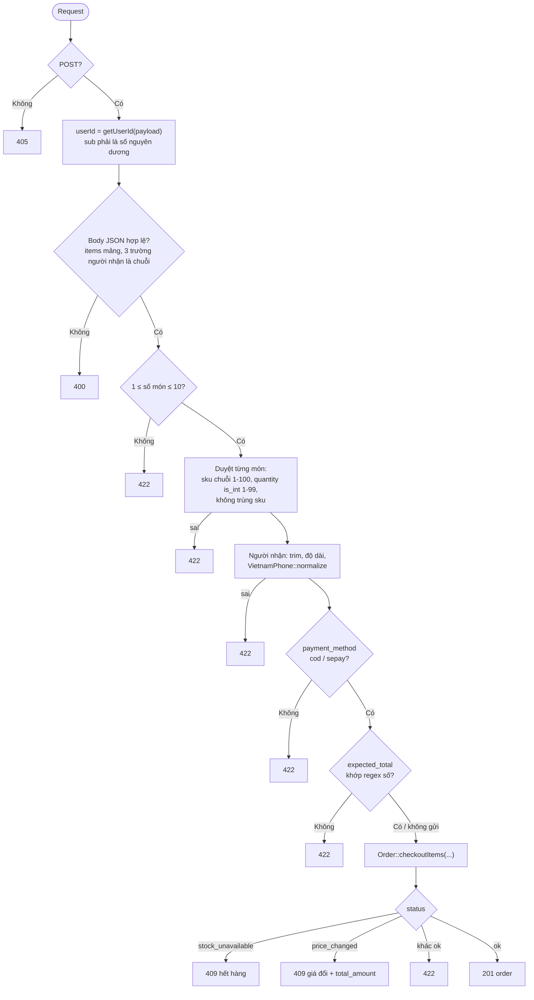
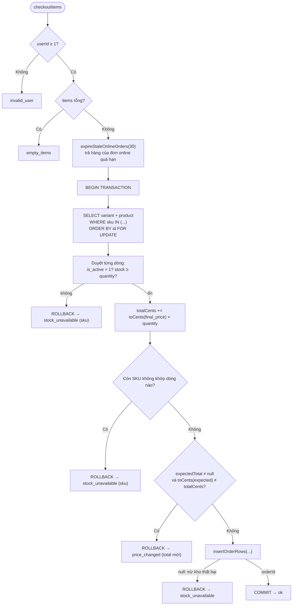

# 05. API xác nhận đơn: `api-order-checkout-items`

Đây là **con đường duy nhất** để đơn nháp của Louis trở thành đơn thật. AI không gọi được API này; chỉ trang `/ai-checkout` gọi khi khách bấm "Xác nhận đặt hàng".

## 1. Contract

| Mục | Nội dung |
| --- | --- |
| URL | `POST /BE/?action=api-order-checkout-items` |
| Xác thực | `Authorization: Bearer <JWT>`, router gọi `requireAuth()`. User lấy từ `sub`, **bỏ qua** mọi ID trong body |
| Content-Type | `application/json` |

### 1.1. Body

```json
{
  "items": [
    { "sku": "CLAYMATION", "quantity": 2 },
    { "sku": "GOT2B-GLUED", "quantity": 1 }
  ],
  "recipient_name": "Trần Minh Khôi",
  "recipient_phone": "0912345678",
  "shipping_address": "12 Lý Tự Trọng, Phường Bến Nghé, Quận 1, TP. Hồ Chí Minh",
  "payment_method": "cod",
  "expected_total": 1150000
}
```

| Trường | Bắt buộc | Quy tắc |
| --- | --- | --- |
| `items` | Có | Mảng 1-10 phần tử. `sku`: chuỗi 1-100 byte. `quantity`: **số nguyên JSON** 1-99 (`"2"` hay `2.5` bị từ chối). SKU không được trùng (không phân biệt hoa thường) |
| `recipient_name` | Có | Chuỗi, sau `trim` 1-100 byte |
| `recipient_phone` | Có | Di động Việt Nam, chuẩn hóa về `0xxxxxxxxx` |
| `shipping_address` | Có | Chuỗi, sau `trim` 1-500 byte |
| `payment_method` | Không | `cod` (mặc định) hoặc `sepay` |
| `expected_total` | Không | Số hoặc chuỗi số, tối đa 12 chữ số phần nguyên và 2 chữ số thập phân. Chỉ dùng để **đối chiếu** |

**Không có** trường giá. Gửi kèm giá cũng bị bỏ qua.

### 1.2. Thành công: 201

```json
{
  "status": "success",
  "message": "Đặt hàng thành công",
  "order": {
    "id": 77,
    "total_amount": "1150000.00",
    "order_status": "pending",
    "payment_status": "unpaid",
    "payment_method": "cod"
  }
}
```

Shape giống hệt `api-order-checkout` để FE dùng chung cách xử lý.

### 1.3. Lỗi

| Mã | Khi nào | `message` |
| --- | --- | --- |
| 401 | Thiếu/sai/hết hạn token (middleware) | Thông báo của middleware |
| 405 | Không phải POST | "Phương thức không được hỗ trợ" |
| 400 | Body không phải JSON, `items` không phải mảng, thiếu trường người nhận dạng chuỗi | "Dữ liệu đơn hàng không hợp lệ" |
| 422 | Số món 0 hoặc > 10 | "Đơn hàng phải có từ 1 đến 10 món" |
| 422 | SKU rỗng/quá dài, số lượng sai | "Món hàng hoặc số lượng không hợp lệ" |
| 422 | SKU lặp | "Một món hàng bị lặp trong đơn" |
| 422 | Tên/địa chỉ rỗng hoặc quá dài | "Thông tin giao hàng không hợp lệ" |
| 422 | SĐT sai | "Số điện thoại phải là số di động Việt Nam 10 chữ số (03, 05, 07, 08, 09)" |
| 422 | Phương thức thanh toán sai | "Phương thức thanh toán không hợp lệ" |
| 422 | `expected_total` sai định dạng | "Tổng tiền đối chiếu không hợp lệ" |
| 409 | SKU không tồn tại, ngừng bán, không đủ kho | "Có món đã hết hàng, ngừng bán hoặc không đủ số lượng. Quý khách vui lòng nhờ trợ lý lên lại đơn." |
| 409 | Tổng tính lại ≠ `expected_total` | "Giá sản phẩm vừa thay đổi. Tổng mới là 960.000đ, ..." kèm `total_amount` |

## 2. Controller: `OrderController::checkoutItems`



Vì sao kiểm tra `expected_total` bằng regex `^\d{1,12}(\.\d{1,2})?$`: hàm `toCents()` của model chỉ cắt chuỗi theo dấu chấm; chuỗi lạ như `"1e6"` hay `"-5"` sẽ bị hiểu sai. Số thực JSON được đổi qua `number_format(..., 2)` trước.

## 3. Model: `Order::checkoutItems`



Mọi lỗi PDO bất ngờ: `catch` → rollback nếu còn transaction → ném lại cho `handleGlobalError`.

### 3.1. Vì sao cần `FOR UPDATE`

Nếu chỉ `SELECT` bình thường, hai khách cùng đọc thấy `stock = 1`, cùng tạo đơn, kho bị bán quá. `FOR UPDATE` khóa các dòng phiên bản tới khi `COMMIT`/`ROLLBACK`, khách thứ hai phải chờ rồi đọc được số mới. Xem [03-luong-xu-ly.md, mục 8](03-luong-xu-ly.md).

### 3.2. Vì sao `ORDER BY id`

Hai giao dịch khóa cùng hai dòng theo thứ tự ngược nhau (A khóa 1 rồi chờ 2, B khóa 2 rồi chờ 1) sẽ chờ nhau mãi: **deadlock**. Luôn khóa theo `id` tăng dần thì không xảy ra. Luồng checkout từ giỏ cũng làm vậy.

### 3.3. Vì sao tính tiền theo "xu"

Số thực trong máy tính không cộng chính xác (`0.1 + 0.2 = 0.30000000000000004`). Đổi giá sang số nguyên đơn vị xu (`toCents`), cộng nhân bằng số nguyên, cuối cùng đổi lại (`fromCents`). So sánh với `expected_total` cũng theo xu.

### 3.4. Vì sao so SKU theo chữ thường

Cột `sku` dùng collation không phân biệt hoa thường, nên `WHERE sku IN ('claymation')` vẫn trả dòng `CLAYMATION`. Model map yêu cầu và kết quả theo `mb_strtolower` để khớp đúng; SKU yêu cầu nào không khớp dòng nào là SKU không tồn tại.

## 4. `Order::insertOrderRows` (dùng chung)

Được tách từ `Order::checkout` (checkout từ giỏ). Cả hai luồng cùng gọi.

| Bước | SQL | Ghi chú |
| --- | --- | --- |
| 1 | `INSERT INTO orders (...)` | `user_id`, người nhận, tổng tiền, phương thức |
| 2 | `INSERT INTO order_details (...)` cho từng món | **Chụp lại** tên sản phẩm, SKU, tên phiên bản, đơn giá tại thời điểm mua |
| 3 | `UPDATE product_variants SET stock = stock - :q WHERE id = :id AND stock >= :q AND is_active = 1` | Trừ kho **nguyên tử**: điều kiện nằm trong câu UPDATE, `rowCount() !== 1` là thất bại → trả `null` |
| 4 | `UPDATE products SET sales_count = sales_count + :q` | Cộng lượt bán |

Hàm **phải** được gọi trong transaction đã mở và sau khi đã khóa dòng. Hàm không commit/rollback; trả `null` để nơi gọi rollback.

## 5. So sánh với `api-order-checkout` (checkout từ giỏ)

| | `api-order-checkout` | `api-order-checkout-items` |
| --- | --- | --- |
| Nguồn món | Giỏ hàng của user | Danh sách SKU trong body |
| Xóa giỏ sau khi đặt | Có | **Không** đụng giỏ |
| Đối chiếu tổng tiền | Không | Có (`expected_total`) |
| Khóa dòng | `cart_items` + `product_variants` | `product_variants` |
| Ghi đơn | `insertOrderRows` | `insertOrderRows` |
| Mã lỗi hết hàng | 409 | 409 |
| Response thành công | 201 `{order}` | 201 `{order}` (giống hệt) |

## 6. Ví dụ gọi thử bằng cURL

```bash
curl -X POST "http://du-an-1.test/BE/?action=api-order-checkout-items" \
  -H "Authorization: Bearer <token lấy từ api-login>" \
  -H "Content-Type: application/json" \
  -d '{"items":[{"sku":"CLAYMATION","quantity":1}],"recipient_name":"Test","recipient_phone":"0912345678","shipping_address":"1 Đường Test","payment_method":"cod","expected_total":1}'
```

`expected_total: 1` cố tình sai để nhận 409 "giá vừa thay đổi" mà **không tạo đơn**: cách an toàn để thử API trên DB thật.
