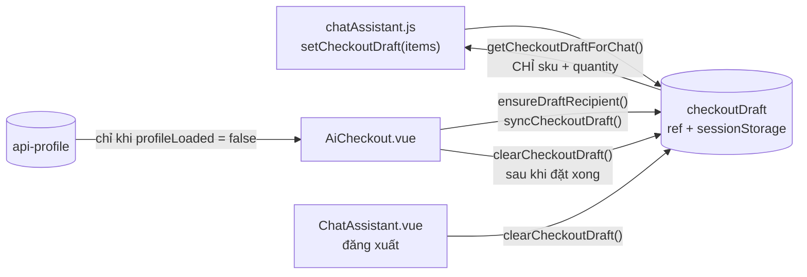
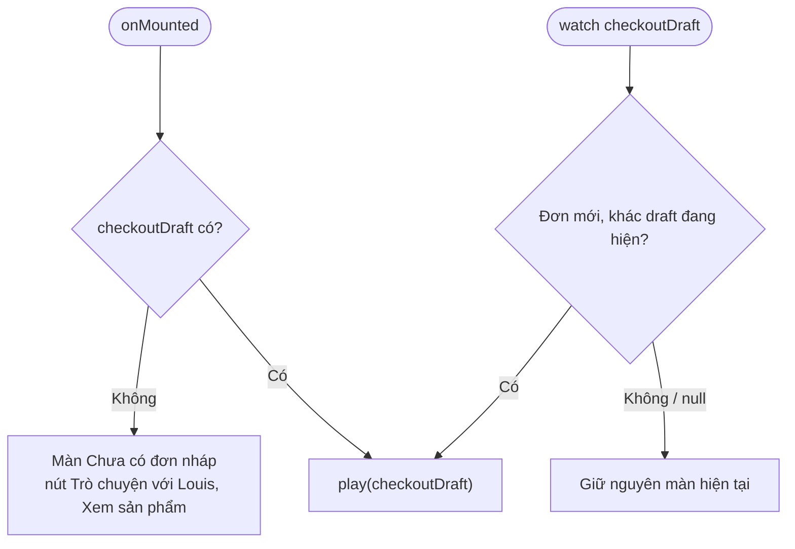
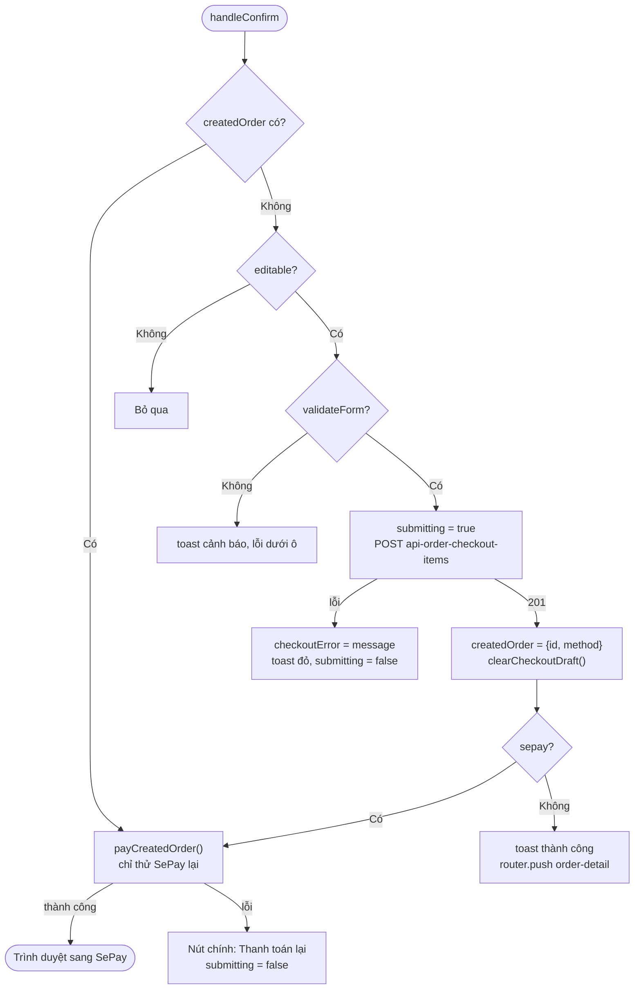

# 06. Giao diện (FE)

## 1. Các file

| File | Vai trò |
| --- | --- |
| `FE/src/helpers/ai/checkoutDraft.js` | Kho đơn nháp (sessionStorage): `setCheckoutDraft`, `ensureDraftRecipient`, `syncCheckoutDraft`, `getCheckoutDraftForChat`, `clearCheckoutDraft`, `useCheckoutDraft` |
| `FE/src/helpers/ai/chatAssistant.js` | Gặp action `checkout-draft` thì lưu đơn nháp, trả đích `{ name: 'ai-checkout' }` |
| `FE/src/components/chat/ChatAssistant.vue` | `router.push` tới đích; xóa đơn nháp khi đăng xuất |
| `FE/src/views/ai/AiCheckout.vue` | Trang "Lên đơn nhanh cho quý ông" |
| `FE/src/router/index.js` | Route `/ai-checkout`, tên `ai-checkout`, `meta: { requiresAuth: true }` |

## 2. Kho đơn nháp `checkoutDraft.js`

Một nguồn duy nhất, gồm 3 phần:

| Phần | Nội dung | Ai ghi |
| --- | --- | --- |
| `items` | Món, số lượng, giá, tồn kho | BE qua `setCheckoutDraft`; khách chỉnh số lượng trên trang |
| `recipient` | Tên, SĐT, địa chỉ | Khách điền trên trang; lần đầu lấy từ hồ sơ |
| `profileLoaded` | Đã lấy hồ sơ cho đơn này chưa | `ensureDraftRecipient` |

Lưu trong **`sessionStorage`** (khóa `ai_checkout_draft`) kèm `userId`:

- F5 vẫn còn; đóng tab thì mất; không dùng chung giữa các tab.
- Khi đọc lại, nếu `userId` không khớp người đang đăng nhập thì bỏ qua.
- Đơn nháp không đi lên URL, không đi qua AI.



### 2.1. `setCheckoutDraft(draft)` kiểm tra gì

Dữ liệu đến từ mạng nên phải kiểm tra trước khi nhận. Sai bất kỳ món nào thì **bỏ cả lệnh**, giữ nguyên đơn cũ, trả `false`.

| Kiểm tra | Xử lý |
| --- | --- |
| `draft.items` là mảng 1-10 phần tử | Sai → `false` |
| Mỗi món: `sku`, `name` là chuỗi có nội dung; `price` là số ≥ 0; `quantity`, `stock` là số nguyên ≥ 1 | Sai → `false` |
| `quantity` | Kẹp về `min(quantity, stock, 99)` |
| `stock` | Kẹp về tối đa 99 |
| `original_price` | Chỉ giữ khi là số và **lớn hơn** `price`, không thì `null` |
| `variant_name`, `image` | Không phải chuỗi thì thành `''` |

Phần `recipient` **không** nằm trong lệnh từ BE. Hàm chỉ thay danh sách món; người nhận và `profileLoaded` của đơn cũ được giữ nguyên.

### 2.2. Người nhận: lấy từ hồ sơ một lần

`ensureDraftRecipient()`, trang gọi khi mở:

1. Nếu `profileLoaded` là `true`: không làm gì.
2. Nếu chưa: gọi `api-profile`, điền vào các ô **đang trống**. Ô đã có giá trị (khách đã nhập) thì giữ nguyên.
3. SĐT trong hồ sơ sai định dạng thì để trống cho khách nhập lại.
4. Thành công: đặt `profileLoaded = true`. Lỗi mạng: không đánh dấu, lần mở sau thử lại.

Quy tắc ưu tiên chỉ có một: **thứ khách đã nhập luôn thắng hồ sơ**, vì hồ sơ chỉ lấp chỗ trống.

### 2.3. Đồng bộ chỉnh sửa với Louis

- `syncCheckoutDraft({ quantities, recipient })`: trang gọi khi khách bấm + / − hoặc sửa ô (sau khi hiệu ứng xong). Sửa thuộc tính bên trong, không thay object, nên trang không diễn lại. Ghi sessionStorage ngay.
- `getCheckoutDraftForChat()`: chỉ trả `{ items: [{ sku, quantity }] }`. Người nhận không bao giờ đi lên Louis.
- Chi tiết: [11-dong-bo-don-nhap.md](11-dong-bo-don-nhap.md).

### 2.4. Vì sao dữ liệu sống được khi chuyển trang và qua F5

Biến `checkoutDraft` là `ref` khai báo ở cấp module nên mọi nơi import dùng chung một biến; chuyển trang trong web không làm mất. Khi tải lại trang, JS chạy lại và đọc lại từ `sessionStorage` (chỉ khi đúng người đang đăng nhập).

## 3. Nhận lệnh trong `chatAssistant.js`

```js
for (const action of actions) {
  if (action?.type === 'checkout-draft') {
    if (setCheckoutDraft(action.draft)) return { name: 'ai-checkout' }
    continue // đơn nháp sai định dạng: bỏ qua lệnh này
  }
  const location = toRouteLocation(action) // lệnh navigate như cũ
  if (location) return location
}
```

`ChatAssistant.vue` nhận `{ name: 'ai-checkout' }` và gọi `router.push` như mọi lệnh khác. Trên điện thoại, khung chat tự thu nhỏ để khách thấy trang vừa mở.

## 4. Trang `AiCheckout.vue`

### 4.1. Bố cục

Theo màn "Thông tin giao hàng" trong Stitch project "Fule BarberShop Online Store".

```text
┌──────────────────────────────────────────────────────────────┐
│ LOUIS DÉ FULE · TRỢ LÝ LÊN ĐƠN                                │
│ Lên đơn nhanh cho quý ông                                     │
├───────────────────────────────────┬──────────────────────────┤
│ ① Người nhận kiện hàng            │ Tóm tắt đơn              │
│   [Họ tên]        [Số điện thoại] │ Tạm tính / Đã giảm       │
│   [Địa chỉ giao hàng           ]  │ TỔNG THANH TOÁN  (dấu)   │
│                                   │ ○ COD   ○ SePay          │
│ ② Món quý ông đã chọn             │ [ XÁC NHẬN ĐẶT HÀNG ]    │
│   [ảnh] Tên · phiên bản  🔒 giá   │ [ Nhờ Louis sửa đơn ]    │
│                        [− 2 +]    │                          │
│ ● Đơn đã sẵn sàng...              │                          │
└───────────────────────────────────┴──────────────────────────┘
        cột trái col-lg-7                 cột phải col-lg-5 (sticky)
```

Điện thoại: hai cột xếp chồng, khối tóm tắt nằm dưới form.

### 4.2. Các biến trạng thái chính

| Biến | Kiểu | Ý nghĩa |
| --- | --- | --- |
| `draft` | `ref` | **Bản chụp** đơn nháp trang đang hiển thị. Tách khỏi kho để khi kho bị xóa sau lúc đặt thành công, trang vẫn còn dữ liệu |
| `phase` | `ref` | `prep` → `fill` → `ready` |
| `quantities` | `ref([])` | Số lượng từng món, khách chỉnh được |
| `form` | `reactive` | `name`, `phone`, `address` gắn với ô nhập bằng `v-model` |
| `fieldErrors` | `reactive` | Lỗi dưới từng ô |
| `submitting` | `ref` | Đang gửi đơn / đang chuyển SePay, khóa nút |
| `checkoutError` | `ref` | Lỗi chung (409, 422, mạng) hiện trong khối đỏ |
| `createdOrder` | `ref` | Đơn đã tạo nhưng chuyển SePay lỗi, để "Thanh toán lại" không tạo đơn mới |
| `editable` | `computed` | `phase === 'ready' && !submitting && !createdOrder` |
| `subtotal` | `computed` | Σ `price × quantities[i]`, chỉ để xem trước |
| `displayTotal` | `computed` | Lúc diễn: số đang nhảy; lúc `ready`: `subtotal` |

### 4.3. Dòng thời gian hiệu ứng

```mermaid
gantt
    title Hiệu ứng mở đơn nháp (khoảng 5-7 giây, tùy độ dài dữ liệu)
    dateFormat x
    axisFormat %S s
    section Màn 1 - prep
    Gõ 3 bước chuẩn bị, mỗi bước hiện dấu ✓ :a1, 0, 3000
    section Màn 2 - fill
    Gõ họ tên (ô phát sáng)                 :a2, 3500, 4200
    Gõ số điện thoại                        :a3, 4200, 4900
    Gõ địa chỉ                              :a4, 4900, 5900
    Các món trượt vào (380 ms mỗi món)      :a5, 5900, 7000
    Tổng tiền nhảy số (900 ms)              :a6, 7000, 7900
    section Màn 3 - đóng dấu
    Con dấu Đã duyệt rơi, khối tóm tắt giật :a7, 8150, 8800
    section ready
    Mở khóa form và nút                     :milestone, m1, 8800, 8800
```



Kỹ thuật:

- `typeInto()` gõ từng ký tự bằng `setTimeout`; `Array.from(text)` tách đúng ký tự tiếng Việt.
- `countUp()` nhảy số bằng `requestAnimationFrame` với ease-out, mỗi khung hình vẫn hiển thị qua `formatPrice`.
- `runId`: mỗi lượt diễn có mã riêng. Rời trang hoặc diễn lại thì mã tăng, các vòng lặp cũ thấy mã đổi sẽ dừng (ném `CANCELLED`), không chồng hiệu ứng.
- Không thêm thư viện: chỉ CSS `@keyframes`, `<Transition>` của Vue.

### 4.4. Khi nào trang diễn



`watch` cần vì khi khách đang ở `/ai-checkout` mà Louis lên đơn mới, `router.push` tới cùng route **không** tạo lại component.

### 4.5. Chỉnh sửa của khách

| Phần | Cho sửa | Quy tắc |
| --- | --- | --- |
| Giá | **Không** (có biểu tượng khóa, chữ "Giá do cửa hàng chốt") | BE tính lại |
| Số lượng | Có, nút − / + | 1 ≤ số lượng ≤ `stock` lúc lên đơn |
| Họ tên | Có | Bắt buộc, ≤ 100 ký tự |
| SĐT | Có | `validateVietnamPhone(..., { required: true })` |
| Địa chỉ | Có | Bắt buộc, ≤ 500 ký tự |
| Phương thức | Có | COD (mặc định) / SePay |

Lỗi hiện ngay dưới ô, tự xóa khi khách sửa ô đó. BE vẫn kiểm tra lại toàn bộ.

### 4.6. Bấm "Xác nhận đặt hàng"



Body gửi đi chỉ có `sku` + `quantity` cho từng món, không có giá. `expected_total = Math.round(subtotal × 100) / 100`.

### 4.7. Các trạng thái hiển thị đầy đủ

| Trạng thái | Hiển thị |
| --- | --- |
| Không có đơn nháp | Thẻ "Chưa có đơn nháp nào" + 2 nút |
| `prep` | Bảng điều khiển navy, chữ gõ, dấu ✓ |
| `fill` | Form khóa (readonly), ô đang điền viền đồng phát sáng, dòng "Louis đang điền đơn..." |
| `ready` | Form mở, dòng xanh "Đơn đã sẵn sàng" |
| Đang gửi | Nút "Đang gửi đơn...", khóa |
| Lỗi 409/422/mạng | Khối đỏ trong cột phải + toast đỏ, form giữ nguyên |
| Đang chuyển SePay | Nút "Đang chuyển sang SePay..." |
| SePay lỗi | Khối đỏ, nút "Thanh toán lại"; nút "Bỏ đơn nháp" bị ẩn vì đơn thật đã tạo |
| 401 | Interceptor tự chuyển về trang đăng nhập |

### 4.8. Nút "Bỏ đơn nháp"

- Nằm trong cụm nút bên phải, viền và chữ đỏ (màu lỗi của dự án).
- Bấm → hộp thoại `window.confirm()` của trình duyệt → OK thì `clearCheckoutDraft()` (xóa cả sessionStorage), toast "Đã bỏ đơn nháp.", chuyển sang trang sản phẩm.
- Không gọi API: đơn nháp chưa được lưu ở server.
- Khóa khi đang gửi đơn; **ẩn** khi đơn thật đã tạo (`createdOrder`, ví dụ chuyển SePay lỗi), để không báo "đã bỏ" trong khi đơn thật vẫn tồn tại.

## 5. Route

```js
{
  path: "/ai-checkout",
  name: "ai-checkout",
  component: AiCheckoutView,
  meta: { requiresAuth: true },
}
```

`requiresAuth` chỉ là trải nghiệm (chưa đăng nhập thì chuyển sang trang đăng nhập). Quyền thật do BE kiểm tra bằng JWT.
