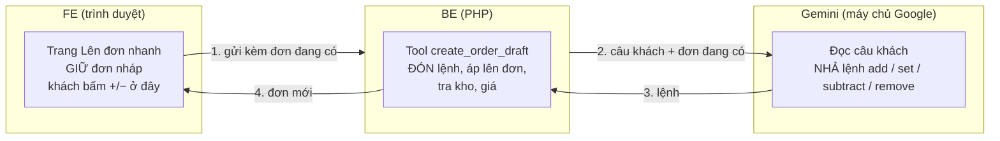
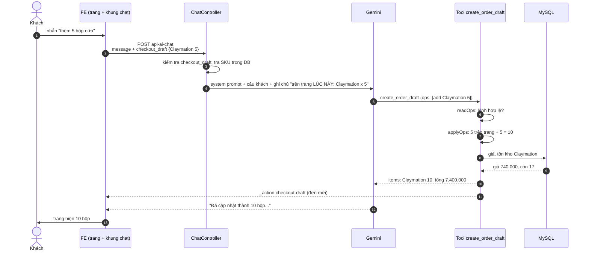
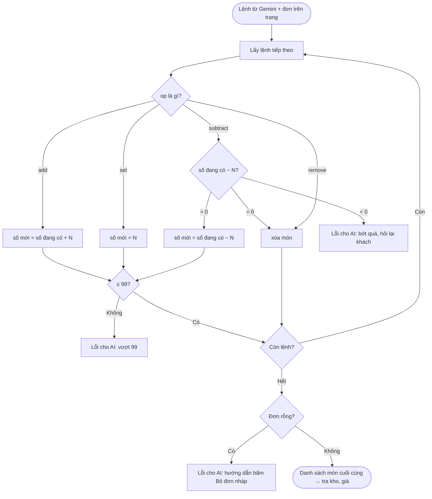
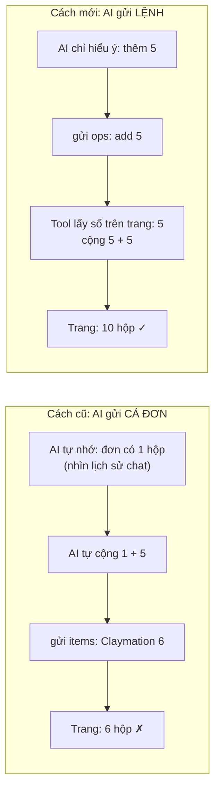

# 13. Giải thích dễ hiểu: tool lên đơn nhanh chạy thế nào

> Dành cho người mới, đọc file này **trước** các file chi tiết (04, 11, 12).
> Mọi đoạn code dưới đây là bản **rút gọn** từ code thật để dễ đọc; tên hàm, tên trường giữ đúng như code.

## Tóm tắt cần nhớ

- **Cũ:** Gemini vừa hiểu câu, vừa nhớ trạng thái, vừa tính toán, rồi điền thẳng kết quả. Một bước sai là cả đơn sai.
- **Mới:** Gemini chỉ dịch câu thành **nhãn + số khách nói**. Tool (BE) lấy **trạng thái đơn hiện tại ở FE** rồi áp nhãn để ra kết quả.

Mỗi bên làm đúng phần mình giỏi: **Gemini giỏi hiểu ngôn ngữ, code PHP giỏi nhớ chính xác và tính toán.**

```text
Khách: "thêm 5 hộp nữa"            (trên trang đang có 5 hộp)

CŨ   Gemini: nhớ đơn từ lịch sử (1 hộp) + tự cộng → điền {Claymation 6}     → trang 6 ✗
MỚI  Gemini: dịch câu → {op: "add", quantity: 5}
     Tool:   trạng thái ở FE (5) + nhãn add + số 5 → 10                       → trang 10 ✓
```

## 1. Vì sao tool này "lú" hơn tool hát và tool tìm sản phẩm?

Cả ba tool chạy cùng một cơ chế: **Gemini nhả nhãn (JSON), BE đón nhãn rồi chạy code PHP**. Khác nhau ở chỗ tool lên đơn phải **nhớ trạng thái**.

| Tool | Khách nói | Gemini nhả nhãn | Có cần biết "trước đó có gì" không? |
| --- | --- | --- | --- |
| `search_product` | "tìm pomade" | `{keyword: "pomade"}` | **Không**. Lần tìm nào cũng độc lập |
| `fule_sing` | "hát bài Vì con" | `{song: "Vì con"}` | **Không**. Bài nào cũng độc lập |
| `create_order_draft` | "thêm 5 hộp nữa" | `{ops: [{op: "add", sku, quantity: 5}]}` | **Có**. "Thêm 5" chỉ có nghĩa khi biết đang có bao nhiêu hộp |

Thêm một điều làm khó: khách còn **tự bấm +/− trên trang**, ngoài cuộc chat. Nên "đang có bao nhiêu hộp" không nằm trong lịch sử chat mà nằm trên trang.

> Quy tắc nhớ: tool **chỉ đọc** dữ liệu (tìm, hát) thì AI gửi tham số là đủ. Tool **thay đổi trạng thái** (đơn, giỏ, lịch hẹn) thì AI chỉ gửi **lệnh thay đổi**, BE giữ trạng thái và tự tính.

## 2. Hình dung bằng quán ăn

| Quán ăn | Hệ thống |
| --- | --- |
| Khách gọi món | Khách nhắn chat |
| **Người phục vụ** nghe rồi ghi phiếu `+5 phần` | **Gemini** đọc câu rồi nhả lệnh `{op: add, quantity: 5}` |
| **Bếp** nhận phiếu, xem bàn đang có 5 phần, cộng thành 10, kiểm tra nguyên liệu | **Tool** (code PHP) nhận lệnh, lấy đơn trên trang (5), cộng thành 10, kiểm tra kho |
| Bàn ăn (khách thấy món trên bàn) | Trang "Lên đơn nhanh" (khách thấy đơn nháp) |

Người phục vụ **không tự tính tổng**, chỉ ghi đúng điều khách nói. Lỗi cũ "6 hộp" giống người phục vụ tự ghi phiếu "bàn này 6 phần" vì nhớ nhầm bàn chỉ có 1 phần (khách đã tự lấy thêm mà người phục vụ không thấy).

## 3. Ba nhân vật và ai giữ cái gì



| Nhân vật | Làm | Không làm |
| --- | --- | --- |
| FE | Giữ đơn nháp (nguồn đúng duy nhất), gửi kèm mỗi lượt chat, hiện đơn mới | Không tính giá |
| Gemini | Hiểu câu khách, chọn lệnh, viết câu trả lời | **Không cộng trừ**, không giữ đơn |
| Tool (BE) | Kiểm tra lệnh, cộng trừ, tra kho và giá | Không lưu DB, không tạo đơn thật |

## 4. Một lượt chat từ đầu đến cuối

Tình huống: trang đang có **Claymation 5 hộp** (khách vừa bấm + từ 1 lên 5), khách nhắn **"thêm 5 hộp nữa"**.



Bước 5 là chỗ quan trọng nhất: Gemini **chỉ** nói `add 5`. Con số 10 do bước 7 (code PHP) tính.

## 5. Code mẫu từng bước

### Bước 1. FE gửi kèm đơn đang có (`FE/src/helpers/ai/checkoutDraft.js`)

```js
// Mỗi lần chat, gửi kèm đơn nháp khách đang thấy: chỉ SKU + số lượng.
export function getCheckoutDraftForChat() {
  const draft = checkoutDraft.value
  if (!draft) return null
  return {
    items: draft.items.map((item) => ({ sku: item.sku, quantity: item.quantity })),
  }
}
```

Body gửi lên:

```json
{
  "message": "thêm 5 hộp nữa",
  "conversation_id": 34,
  "checkout_draft": { "items": [{ "sku": "CLAYMATION-113G", "quantity": 5 }] }
}
```

### Bước 2. ChatController đưa đơn cho cả Gemini và tool (`BE/controllers/ChatController.php`, rút gọn)

```php
// Kiểm tra định dạng, rồi tra SKU trong DB: chỉ SKU có thật, tên lấy từ DB.
$draftLines = $this->describeDraftItems($checkoutDraft['items']);
// → [['sku' => 'CLAYMATION-113G', 'name' => 'Sáp ... Hũ 113g', 'quantity' => 5]]

$systemPrompt .= GeminiPrompt::checkoutDraftContext($draftLines);   // cho Gemini biết đơn đang có

$result = (new Gemini($systemPrompt))
    ->addTool(new GeminiToolCreateOrderDraft())
    ->chat(
        $message . GeminiPrompt::checkoutDraftReminder($draftLines),   // ghi chú gắn ngay sau câu khách
        $history,
        ['user_id' => $userId, 'checkout_draft' => $draftLines,        // context: tool dùng làm GỐC
         'checkout_draft_dropped' => $draftDropped]                    // số món trên trang đã ngừng bán (mục 5b)
    );
```

Đơn trên trang đi **ba đường**: vào system prompt, vào ghi chú sau câu khách (để Gemini chọn đúng lệnh), và vào `context` (để tool cộng trừ). Ghi chú không được lưu vào lịch sử chat.

### Bước 3. Gemini nhả lệnh

Gemini đọc "thêm 5 hộp nữa" và trả về (đây là JSON thật từ Gemini, không phải code mình viết):

```json
{
  "functionCall": {
    "name": "create_order_draft",
    "args": { "ops": [{ "op": "add", "sku": "CLAYMATION-113G", "quantity": 5 }] }
  }
}
```

Gemini biết có những lệnh nào là nhờ phần "giới thiệu" trong class tool:

```php
public function parameters()
{
    return [
        'type' => 'object',
        'properties' => [
            'ops' => [
                'type' => 'array',
                'items' => [
                    'type' => 'object',
                    'properties' => [
                        'op'       => ['type' => 'string', 'enum' => ['add', 'set', 'subtract', 'remove']],
                        'sku'      => ['type' => 'string'],
                        'quantity' => ['type' => 'integer'],
                    ],
                    'required' => ['op', 'sku'],
                ],
            ],
        ],
        'required' => ['ops'],
    ];
}
```

### Bước 4. Tool đón lệnh (`BE/geminiServices/GeminiToolCreateOrderDraft.php`, rút gọn)

```php
public function execute($args = [], $context = [])
{
    // Gốc: đơn khách đang thấy trên trang (rỗng nếu chưa có đơn nháp).
    $pageDraft = $context['checkout_draft'] ?? [];

    $ops   = $this->readOps($args['ops'] ?? null);          // 4a. kiểm tra lệnh
    $items = $this->applyOps($ops, $pageDraft)['items'];    // 4b. áp lệnh → số cuối cùng

    // 4c. tra giá, tồn kho thật trong DB; thiếu kho thì trả problems, không mở trang
    // 4d. trả kết quả: cho AI (tóm tắt) và cho FE (_action checkout-draft)
}
```

#### 4a. `readOps`: lệnh có hợp lệ không?

```php
foreach ($rawOps as $rawOp) {
    if (!in_array($rawOp['op'], ['add', 'set', 'subtract', 'remove'], true)) {
        throw new InvalidArgumentException('op chỉ nhận add, set, subtract hoặc remove.');
    }
    // sku là chuỗi 1-100 ký tự; quantity là số nguyên 1-99 (remove không cần; add thiếu số thì là 1)
}
```

Ném `InvalidArgumentException` thì Gemini nhận đúng câu báo lỗi đó và tự sửa lệnh.

#### 4b. `applyOps`: trái tim của tool

```php
// Đơn đang làm việc: bắt đầu từ đơn trên trang. Ví dụ ['claymation-113g' => 5]
$draft = /* chép từ $pageDraft */;

foreach ($ops as $op) {                              // áp đúng thứ tự khách nói
    $current = $draft[$op['sku']] ?? 0;              // món chưa có thì là 0

    if ($op['op'] === 'add')      $draft[$op['sku']] = $current + $op['quantity'];   // 5 + 5 = 10
    if ($op['op'] === 'set')      $draft[$op['sku']] = $op['quantity'];
    if ($op['op'] === 'subtract') $draft[$op['sku']] = $current - $op['quantity'];   // = 0 thì bỏ món, < 0 thì báo lỗi
    if ($op['op'] === 'remove')   unset($draft[$op['sku']]);
}
// Kiểm tra sau cùng: đơn không rỗng, mỗi món ≤ 99, tối đa 10 món.
```

Món khách **không nhắc tới** thì không có lệnh nào đụng vào, nên tự giữ nguyên. Đây là lý do AI không cần gửi lại cả đơn.



### Bước 5. Kết quả trả về

Cho **Gemini** (để viết câu trả lời đúng số):

```json
{
  "ready": true,
  "items": [{ "name": "Sáp Vuốt Tóc Hanz de Fuko Claymation - Hũ 113g", "quantity": 10, "line_total": 7400000 }],
  "total_amount": 7400000,
  "message": "Đơn nháp đã mở trên website với ĐÚNG các món và số lượng trong items (báo khách theo số này)..."
}
```

Cho **FE** (trong `actions` của response), FE thay đơn nháp rồi hiện lên trang:

```js
// FE/src/helpers/ai/chatAssistant.js
if (action?.type === 'checkout-draft') {
  if (setCheckoutDraft(action.draft)) return { name: 'ai-checkout' }
}
```

### Bước 5b. Hai trường hợp đặc biệt trong một lượt

**Gemini gọi tool 2 lần trong cùng một lượt.** Ví dụ khách nói "thêm 1 Layrite và 1 Suavecito", Gemini có thể gửi 2 lời gọi riêng. FE chỉ nhận đơn của **lần gọi cuối**, nên lần 2 phải áp tiếp lên kết quả lần 1, không quay lại đơn trên trang:

```php
private $workingDraft = null;   // đơn làm việc của lượt này

$base = $this->workingDraft ?? $context['checkout_draft'];   // lần đầu: đơn trên trang
// ... applyOps, tra kho ...
$this->workingDraft = /* đơn vừa lên thành công */;            // lần sau áp tiếp lên đây
```

| Trang: Clay 2 | Lần 1: `add Layrite 1` | Lần 2: `add Suavecito 1` | FE nhận |
| --- | --- | --- | --- |
| Không có đơn làm việc | Clay 2, Layrite 1 | Clay 2, Suavecito 1 | **mất Layrite** ✗ |
| Có đơn làm việc | Clay 2, Layrite 1 → ghi nhận | Clay 2, Layrite 1, Suavecito 1 | đủ 3 món ✓ |

Lần gọi lỗi (thiếu kho, lệnh sai) **không** được ghi nhận. Tool được tạo mới mỗi request nên đơn làm việc không lẫn sang lượt sau.

**Món trên trang vừa ngừng bán.** `ChatController` chỉ giữ món còn bán, nên món đó không có trong đơn mới. Để món không biến mất âm thầm, tool báo AI bằng `notes`: "1 món trong đơn nháp trên trang đã ngừng bán... Báo khách biết". Chỉ báo **số món**, không chép SKU do client gửi vào kết quả.

## 6. Bảng lệnh và ví dụ

| Lệnh | Khách nói | `quantity` |
| --- | --- | --- |
| `add` | "mua 2 hộp", "thêm 5 hộp nữa" | Số thêm (không nói số thì 1) |
| `set` | "đổi thành 3", "lấy 3 hộp thôi" | Số cuối cùng |
| `subtract` | "bớt 2" | Số bớt |
| `remove` | "bỏ Vinh Râu" | Không cần |

Trang đang có **Claymation 5, Vinh Râu 3**:

| Khách nói | Gemini gửi | Tool tính ra |
| --- | --- | --- |
| "thêm 5 hộp Claymation" | `add Claymation 5` | Claymation **10**, Vinh Râu 3 |
| "bớt 2 Claymation" | `subtract Claymation 2` | Claymation **3**, Vinh Râu 3 |
| "Vinh Râu lấy 1 thôi" | `set Vinh Râu 1` | Claymation 5, Vinh Râu **1** |
| "bỏ Vinh Râu" | `remove Vinh Râu` | Claymation 5 |
| "bỏ Vinh Râu, thêm 1 Got2b, Claymation để 2 thôi" | `remove Vinh Râu`, `add Got2b 1`, `set Claymation 2` | Claymation 2, Got2b 1 |
| "đổi Claymation sang hũ 56g" | `remove Claymation-113g`, `add Claymation-56g 5` | Claymation 56g 5, Vinh Râu 3 |
| "bớt 5 Claymation" (bớt hết) | `subtract Claymation 5` | Vinh Râu 3 (bỏ Claymation) |
| "bớt 7 Claymation" | `subtract Claymation 7` | **Lỗi** cho AI: đơn chỉ có 5, hỏi lại khách |

Chưa có đơn nháp thì gốc là đơn rỗng: "lấy 2 Claymation" → `add Claymation 2` → Claymation 2.

## 7. Cách cũ và cách mới khác nhau thế nào

Cùng tình huống: lịch sử chat có "đã lên đơn **1 hộp**", khách bấm + lên **5**, rồi nhắn "thêm 5 hộp nữa".



| | Cách cũ (gửi cả đơn) | Cách mới (gửi lệnh) |
| --- | --- | --- |
| Ai giữ trạng thái đơn | AI tự dựng lại từ lịch sử chat | Trang (FE), tool đọc lại mỗi lượt |
| Ai cộng trừ | AI | Code PHP |
| Món khách không nhắc tới | AI phải nhớ gửi lại, dễ quên | Tự giữ nguyên |
| Kết quả test thật | "thêm 5" ra **6** | "thêm 5" ra **10**, "bớt 3" ra **7** |

## 8. Đặt cạnh tool tìm sản phẩm cho dễ so

```php
// search_product: chỉ đọc, không có trạng thái
public function execute($args = [], $context = [])
{
    $keyword = $args['keyword'];                         // Gemini gửi: "pomade"
    $products = /* tìm trong DB theo $keyword */;
    return ['products' => $products, '_action' => /* mở trang danh mục */];
}

// create_order_draft: có trạng thái, cần GỐC từ trang
public function execute($args = [], $context = [])
{
    $pageDraft = $context['checkout_draft'];             // ← khác biệt: đơn khách đang thấy
    $items = $this->applyOps($this->readOps($args['ops']), $pageDraft);
    /* tra kho, giá trên $items */
    return ['items' => /* tóm tắt */, '_action' => /* checkout-draft */];
}
```

Khác biệt nằm ở **một dòng**: tool lên đơn cần `$context['checkout_draft']` làm gốc, hai tool kia không cần.

## 9. Tự kiểm tra hiểu bài

1. Trong lượt "thêm 5 hộp nữa", con số 10 do ai tính? → Code PHP (`applyOps`), không phải Gemini.
2. Khách không nhắc tới Vinh Râu, sao đơn mới vẫn còn Vinh Râu? → Không có lệnh nào đụng vào Vinh Râu, nên nó giữ nguyên từ đơn trên trang.
3. Gemini gửi `subtract Claymation 7` khi chỉ có 5 thì sao? → Tool trả lỗi, Gemini hỏi lại khách. Trang không đổi.
4. Đơn nháp có được lưu vào DB không? → Không. Đơn thật chỉ tạo khi khách bấm "Xác nhận đặt hàng".
5. Vì sao tool hát không cần thiết kế lệnh? → Mỗi lần hát độc lập, không có trạng thái để nhớ.
6. Có 2 hộp, khách nói "bớt 2" thì sao? → Bớt đúng bằng số đang có nghĩa là hết món, tool bỏ món đó. Chỉ bớt **quá** số đang có mới báo lỗi.
7. Gemini gọi tool 2 lần trong một lượt thì lần 2 tính từ đâu? → Từ đơn làm việc mà lần 1 đã ghi nhận, không quay về đơn trên trang.

## 10. Đọc tiếp

| Muốn biết | File |
| --- | --- |
| Tham số, câu báo lỗi, thuật toán đầy đủ | [04-tool-be.md](04-tool-be.md) |
| Đồng bộ trang và chat, lỗi "6 hộp" và các lần thử | [11-dong-bo-don-nhap.md](11-dong-bo-don-nhap.md) mục 6 |
| JSON thật từng bước qua 3 kịch bản | [12-mo-phong-json.md](12-mo-phong-json.md) |
| Kết quả test script và Chrome | [09-kiem-thu.md](09-kiem-thu.md) mục 1.7 |
