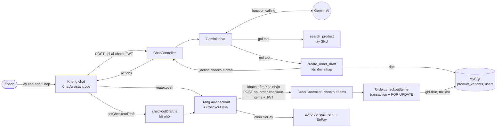

# Tính năng "Lên đơn nhanh cho quý ông" (tool `create_order_draft`)

Bộ tài liệu riêng cho tính năng **trợ lý AI Louis Dé Fule lên đơn hàng giúp khách** ngay trong khung chat.

Đây là tool quan trọng nhất của trợ lý: các tool khác chỉ **đọc** dữ liệu (tìm sản phẩm, hát), còn tool này dẫn tới việc **tạo đơn hàng thật, trừ tồn kho và thu tiền**. Vì vậy thiết kế được làm rất chặt: AI chỉ được lên **đơn nháp**, đơn thật chỉ được tạo khi **chính khách bấm xác nhận**.

> Tài liệu chung của chức năng chat (kiến trúc, bảng lịch sử, tool tìm sản phẩm...) nằm ở thư mục cha [`docs/chat-ai/`](../README.md). Bộ này chỉ nói về lên đơn.

## Mục lục

| File | Nội dung | Đọc khi |
| --- | --- | --- |
| [01-nghiep-vu.md](01-nghiep-vu.md) | Mục tiêu, nguyên tắc, các tình huống của khách, vòng đời đơn nháp | Muốn hiểu tính năng làm gì, vì sao làm vậy |
| [02-kien-truc.md](02-kien-truc.md) | Thành phần BE/FE, bản đồ file code, các quyết định thiết kế | Muốn biết code nằm đâu, nối với nhau thế nào |
| [03-luong-xu-ly.md](03-luong-xu-ly.md) | Sơ đồ tuần tự cho **mọi** tình huống: thành công, thiếu thông tin, hết hàng, COD, SePay, giá đổi, đăng xuất | Cần vẽ/giải thích luồng chạy |
| [04-tool-be.md](04-tool-be.md) | Tool `create_order_draft`: tham số, kiểm tra, thuật toán, 4 dạng kết quả | Sửa hoặc giải thích phần AI gọi tool |
| [05-api-xac-nhan.md](05-api-xac-nhan.md) | API `api-order-checkout-items`: contract, validate, transaction, khóa dòng, đối chiếu giá | Sửa hoặc giải thích phần tạo đơn thật |
| [06-frontend.md](06-frontend.md) | Kho đơn nháp, khung chat, trang `/ai-checkout`, hiệu ứng, xác nhận | Sửa giao diện |
| [07-prompt.md](07-prompt.md) | Các quy tắc trong system prompt dạy Louis dùng tool này | AI gọi sai tool, nói sai |
| [08-bao-mat.md](08-bao-mat.md) | Mô hình rủi ro, các lớp bảo vệ, dòng chảy dữ liệu cá nhân, **các chốt chặn BE khi FE bị sửa (F12)** | Trả lời câu hỏi an toàn |
| [09-kiem-thu.md](09-kiem-thu.md) | Những gì đã kiểm tra, danh sách test tay, cách tự kiểm tra | Trước khi bàn giao/bảo vệ |
| [10-van-dap.md](10-van-dap.md) | Câu hỏi thường gặp khi bảo vệ, trả lời ngắn | Chuẩn bị vấn đáp |
| [11-dong-bo-don-nhap.md](11-dong-bo-don-nhap.md) | **Đồng bộ đơn nháp giữa trang và Louis** để tăng trải nghiệm: khách sửa trên trang thì Louis biết ở lượt sau | Muốn hiểu vì sao Louis nhớ chỉnh sửa của khách |
| [12-mo-phong-json.md](12-mo-phong-json.md) | **Mô phỏng JSON từng bước** qua 3 kịch bản (lên đơn + COD, thiếu SĐT, sửa trên trang + giá đổi 409): request/response, payload Gemini, kết quả tool, lượt lưu DB | Cần chỉ ra chính xác dữ liệu nào đi đâu |

## Tóm tắt một đoạn

Khách nhắn "lấy cho anh 2 hũ Claymation" → Louis (Gemini) gọi `search_product` để lấy SKU, rồi gọi `create_order_draft` → server tra **giá, tồn kho thật** trong DB và gửi **đơn nháp chỉ gồm món** cho FE qua lệnh `checkout-draft` → FE giữ đơn nháp trong bộ nhớ, mở trang **"Lên đơn nhanh cho quý ông"**, **tự lấy tên, SĐT, địa chỉ từ hồ sơ qua `api-profile`** (Louis không hỏi, AI không thấy), chạy hiệu ứng Louis tự điền đơn (bỏ qua ô trống) → khách điền ô còn trống, chỉnh số lượng/thông tin (mỗi chỉnh sửa được gửi kèm lượt chat sau, nên Louis lên đơn tiếp từ đúng trạng thái khách thấy), chọn COD hoặc SePay, bấm **"Xác nhận đặt hàng"** → FE gọi `api-order-checkout-items` → server **khóa dòng, tính lại giá, đối chiếu tổng tiền**, tạo đơn và trừ kho trong một transaction.

## Sơ đồ tổng quan

## Bốn nguyên tắc cốt lõi (nhớ 4 câu này là giải thích được cả tính năng)

1. **AI không bao giờ tạo đơn.** Tool chỉ lên đơn nháp, không ghi DB. Đơn thật do khách bấm xác nhận.
2. **Server không tin dữ liệu từ AI hay FE.** ID khách lấy từ JWT; giá, tồn kho lấy từ DB và tính lại lúc xác nhận; mọi tham số đều được kiểm tra. FE có bị sửa bằng F12 cũng không qua được các chốt chặn BE: xem [08-bao-mat.md, mục 4](08-bao-mat.md).
3. **Thông tin cá nhân tách hẳn khỏi luồng AI.** Tool, `_action`, `api-ai-chat`, prompt, lịch sử chat đều **không** chứa tên, SĐT, địa chỉ. FE tự lấy từ `api-profile`, khách sửa trên form, gửi thẳng tới API xác nhận. Louis không hỏi thông tin cá nhân trong chat.
4. **Trang và Louis luôn khớp nhau (trải nghiệm).** Khách bấm + / − trên trang, lượt chat sau Louis lên đơn từ đúng số lượng đó; thông tin người nhận khách sửa được FE tự giữ sang đơn mới. Xem [11-dong-bo-don-nhap.md](11-dong-bo-don-nhap.md).

## Thuật ngữ

| Thuật ngữ | Giải thích |
| --- | --- |
| Đơn nháp (draft) | Bản xem trước của đơn hàng: món, số lượng, giá, người nhận. **Chưa** nằm trong DB, chưa trừ kho. |
| Đơn thật | Dòng trong bảng `orders` + `order_details`, đã trừ tồn kho. Chỉ được tạo qua `api-order-checkout-items`. |
| SKU | Mã của một **phiên bản** sản phẩm (ví dụ `CLAYMATION`), duy nhất trong bảng `product_variants`. |
| Phiên bản (variant) | Một lựa chọn cụ thể của sản phẩm: "Hũ 56g", "Chai 100ml". Giá và tồn kho nằm ở đây. |
| Tool | Hàm PHP mà AI được phép yêu cầu server chạy. AI không tự đọc DB. |
| `_action` | Key đặc biệt trong kết quả tool, chứa lệnh cho FE. Server tách nó ra trước khi gửi cho AI. |
| `checkout-draft` | Loại lệnh mới: "đây là đơn nháp, hãy mở trang lên đơn". |
| `expected_total` | Tổng tiền khách đang thấy. Server chỉ dùng để **phát hiện giá đã đổi**, không dùng để tính tiền. |
| `FOR UPDATE` | Câu SQL khóa các dòng đang đọc tới hết transaction, để hai người không mua trùng một món cuối. |
| JWT / `sub` | Token đăng nhập. Claim `sub` là ID user, server dùng nó thay vì tin ID do client gửi. |
| COD / SePay | Thanh toán khi nhận hàng / thanh toán online qua cổng SePay. |

## Bản đồ file code

| Phía | File | Vai trò |
| --- | --- | --- |
| BE | `BE/geminiServices/GeminiToolCreateOrderDraft.php` | Tool lên đơn nháp |
| BE | `BE/geminiServices/GeminiPrompt.php` | Quy tắc dạy Louis dùng tool; `checkoutDraftContext()` mô tả đơn nháp đang mở |
| BE | `BE/controllers/ChatController.php` | Đăng ký tool, truyền `user_id` từ JWT; đọc `checkout_draft` (chỉ món), ghép đơn nháp vào prompt của lượt |
| BE | `BE/models/Product.php` → `getActiveVariantsBySkus()` | Tra phiên bản theo SKU |
| BE | `BE/controllers/ProfileController.php` → `api-profile` | FE gọi để lấy tên, SĐT, địa chỉ điền form (có sẵn) |
| BE | `BE/controllers/OrderController.php` → `checkoutItems()` | API xác nhận đơn |
| BE | `BE/models/Order.php` → `checkoutItems()`, `insertOrderRows()` | Tạo đơn trong transaction |
| BE | `BE/routes/index.php` → `api-order-checkout-items` | Route, bắt đăng nhập |
| FE | `FE/src/helpers/ai/checkoutDraft.js` | Kho đơn nháp (sessionStorage, khóa theo user): `setCheckoutDraft`, `ensureDraftRecipient` (lấy hồ sơ một lần), `syncCheckoutDraft`, `getCheckoutDraftForChat` |
| FE | `FE/src/helpers/ai/chatAssistant.js` | Nhận lệnh `checkout-draft`, mở trang |
| FE | `FE/src/components/chat/ChatAssistant.vue` | Xóa đơn nháp khi đăng xuất |
| FE | `FE/src/views/ai/AiCheckout.vue` | Trang "Lên đơn nhanh cho quý ông" |
| FE | `FE/src/router/index.js` → route `ai-checkout` | Route, cần đăng nhập |
