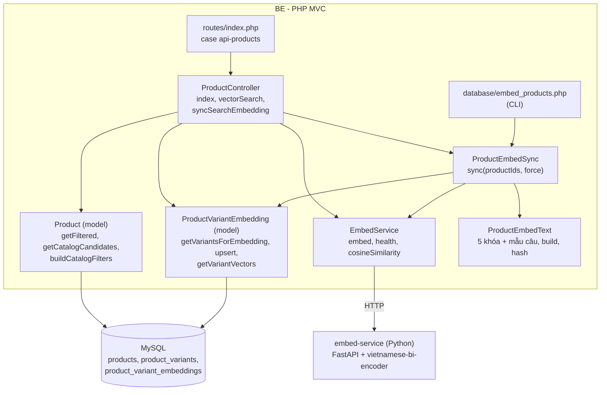
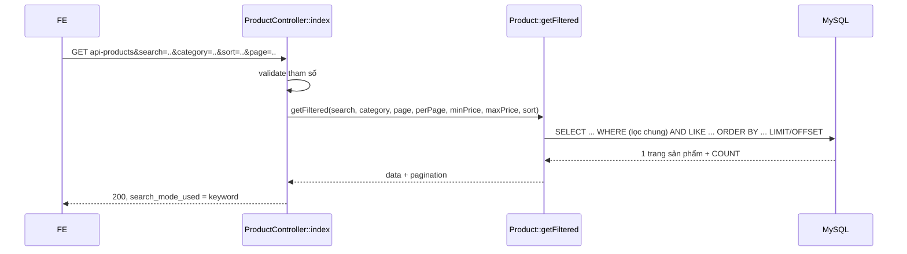
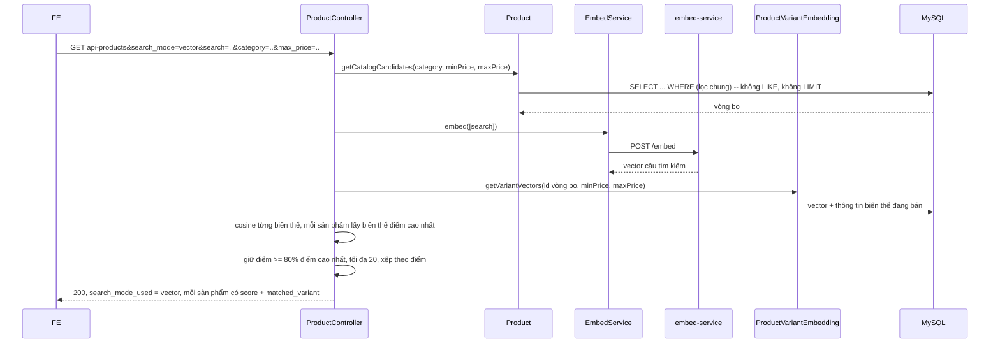
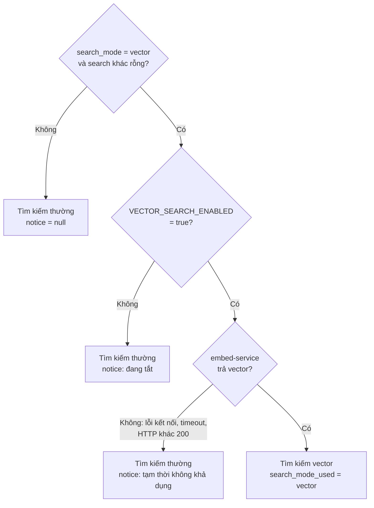
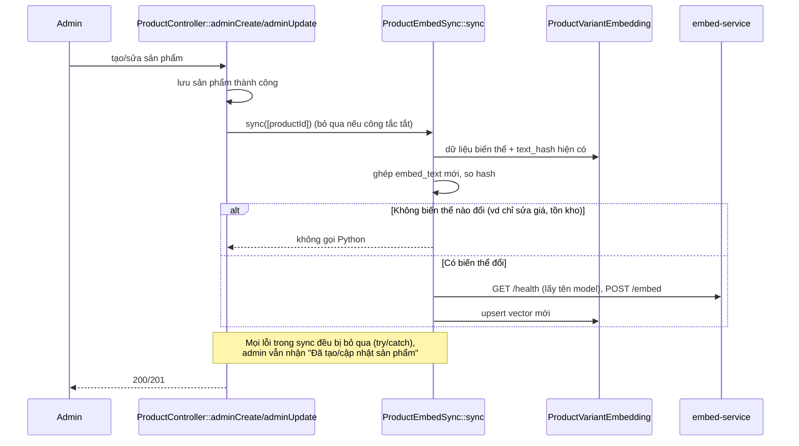

# 01. Kiến trúc

## 1. Các thành phần

## 2. Phân tầng

| Tầng | Thành phần | Được làm | Không được làm |
| --- | --- | --- | --- |
| Router | `routes/index.php` | Gọi `ProductController::index` | Truy vấn DB |
| Controller | `ProductController` | Đọc/validate query, chọn chế độ, chấm điểm, cắt ngưỡng, trả JSON | Viết SQL |
| Service | `EmbedService`, `ProductEmbedText`, `ProductEmbedSync` | Gọi server Python, ghép đoạn văn, tính cosine, điều phối đồng bộ | Viết SQL, đọc `$_GET` |
| Model | `Product`, `ProductVariantEmbedding` | SQL với prepared statement | Gọi server Python, trả HTTP |
| Python | `embed-service` | Tách từ, chạy model, trả vector | Đọc DB |

## 3. Luồng tìm kiếm thường (`search_mode` không gửi hoặc `keyword`)

Giống hệt trước đây, chỉ thêm lọc giá và sắp xếp:

## 4. Luồng tìm kiếm vector (`search_mode=vector`, có `search`)

Vì sao **không phân trang** ở chế độ vector: SQL không biết điểm vector. Nếu `LIMIT 8` trước thì vector chỉ chấm điểm 8 sản phẩm đầu theo id, sản phẩm liên quan nhất có thể nằm ở trang sau và không bao giờ được xét. Kết quả vector đã bị cắt còn tối đa 20 nên trả cả danh sách là đủ.

Vì sao **không sắp xếp lại** theo giá: danh sách vector là "đề xuất theo mức liên quan". Thứ tự liên quan chính là giá trị của nó.

## 5. Luồng lùi về tìm kiếm thường

Trường hợp `search` rỗng: không có gì để so nghĩa, nên dùng tìm kiếm thường và **không** có `notice` (không phải lỗi).

## 6. Luồng đồng bộ vector khi admin lưu sản phẩm

Nếu server Python tắt lúc admin đổi tên/mô tả, sản phẩm đó tạm có vector cũ (hoặc chưa có vector, nếu là sản phẩm mới) cho tới khi chạy lại `php BE/database/embed_products.php`.

## 7. Quyết định thiết kế

| Quyết định | Lý do |
| --- | --- |
| Server Python riêng, không chạy model trong PHP | Model chỉ chạy được bằng Python. Server giữ model trong RAM (~540 MB) nên mỗi lần encode chỉ vài chục ms; gọi `exec("python ...")` mỗi request phải nạp lại model mất vài giây. |
| Embed theo **biến thể**, gom theo sản phẩm khi trả | Hai biến thể của cùng sản phẩm có thể khác đặc điểm (bản bóng / bản không bóng). Giỏ hàng, đơn hàng đều làm theo SKU, nên biết biến thể khớp là có SKU ngay. |
| Lọc vòng bo bằng SQL trước, vector sau | Lọc danh mục/giá cần chính xác tuyệt đối, SQL làm tốt. Vector chỉ cần xếp hạng trong tập nhỏ. |
| Ngưỡng tương đối 80%, tối đa 20 | Vector không tự loại sản phẩm nào. Ngưỡng tương đối tự co giãn: câu rõ ràng ra ít kết quả, câu chung chung giữ nhiều hơn. |
| Bảng vector riêng, không thêm cột vào `products`/`product_variants` | Vector là dữ liệu suy ra, xóa đi tạo lại được; đổi model không ảnh hưởng bảng chính. |
| Lưu vector dạng JSON | MySQL 8.0.30 chưa có kiểu `VECTOR`. Vài trăm biến thể thì đọc JSON rồi tính cosine trong PHP vẫn nhanh. |
| So `text_hash` trước khi gọi Python | Sửa giá/tồn kho không đổi đoạn văn nên không tốn request, admin không bị chậm, không phụ thuộc server Python. |
| Lỗi Python thì lùi về tìm thường, không trả 503 | Tìm kiếm thông minh là phần phụ; trang sản phẩm là phần chính, không được hỏng. |
| **Không** làm tìm kết hợp (cộng điểm từ khóa) | Quyết định của nhóm: chất lượng kém là do model; nếu cần thì đổi model mạnh hơn (xem [04-van-hanh.md, mục 5](04-van-hanh.md)). |
