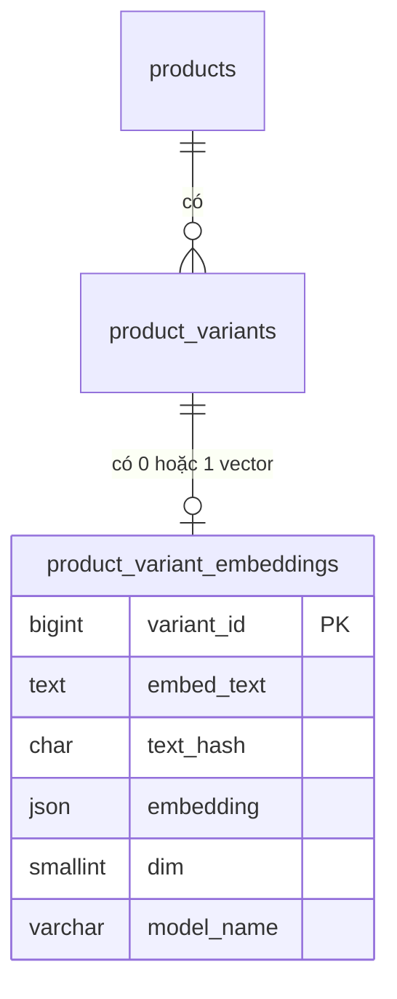

# 03. Dữ liệu

## 1. Bảng `product_variant_embeddings`

Migration: `BE/database/migrations/20261119_01_create_product_variant_embeddings_table.sql` (chạy lặp được nhờ `IF NOT EXISTS`).

| Cột | Kiểu | Ý nghĩa |
| --- | --- | --- |
| `variant_id` | BIGINT UNSIGNED, **khóa chính**, FK → `product_variants.id` (`ON DELETE CASCADE`) | Mỗi biến thể một dòng. Xóa biến thể thì xóa luôn vector. |
| `embed_text` | TEXT | Đoạn văn đã ghép để tạo vector |
| `text_hash` | CHAR(64) | SHA-256 của `embed_text` |
| `embedding` | JSON (CHECK là mảng) | Vector, mảng 768 số thực |
| `dim` | SMALLINT UNSIGNED | Số chiều (hiện tại 768) |
| `model_name` | VARCHAR(150) | Model đã tạo vector |
| `created_at`, `updated_at` | TIMESTAMP | Tự động |



Đây là **dữ liệu suy ra**: xóa cả bảng vẫn tạo lại được bằng `php BE/database/embed_products.php`.

## 2. Quy ước `product_variants.attributes` (JSON "dẻo")

Cột `attributes` đã có sẵn (JSON object). Tính năng này **tận dụng** nó, không thêm cột mới.

- **Khóa**: không dấu, chữ thường, `snake_case` (chỉ `a-z`, `0-9`, `_`). Lý do: chữ có dấu có thể lưu theo 2 kiểu Unicode (NFC/NFD), nhìn giống nhau nhưng máy coi là khác; khóa không dấu tránh được.
- **Giá trị**: tiếng Việt có dấu, viết tự nhiên.
- **Luôn có đủ 5 khóa mặc định**; chưa rõ hoặc không áp dụng thì để `null`.
- Ngoài 5 khóa đó được thêm **khóa tự do** (vd `mui_huong`, `xuat_xu`).
- Không lọc SQL theo các khóa này; chúng chỉ phục vụ tìm kiếm vector (và hiển thị).

### 5 khóa mặc định (định nghĩa duy nhất ở `ProductEmbedText::DEFAULT_ATTRIBUTES`)

| Khóa | Nhãn | Mẫu câu khi ghép | Ví dụ giá trị |
| --- | --- | --- | --- |
| `dung_tich` | Dung tích | `Dung tích {v}.` | `113g` |
| `do_giu_nep` | Độ giữ nếp | `Độ giữ nếp {v}.` | `nhẹ`, `trung bình`, `mạnh`, `rất mạnh` |
| `do_bong` | Độ bóng | `Độ bóng: {v}.` | `không bóng`, `bóng nhẹ`, `bóng vừa`, `bóng cao` |
| `phu_hop` | Phù hợp với | `Phù hợp với {v}.` | `tóc dày, tóc rễ tre` |
| `kieu_toc` | Kiểu tóc | `Hợp kiểu tóc {v}.` | `side part, pompadour` |
| *khóa tự do* | | `{v}.` | `mùi cam chanh` |

Viết giá trị sao cho ghép vào mẫu câu đọc xuôi: `kieu_toc` ghi `"dựng đứng, mohican"`, **không** ghi `"tóc dựng đứng"` (sẽ thành "Hợp kiểu tóc tóc dựng đứng").

Ví dụ một biến thể:

```json
{"dung_tich": "113g", "do_giu_nep": "mạnh", "do_bong": "bóng vừa",
 "phu_hop": "tóc dày, tóc cứng, tóc rễ tre", "kieu_toc": "side part, pompadour"}
```

## 3. Cách ghép `embed_text` (`ProductEmbedText::build`)

Thứ tự cố định (cùng dữ liệu luôn ra cùng đoạn văn, nhờ đó `text_hash` ổn định):

1. `{tên sản phẩm} - {tên biến thể}.` (bỏ tên biến thể nếu là `Mặc định`)
2. `Danh mục: {tên danh mục}.`
3. `{mô tả sản phẩm}` (thêm dấu chấm nếu thiếu)
4. 5 khóa mặc định theo mẫu câu; giá trị `null`/rỗng thì **bỏ cả câu**
5. Khóa tự do, sắp theo tên khóa, chỉ lấy giá trị

**Không** đưa vào: giá, giá giảm, tồn kho, lượt xem, lượt bán, SKU, mã sản phẩm.

Ví dụ kết quả:

> Pomade Reuzel Blue Strong Hold - Hũ 113g. Danh mục: Pomade. Pomade gốc nước của Reuzel, giữ nếp mạnh, độ bóng vừa. Hợp kiểu side part, pompadour cần đứng nếp cả ngày, dễ gội sạch. Dung tích 113g. Độ giữ nếp mạnh. Độ bóng: bóng vừa. Phù hợp với tóc dày, tóc cứng, tóc rễ tre. Hợp kiểu tóc side part, pompadour.

Muốn thêm/đổi khóa mặc định: sửa **chỉ** `ProductEmbedText::DEFAULT_ATTRIBUTES`, rồi chạy `embed_products.php` (hash đổi nên vector tự được tạo lại).

## 4. Đặc điểm chung ở đâu, đặc điểm riêng ở đâu

| Thông tin | Đặt ở | Ví dụ |
| --- | --- | --- |
| Đặc điểm chung của sản phẩm | `products.description` | "Pomade gốc nước, giữ nếp mạnh..." |
| Đặc điểm riêng của biến thể | `product_variants.variant_name` + `attributes` | Bản Matte: `"do_bong": "không bóng"` |
| Giá, tồn kho | cột riêng của `product_variants` | lọc/sắp xếp bằng SQL |

Nếu sau này cần mô tả dài cho từng biến thể, có thể thêm cột `product_variants.description` (cho phép NULL) bằng migration mới và ghép vào `build()`. Hiện chưa cần.

## 5. Seed demo `products_search_attributes.sql`

- Viết lại `description` và điền 5 khóa cho biến thể của 6 sản phẩm: `CLAYMATION`, `GOT2B-GLUED`, `POMADE-REUZEL-RED`, `POMADE-REUZEL-BLUE`, `POMADE-SUAVECITO-ORIGINAL` (thêm `mui_huong`), `POMADE-LAYRITE-ORIGINAL`.
- **Không** sửa sản phẩm `HOANG-VINH-01`, giá, tồn kho, tên biến thể. `dung_tich` đang có thì giữ (`JSON_INSERT`), chưa có thì thêm `null`.
- Chạy lặp được. Tên file bắt đầu bằng `products_` để chạy **sau** `catalog_product_variants.sql` khi dùng `run.php --seed`.
- Chạy seed xong phải chạy `embed_products.php` để tạo lại vector.

> Tác động phụ: `ProductDetail.vue` và `CartView.vue` đang in **toàn bộ** giá trị `attributes` cạnh tên biến thể (`Object.values(...).join(' · ')`). Sau seed, dòng này dài ra và có chỗ trống do giá trị `null`. Việc của FE: chỉ hiện `dung_tich` và bỏ qua `null`.
