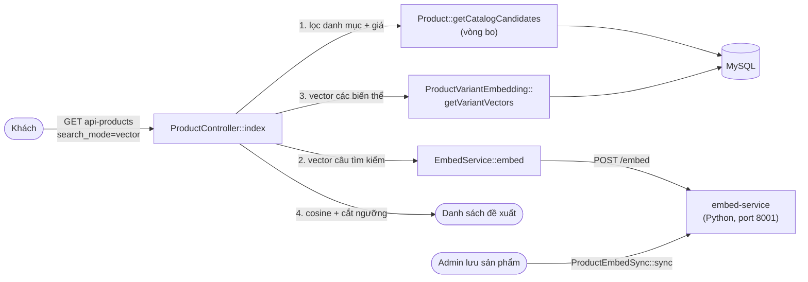

# Tính năng "Tìm kiếm thông minh" (tìm sản phẩm theo nghĩa bằng vector)

Bộ tài liệu riêng cho chế độ **tìm kiếm thông minh** của API danh sách sản phẩm `api-products` (`search_mode=vector`).

Tìm kiếm thường dùng `LIKE`: chỉ ra sản phẩm có **đúng chữ** khách gõ. Tìm kiếm thông minh so **ý nghĩa**: khách gõ "mùi cam chanh" vẫn ra pomade có mô tả "mùi cam chanh dễ chịu", gõ "người mới tập vuốt tóc" vẫn ra sản phẩm "dễ dùng cho người mới", dù câu chữ không trùng hoàn toàn.

> Tính năng này **không** thuộc khung chat Louis. Tool `search_product` của Louis vẫn tìm bằng SQL (xem [../05-tools.md](../05-tools.md)). Bộ tài liệu đặt cạnh [len-don-nhanh/](../len-don-nhanh/README.md) vì cùng là phần dùng AI của dự án.
>
> Hiện trạng: **mới xong phía BE (API)**. FE chưa gọi các tham số mới; trang sản phẩm vẫn chạy như cũ.

## Mục lục

| File | Nội dung | Đọc khi |
| --- | --- | --- |
| [01-kien-truc.md](01-kien-truc.md) | Thành phần, sơ đồ luồng tìm kiếm thường / vector / lùi về thường / đồng bộ vector, bản đồ file, quyết định thiết kế | Muốn biết code nằm đâu, chạy thế nào |
| [02-api.md](02-api.md) | Contract `api-products`: tham số, response 2 chế độ, `matched_variant`, mã lỗi, ví dụ | FE nối API, test bằng Thunder |
| [03-du-lieu.md](03-du-lieu.md) | Bảng `product_variant_embeddings`, quy ước 5 khóa `attributes`, cách ghép đoạn văn, seed | Thêm/sửa dữ liệu sản phẩm |
| [04-van-hanh.md](04-van-hanh.md) | Cài và chạy server Python, tạo vector, công tắc tắt, đổi model, xử lý sự cố | Cài trên máy mới, demo |
| [05-kiem-thu.md](05-kiem-thu.md) | Những gì đã kiểm tra (kết quả thật), giới hạn đã biết | Trước khi bàn giao/bảo vệ |
| [06-van-dap.md](06-van-dap.md) | Câu hỏi thường gặp khi bảo vệ, trả lời ngắn | Chuẩn bị vấn đáp |

## Tóm tắt một đoạn

Mỗi biến thể sản phẩm được ghép thành **một đoạn văn** (tên, danh mục, mô tả, các thuộc tính như độ bóng, độ giữ nếp, hợp tóc nào...). Server Python `embed-service` biến đoạn văn đó thành **vector 768 số** và lưu vào bảng `product_variant_embeddings`. Khi khách tìm với `search_mode=vector`: SQL lọc danh mục + khoảng giá ra **"vòng bo"** (danh sách hẹp) → câu tìm kiếm cũng được biến thành vector → so **cosine** với vector từng biến thể trong vòng bo → giữ sản phẩm có điểm ≥ 80% điểm cao nhất (tối đa 20) → trả **danh sách đề xuất** theo thứ tự liên quan. Server Python lỗi thì API **tự dùng tìm kiếm thường**, trang sản phẩm không bao giờ hỏng vì tính năng này.

## Sơ đồ tổng quan

## Bốn nguyên tắc cốt lõi

1. **Cờ chỉ đổi ô tìm kiếm.** Danh mục, khoảng giá luôn lọc bằng SQL ở cả hai chế độ. Vector chỉ chạy **trong** vòng bo đã lọc.
2. **Không gửi tham số mới thì API như cũ.** FE hiện tại không phải sửa gì.
3. **Vector chết, trang vẫn sống.** Server Python lỗi hoặc công tắc `VECTOR_SEARCH_ENABLED = false` → tự dùng tìm kiếm thường, trả `notice`.
4. **Không đưa dữ liệu thay đổi liên tục vào vector.** Giá, tồn kho, lượt xem, lượt bán không nằm trong đoạn văn; chúng được lọc/sắp xếp bằng SQL.

## Thuật ngữ

| Thuật ngữ | Giải thích |
| --- | --- |
| Embedding / vector | Mảng 768 số thực đại diện cho "ý nghĩa" của một đoạn văn. Hai đoạn gần nghĩa thì hai vector "chỉ cùng hướng". |
| Cosine similarity | Độ giống nhau giữa hai vector, từ -1 đến 1. Càng gần 1 càng giống nghĩa. |
| Vòng bo | Danh sách sản phẩm đã lọc theo danh mục + khoảng giá bằng SQL, trước khi vector chấm điểm. |
| Ngưỡng tương đối | Chỉ giữ sản phẩm có điểm ≥ 80% điểm của sản phẩm đứng đầu. Vector không tự loại sản phẩm nào (ai cũng có điểm), nên phải cắt. |
| `embed_text` | Đoạn văn đã ghép để tạo vector của một biến thể. |
| `text_hash` | Mã SHA-256 của `embed_text`; đổi nghĩa là dữ liệu đã đổi, cần tạo lại vector. |
| `embed-service` | Server Python nhỏ (FastAPI) chạy model, biến câu thành vector. |
| Tách từ (pyvi) | Nối âm tiết của từ ghép bằng dấu `_` ("Hà Nội" → "Hà_Nội"). Model bắt buộc đầu vào đã tách từ; server Python tự làm. |
| Lùi về (fallback) | Muốn dùng vector nhưng không được, API tự dùng tìm kiếm thường thay vì báo lỗi. |

## Bản đồ file code

| Phía | File | Vai trò |
| --- | --- | --- |
| Python | `embed-service/main.py` | FastAPI: `GET /health`, `POST /embed`; nạp model một lần, tách từ bằng pyvi |
| Python | `embed-service/README.md` | Cách cài, chạy, contract của server Python |
| BE | `BE/embedServices/EmbedService.php` | Gọi server Python (`embed`, `health`), tính `cosineSimilarity` |
| BE | `BE/embedServices/ProductEmbedText.php` | **Nơi duy nhất** định nghĩa 5 khóa `attributes` mặc định + mẫu câu; ghép `embed_text`; tính hash |
| BE | `BE/embedServices/ProductEmbedSync.php` | Đồng bộ vector theo `text_hash` (dùng chung cho admin và script) |
| BE | `BE/models/ProductVariantEmbedding.php` | Bảng `product_variant_embeddings`: đọc dữ liệu cần ghép, `upsert`, `getVariantVectors` |
| BE | `BE/models/Product.php` | `getFiltered()` (tìm thường, đã mở rộng), `getCatalogCandidates()` (vòng bo), `buildCatalogFilters()` (lọc dùng chung) |
| BE | `BE/controllers/ProductController.php` | `index()` chọn chế độ, `vectorSearch()`, `syncSearchEmbedding()` gọi sau khi admin tạo/sửa |
| BE | `BE/configs/config.php` | `EMBED_SERVICE_URL`, `VECTOR_SEARCH_ENABLED`, `PATH_EMBED_SERVICE` |
| BE | `BE/index.php` | Autoload thêm thư mục `embedServices/` |
| DB | `BE/database/migrations/20261119_01_create_product_variant_embeddings_table.sql` | Tạo bảng vector |
| DB | `BE/database/seed/products_search_attributes.sql` | Mô tả + 5 khóa `attributes` cho 6 sản phẩm demo |
| DB | `BE/database/embed_products.php` | Script CLI tạo/tạo lại vector (`--force` để làm lại toàn bộ) |
