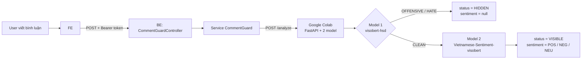

# Kiểm duyệt bình luận bằng AI (Comment Guard)

Tài liệu mô tả phần tích hợp AI kiểm duyệt bình luận: dịch vụ chạy trên Google Colab, service gọi dịch vụ ở BE, API test tạm thời, kết quả kiểm thử và phần tích hợp vào luồng tạo/sửa bình luận.

> **Trạng thái (22/11/2026):**
> - BE: **đã tích hợp** vào `api-comment-create` và `api-comment-update` (mục 8), đã thêm 3 cột nhãn AI vào bảng `comments` và chạy migration trên DB local.
> - API test `api-comment-guard` vẫn còn, sẽ xóa sau khi nhóm test xong.
> - FE: **chưa cập nhật** theo contract mới (kế hoạch ở mục 10).

## Mục lục

1. [Tổng quan](#1-tổng-quan)
2. [Dịch vụ AI trên Google Colab](#2-dịch-vụ-ai-trên-google-colab)
3. [Cấu hình](#3-cấu-hình)
4. [Các file ở BE](#4-các-file-ở-be)
5. [API test `api-comment-guard`](#5-api-test-api-comment-guard)
6. [Kết quả kiểm thử](#6-kết-quả-kiểm-thử)
7. [Nhận xét chất lượng model](#7-nhận-xét-chất-lượng-model)
8. [Tích hợp vào `CommentController`](#8-tích-hợp-vào-commentcontroller)
9. [Rủi ro và lưu ý vận hành](#9-rủi-ro-và-lưu-ý-vận-hành)
10. [Kế hoạch cập nhật FE](#10-kế-hoạch-cập-nhật-fe)

## Thuật ngữ

| Thuật ngữ | Giải thích |
| --- | --- |
| Kiểm duyệt (moderation) | Tự động quyết định một bình luận được hiện hay phải ẩn. |
| HSD (Hate Speech Detection) | Bài toán phát hiện ngôn từ xúc phạm hoặc thù ghét. |
| Sentiment | Cảm xúc của câu: tích cực, tiêu cực hay trung tính. |
| `toxic_prob` | Xác suất (0 đến 1) câu là độc hại, do model 1 tính. |
| Ngưỡng (threshold) | Mốc `toxic_prob` để quyết định ẩn. Colab đang đặt **0.7**. |
| Google Colab | Dịch vụ chạy notebook Python miễn phí của Google, ở đây dùng để chạy 2 model. |
| trycloudflare | Đường hầm (tunnel) miễn phí của Cloudflare, đưa server trong Colab ra một URL công khai. URL đổi mỗi lần chạy lại. |

## 1. Tổng quan



Bình luận chạy qua **model 1** trước. Chỉ khi model 1 cho qua (nhãn `CLEAN`) thì mới chạy tiếp **model 2** để gắn nhãn cảm xúc. Câu bị chặn có `sentiment` và `sentiment_score` là `null`.

## 2. Dịch vụ AI trên Google Colab

| # | Model | Nhiệm vụ | Nhãn |
| --- | --- | --- | --- |
| 1 | `visolex/visobert-hsd` | Kiểm duyệt: phát hiện ngôn từ xúc phạm hoặc thù ghét (HSD = Hate Speech Detection) | `CLEAN` / `OFFENSIVE` / `HATE` |
| 2 | `5CD-AI/Vietnamese-Sentiment-visobert` | Gắn nhãn cảm xúc của bình luận | `POS` (tích cực) / `NEG` (tiêu cực) / `NEU` (trung tính) |

Endpoint của Colab (FastAPI, xem thử trên web ở `<URL>/docs`):

| Method | Đường dẫn | Body | Kết quả |
| --- | --- | --- | --- |
| GET | `/` | – | `{ "status": "ok", "device": "cpu", "toxic_threshold": 0.7 }` |
| POST | `/analyze` | `{ "text": "..." }` | 1 kết quả |
| POST | `/analyze-batch` | `{ "texts": ["...", "..."] }` | `{ "results": [kết quả, ...] }` |

Header `x-api-key` có trong spec nhưng **hiện Colab chưa kiểm tra** (gửi key sai vẫn nhận 200).

Một kết quả có dạng:

```json
{
  "text": "Sản phẩm rất tốt, giao hàng nhanh",
  "status": "VISIBLE",
  "reason": "CLEAN",
  "toxic_prob": 0.017,
  "needs_review": false,
  "sentiment": "POS",
  "sentiment_score": 0.9982
}
```

| Trường | Ý nghĩa |
| --- | --- |
| `status` | `VISIBLE` = cho hiện, `HIDDEN` = nên ẩn. |
| `reason` | Nhãn của model 1: `CLEAN`, `OFFENSIVE` (thô tục), `HATE` (thù ghét, lăng mạ). |
| `toxic_prob` | Xác suất độc hại. Từ 0.7 trở lên thì `HIDDEN`. |
| `needs_review` | `true` = AI không chắc chắn, nên để admin xem lại. Theo kết quả test, cờ bật khi `toxic_prob` khoảng 0.43 đến dưới 0.7 (mốc dưới là ước lượng, Colab không công bố). |
| `sentiment` | Nhãn của model 2. `null` nếu câu đã bị ẩn. |
| `sentiment_score` | Độ tin cậy của nhãn cảm xúc (0 đến 1). |

## 3. Cấu hình

Thêm vào `BE/.env` (tên biến có trong `BE/.env.example`):

```text
COMMENT_GUARD_ENABLED=1
COMMENT_GUARD_URL=https://<ten-tunnel>.trycloudflare.com
COMMENT_GUARD_KEY=
COMMENT_GUARD_TIMEOUT=15
```

| Biến | Ý nghĩa |
| --- | --- |
| `COMMENT_GUARD_ENABLED` | Bật/tắt AI kiểm duyệt khi tạo/sửa bình luận. Nhận `1`/`0`, `true`/`false`, `on`/`off`, `yes`/`no`. Để trống, không khai báo hoặc ghi sai thì mặc định **bật**. Khi tắt: không gọi Colab, bình luận lưu ngay với `status = 0` chờ admin duyệt, nhãn `NULL`. Dùng khi Colab tắt để khách không phải chờ timeout. Sửa xong không cần khởi động lại Apache, vì `.env` được đọc lại ở mỗi request. |
| `COMMENT_GUARD_URL` | URL gốc của Colab, không có `/` ở cuối. Để trống thì service báo lỗi khi được gọi. |
| `COMMENT_GUARD_KEY` | Key gửi qua header `x-api-key`. Để trống thì không gửi. |
| `COMMENT_GUARD_TIMEOUT` | Số giây chờ tối đa. Sai định dạng hoặc ngoài 1–60 thì dùng 15. |

`BE/configs/config.php` đọc 3 biến này thành hằng `COMMENT_GUARD_URL`, `COMMENT_GUARD_KEY`, `COMMENT_GUARD_TIMEOUT`, và khai báo `PATH_COMMENT_GUARD_SERVICE` trỏ tới thư mục service.

## 4. Các file ở BE

| File | Vai trò | Giữ lại sau khi tích hợp? |
| --- | --- | --- |
| `BE/commentGuardServices/CommentGuard.php` | Service gọi Colab bằng cURL: `analyze($text)` chấm 1 câu, `analyzeBatch($texts)` chấm tối đa 50 câu. Kiểm tra và chuẩn hóa kết quả trả về. | Giữ |
| `BE/controllers/CommentGuardController.php` | Controller của API test. | **Xóa** |
| `BE/routes/index.php` | Case `api-comment-guard`. | **Xóa case này** |
| `BE/configs/config.php` | Hằng `COMMENT_GUARD_*`, `PATH_COMMENT_GUARD_SERVICE`. | Giữ |
| `BE/index.php` | Thêm thư mục `commentGuardServices/` vào autoload. | Giữ |
| `BE/controllers/CommentController.php` | Chốt chặn kiểm duyệt trong `create`/`update` (mục 8). | Giữ |
| `BE/models/Comment.php` | Lưu status + 3 nhãn AI, thêm `findOwned`, admin list trả thêm nhãn. | Giữ |
| `BE/database/migrations/20261122_01_add_comments_ai_labels.sql` | Thêm 3 cột `moderation_label`, `sentiment`, `toxic_prob`. | Giữ |

Service ném lỗi theo 2 loại:

| Exception | Khi nào | API test trả | `CommentController` xử lý |
| --- | --- | --- | --- |
| `InvalidArgumentException` | Nội dung rỗng, danh sách rỗng hoặc quá 50 phần tử | 422 | Lưu chờ duyệt (thực tế không xảy ra vì đã validate trước) |
| `RuntimeException` | Chưa cấu hình URL, lỗi mạng, Colab trả HTTP khác 200, dữ liệu không phải JSON hoặc sai định dạng | 502 | Lưu `status = 0` chờ duyệt, nhãn `NULL` |

Cả hai trường hợp đều ghi chi tiết vào `error_log` với tiền tố `[CommentGuard]`.

## 5. API test `api-comment-guard`

> API tạm, chỉ dùng để thử model. **Sẽ xóa** sau khi tích hợp vào `api-comment-create`. FE không được dùng API này trong code chính thức.

```text
POST http://du-an-1.test/BE/index.php?action=api-comment-guard
Authorization: Bearer <token user đã đăng nhập>
Content-Type: application/json

{ "text": "Sản phẩm rất tốt, giao hàng nhanh" }
```

- Quyền: đăng nhập (`AuthMiddleware::requireAuth` ở router). Không cần admin.
- Mỗi lần chỉ chấm 1 câu, không nhận `texts`, để một user không dồn nhiều nội dung làm quá tải Colab.
- `text`: chuỗi, sau khi bỏ khoảng trắng hai đầu không rỗng, tối đa 2000 ký tự (bằng giới hạn bình luận).

Thành công 200:

```json
{ "status": "success", "result": { "text": "...", "status": "VISIBLE", "reason": "CLEAN", "toxic_prob": 0.017, "needs_review": false, "sentiment": "POS", "sentiment_score": 0.9982 } }
```

| Mã | Khi nào |
| --- | --- |
| 405 | Không phải POST |
| 400 | Body không phải JSON |
| 422 | Thiếu `text`, không phải chuỗi, rỗng hoặc quá 2000 ký tự |
| 401 | Thiếu hoặc sai token |
| 502 | Colab lỗi, tắt, sai URL hoặc chưa cấu hình |

Lưu ý khi test bằng `curl` trong Git Bash trên Windows: gõ tiếng Việt thẳng trong lệnh sẽ bị mất dấu (Colab nhận `d? ngu`). Để body trong file UTF-8 rồi gửi bằng `--data-binary @body.json`, hoặc dùng Postman/Thunder Client.

## 6. Kết quả kiểm thử

Kiểm thử ngày **22/11/2026**, trong giai đoạn dựng API test `api-comment-guard`, gồm 2 phần:

1. **Gọi qua API test** (Postman, có token user): câu `Như cặc` cho kết quả `HIDDEN` / `OFFENSIVE` / `toxic_prob = 0.9973` / `needs_review = false`, `sentiment = null`.
2. **Gọi qua service `CommentGuard`** bằng script PHP chạy từ dòng lệnh (`analyzeBatch`), đúng đoạn code mà API test gọi, chỉ bỏ qua bước đăng nhập. Gồm 26 câu dưới đây.

Ngoài ra đã thử các trường hợp lỗi:

| Trường hợp | Kết quả |
| --- | --- |
| Gọi API không có token | 401 `Unauthorized: thiếu Bearer token` |
| Gọi API với token sai | 401 `Unauthorized: Token không hợp lệ` |
| Service nhận nội dung chỉ có khoảng trắng | `InvalidArgumentException` (API trả 422) |
| Service không có URL cấu hình | `RuntimeException` "Chưa cấu hình COMMENT_GUARD_URL" (API trả 502) |
| Gửi header `x-api-key` sai thẳng tới Colab | Vẫn 200, Colab chưa kiểm tra key |

### Bảng kết quả 26 câu

Ghi nguyên văn câu đã test, kể cả lời thô tục, để nhóm đối chiếu khi chỉnh ngưỡng hoặc đổi model.

| # | Nhóm | Câu (nguyên văn) | status | reason | toxic_prob | needs_review | sentiment | Đánh giá |
| --- | --- | --- | --- | --- | --- | --- | --- | --- |
| 1 | Tích cực | Sản phẩm rất tốt, giao hàng nhanh, sẽ ủng hộ shop dài dài | VISIBLE | CLEAN | 0.004 | không | POS 1.00 | Đúng |
| 2 | Tích cực | Áo đẹp, vải mát, mặc vừa in | VISIBLE | CLEAN | 0.011 | không | POS 0.99 | Đúng |
| 3 | Tích cực | Shop tư vấn nhiệt tình, 10 điểm | VISIBLE | CLEAN | 0.003 | không | POS 1.00 | Đúng |
| 4 | Trung tính | Hàng nhận được rồi | VISIBLE | CLEAN | 0.002 | không | POS 0.96 | Sai cảm xúc, đáng lẽ NEU |
| 5 | Trung tính | Size M có còn không shop? | VISIBLE | CLEAN | 0.007 | không | NEU 0.70 | Đúng |
| 6 | Trung tính | Giao hàng mất 3 ngày | VISIBLE | CLEAN | 0.003 | không | NEU 0.62 | Đúng |
| 7 | Chê lịch sự | Hàng tệ quá, thất vọng | VISIBLE | CLEAN | 0.628 | **có** | NEG 1.00 | Gắn cờ thừa, câu không độc hại |
| 8 | Chê lịch sự | Chất vải mỏng, không giống hình | VISIBLE | CLEAN | 0.156 | không | NEG 0.97 | Đúng |
| 9 | Chê lịch sự | Giao hàng chậm, đóng gói cẩu thả | VISIBLE | CLEAN | 0.433 | **có** | NEG 0.98 | Gắn cờ thừa |
| 10 | Chê gay gắt | Shop lừa đảo, đừng ai mua | VISIBLE | CLEAN | 0.399 | không | NEG 1.00 | Chấp nhận được |
| 11 | Chê gay gắt | Hàng như rác, phí tiền | **HIDDEN** | OFFENSIVE | 0.774 | không | – | Ẩn nhầm: chê gay gắt, không chửi |
| 12 | Chửi / thô tục | Đồ ngu, shop lừa đảo | HIDDEN | HATE | 0.989 | không | – | Đúng |
| 13 | Chửi / thô tục | Như cặc | HIDDEN | OFFENSIVE | 0.997 | không | – | Đúng |
| 14 | Chửi / thô tục | đm shop làm ăn như l | HIDDEN | HATE | 0.990 | không | – | Đúng (bắt được viết tắt) |
| 15 | Chửi / thô tục | vcl hàng gì mà xấu thế | HIDDEN | OFFENSIVE | 0.992 | không | – | Đúng (bắt được viết tắt) |
| 16 | Chửi / thô tục | Thằng chủ shop óc chó | HIDDEN | HATE | 0.996 | không | – | Đúng |
| 17 | Không dấu / lách | hang dep vl | VISIBLE | CLEAN | 0.298 | không | POS 1.00 | Đúng (lóng tích cực) |
| 18 | Không dấu / lách | dit me shop | HIDDEN | HATE | 0.997 | không | – | Đúng (bắt được không dấu) |
| 19 | Không dấu / lách | c.ặ.c | HIDDEN | OFFENSIVE | 0.893 | không | – | Đúng (bắt được chèn dấu chấm) |
| 20 | Mỉa mai | Ừ hàng đẹp lắm, đẹp đến mức muốn vứt luôn | VISIBLE | CLEAN | 0.370 | không | POS 0.95 | Sai cảm xúc, đáng lẽ NEG |
| 21 | Lóng tích cực | Đẹp vãi chưởng | VISIBLE | CLEAN | 0.013 | không | POS 1.00 | Đúng |
| 22 | Lóng tích cực | Ngon vãi, mua tiếp | VISIBLE | CLEAN | 0.029 | không | POS 1.00 | Đúng |
| 23 | Tiếng Anh | This product is amazing | VISIBLE | CLEAN | 0.001 | không | POS 1.00 | Đúng |
| 24 | Tiếng Anh | fuck this shop | VISIBLE | CLEAN | 0.650 | **có** | NEG 0.99 | Lọt: chửi tiếng Anh chỉ bị gắn cờ, không bị ẩn |
| 25 | Spam | Inbox zalo 09xx để mua giá rẻ hơn | VISIBLE | CLEAN | 0.002 | không | NEU 0.99 | Lọt: model không lọc spam/quảng cáo |
| 26 | Emoji | 👍👍👍 | VISIBLE | CLEAN | 0.004 | không | POS 1.00 | Đúng |

Tổng: model 1 chặn đúng 7/7 câu chửi tục tiếng Việt (#12–16, #18, #19). Có 1 câu ẩn nhầm (#11), 1 câu chửi tiếng Anh lọt (#24) và 2 câu chê lịch sự bị gắn cờ thừa (#7, #9). Model 2 gắn sai 2/18 câu được chấm cảm xúc (#4, #20).

## 7. Nhận xét chất lượng model

**Model 1 (`visolex/visobert-hsd`)**
- Tốt: chặn chửi tục tiếng Việt kể cả viết tắt (`đm`, `vcl`, `như l`), không dấu (`dit me`) và chèn ký tự (`c.ặ.c`). Không chặn nhầm lóng tích cực (`vãi chưởng`, `ngon vãi`, `dep vl`).
- Yếu: dễ nhầm "tiêu cực" với "độc hại" (#7, #9, #11), nên có nguy cơ ẩn đánh giá xấu nhưng hợp lệ của khách. Kém với chửi tiếng Anh (#24). Không có nhiệm vụ lọc spam (#25).

**Model 2 (`5CD-AI/Vietnamese-Sentiment-visobert`)**
- Tốt: phân biệt rõ khen và chê, nhận ra câu hỏi và câu thông báo là trung tính.
- Yếu: câu trung tính ngắn có thể bị gắn tích cực (#4), không hiểu mỉa mai (#20).

## 8. Tích hợp vào `CommentController`

Kiểm duyệt đặt **ở server, bên trong `CommentController::create` và `update`**, không để FE tự gọi API kiểm duyệt rồi mới gọi `api-comment-create`. Lý do: ai dùng Postman có thể gọi thẳng `api-comment-create` và bỏ qua bước kiểm duyệt.

### 8.1. Cột mới trong bảng `comments`

| Cột | Kiểu | Lưu gì | `NULL` khi |
| --- | --- | --- | --- |
| `moderation_label` | `VARCHAR(20)` | Nhãn model 1: `CLEAN` / `OFFENSIVE` / `HATE` (trường `reason` của Colab) | Chưa chấm (bình luận cũ, hoặc Colab lỗi lúc gửi) |
| `sentiment` | `VARCHAR(10)` | Nhãn model 2: `POS` / `NEG` / `NEU` | Câu bị model 1 chặn, hoặc chưa chấm |
| `toxic_prob` | `DECIMAL(5,4)` | Xác suất độc hại 0..1, để sau này chỉnh ngưỡng | Chưa chấm |

Cột `status` cũ vẫn là cột quyết định hiện (1) hay ẩn (0). Ba cột trên chỉ lưu kết quả AI, admin vẫn duyệt khác AI được. Không lưu `sentiment_score` (hầu như luôn ≥ 0.9) và `needs_review` (đã thể hiện qua `status = 0`).

Migration: `BE/database/migrations/20261122_01_add_comments_ai_labels.sql`, chạy lặp không lỗi. Chạy bằng `php BE/database/run.php` (chỉ chạy migration chưa có trong bảng `schema_migrations`).

### 8.2. Bảng quyết định (chốt chặn)

Bình luận **luôn được lưu**, AI chỉ quyết định `status`. Quyết định chỉ dựa vào `status` và `needs_review` của AI, không liệt kê cứng từng `reason`, vì Colab có thể thêm nhãn mới.

| Kết quả AI | `status` lưu | Nhãn lưu | `moderation` trả về | Thông báo cho khách |
| --- | --- | --- | --- | --- |
| `HIDDEN` (độc hại) | 0 | Có | `blocked` | "Bình luận chứa ngôn từ không phù hợp nên đã bị ẩn. Vui lòng sửa lại nội dung lịch sự hơn." |
| `VISIBLE` + `needs_review = true` | 0 | Có | `pending` | "Thêm bình luận thành công, bình luận đang chờ quản trị viên duyệt." |
| `VISIBLE` + `needs_review = false` | **1** (hiện ngay) | Có | `approved` | "Thêm bình luận thành công!" |
| Colab/service lỗi (tắt, timeout, sai URL, dữ liệu sai) | 0 | `NULL` | `pending` | Như dòng `pending` (khách không biết AI lỗi) |
| `COMMENT_GUARD_ENABLED=0` (không gọi Colab) | 0 | `NULL` | `pending` | Như dòng `pending` |

Thông báo không nói nhãn hay điểm AI, để người cố tình lách luật không dò được ngưỡng chặn.

**Thay đổi so với trước:** trước đây mọi bình luận mới đều `status = 0` chờ admin duyệt tay. Giờ bình luận sạch được hiện ngay, admin chỉ phải xem các câu bị chặn hoặc chờ duyệt.

Khi **sửa** bình luận:
- Kiểm tra quyền sở hữu trước (bình luận của người khác trả 404, không gọi AI).
- Nội dung không đổi: không gọi AI, giữ nguyên trạng thái đang lưu, message "Nội dung bình luận không thay đổi".
- Nội dung đổi: chấm lại và ghi đè cả `status` lẫn 3 nhãn. Bình luận đã duyệt bị sửa thành thô tục sẽ bị ẩn lại; bình luận bị chặn sửa thành lịch sự sẽ được hiện.

### 8.3. Contract sau khi tích hợp

`POST ?action=api-comment-create` (đăng nhập), body không đổi: `{ product_id, content }`.

```json
HTTP 201
{
  "status": "success",
  "message": "Thêm bình luận thành công!",
  "comment": { "id": 19, "product_id": 1, "content": "...", "status": 1, "moderation": "approved" }
}
```

`PUT ?action=api-comment-update&id=<id>` (đăng nhập), body không đổi: `{ content }`.

```json
HTTP 200
{
  "status": "success",
  "message": "Cập nhật bình luận thành công!",
  "comment": { "id": 22, "content": "...", "status": 1, "moderation": "approved" }
}
```

- Thêm 2 key trong `comment`: `status` (0/1) và `moderation` (`approved` / `blocked` / `pending`). Không đổi tên hay xóa key cũ. `message` giờ thay đổi theo kết quả.
- Mã HTTP và lỗi giữ nguyên (400, 401, 404, 405, 422). Bình luận bị chặn **vẫn trả 201/200**, vì đã được lưu; FE phân biệt bằng `moderation`.
- `api-admin-comments`: mỗi dòng có thêm `moderation_label`, `sentiment`, `toxic_prob` (`toxic_prob` là chuỗi số, ví dụ `"0.9973"`, vì PDO trả `DECIMAL` dạng chuỗi).
- `api-product-comments` (công khai): không đổi, vẫn chỉ trả bình luận `status = 1` và không trả nhãn AI.

### 8.4. Kết quả kiểm thử sau tích hợp (22/11/2026)

Gọi API thật qua HTTP (`http://du-an-1.test/BE/index.php`) bằng script PHP, đăng nhập tài khoản mẫu `user@example.com` và `admin@example.com`, bình luận vào sản phẩm id 1. Sau mỗi request đọc lại DB. Các bình luận test đã được xóa sau khi chạy.

**Tạo bình luận**

| Câu (nguyên văn) | HTTP | `moderation` | DB: status / label / sentiment / toxic_prob |
| --- | --- | --- | --- |
| Sản phẩm rất tốt, giao hàng nhanh, sẽ ủng hộ shop dài dài | 201 | approved | 1 / CLEAN / POS / 0.0035 |
| Size M có còn không shop? | 201 | approved | 1 / CLEAN / NEU / 0.0066 |
| Hàng tệ quá, thất vọng | 201 | pending | 0 / CLEAN / NEG / 0.6285 |
| Như cặc | 201 | blocked | 0 / OFFENSIVE / NULL / 0.9973 |
| Thằng chủ shop óc chó | 201 | blocked | 0 / HATE / NULL / 0.9962 |
| fuck this shop | 201 | pending | 0 / CLEAN / NEG / 0.6503 |

**Sửa bình luận**

| Trường hợp | HTTP | Kết quả |
| --- | --- | --- |
| Giữ nguyên "Như cặc" | 200 | "Nội dung bình luận không thay đổi", `blocked` |
| "Như cặc" → "Áo đẹp, vải mát, mặc vừa in" | 200 | `approved`, DB 1 / CLEAN / POS / 0.0110 |
| Giữ nguyên câu đã duyệt | 200 | "Nội dung bình luận không thay đổi", `approved` |
| Câu khen → "đm shop làm ăn như l" | 200 | `blocked`, DB 0 / HATE / NULL / 0.9904 |
| Admin sửa bình luận của user | 404 | "Không tìm thấy bình luận" |
| id không tồn tại | 404 | "Không tìm thấy bình luận" |
| Thiếu id | 400 | "ID bình luận không hợp lệ" |

**Lỗi khi tạo**

| Trường hợp | HTTP |
| --- | --- |
| Không có token | 401 |
| Gọi bằng GET | 405 |
| Body không phải JSON | 400 |
| Nội dung chỉ có khoảng trắng | 422 |
| Nội dung 2001 ký tự | 422 |
| `product_id = 0` | 422 |
| Sản phẩm không tồn tại | 404 |

**Đọc**
- `api-product-comments`: chỉ thấy các bình luận đang `status = 1` (câu "Size M…" và câu đã sửa thành lịch sự), không thấy câu bị chặn hay chờ duyệt.
- `api-admin-comments?status=0`: mỗi dòng có đủ `moderation_label`, `sentiment`, `toxic_prob`.

**Colab lỗi:** không tắt được Colab thật lúc test, nên giả lập bằng cách trỏ `COMMENT_GUARD_URL` tới một cổng không có server, rồi gọi thẳng bước kiểm duyệt của controller và lưu bằng model (chạy từ dòng lệnh, không qua HTTP). Kết quả: sau khoảng 2 giây trả `status = 0`, `moderation = pending`, cả 3 nhãn `NULL` trong DB. Log ghi `[CommentGuard] Kiểm duyệt lỗi, chuyển bình luận sang chờ duyệt: Không kết nối được dịch vụ kiểm duyệt: ... Connection refused`.

## 9. Rủi ro và lưu ý vận hành

- **URL đổi mỗi lần chạy lại Colab.** Chỉ cần sửa `COMMENT_GUARD_URL` trong `BE/.env`, không phải sửa code.
- **Colab tắt lâu:** đặt `COMMENT_GUARD_ENABLED=0` trong `BE/.env` để bình luận lưu ngay (chờ admin duyệt), không phải chờ timeout. Bật lại bằng `1` khi Colab chạy lại.
- **Colab miễn phí có thể ngắt bất cứ lúc nào.** Vì vậy luồng bình luận phải chạy được khi Colab tắt (xem mục 8).
- **Colab chạy trên CPU**, mỗi câu mất khoảng dưới 1 giây. Timeout mặc định 15 giây.
- **Key chưa có tác dụng** cho tới khi Colab kiểm tra `x-api-key`. Trong thời gian đó, ai biết URL tunnel đều gọi được Colab.
- **Nội dung bình luận được gửi ra dịch vụ bên ngoài** (Colab, Cloudflare). Cần nêu khi được hỏi về quyền riêng tư.
- Lỗi chi tiết ghi vào log PHP (Laragon: `C:\laragon\tmp\php_errors.log`) với tiền tố `[CommentGuard]`. Client chỉ nhận thông báo chung, không lộ URL hay key.
- **Gửi bình luận chậm hơn trước** vì phải chờ Colab (thường dưới 1 giây). Nếu Colab treo, khách chờ tối đa bằng `COMMENT_GUARD_TIMEOUT` (15 giây) rồi bình luận được lưu ở trạng thái chờ duyệt.
- **Bình luận cũ** (trước migration) có 3 nhãn `NULL`. Nếu cần có thể viết script chấm bù bằng `analyzeBatch`.

## 10. Kế hoạch cập nhật FE

FE chưa sửa. Các việc cần làm theo contract mới ở mục 8.3:

| # | File | Hiện tại | Cần đổi |
| --- | --- | --- | --- |
| 1 | `FE/src/views/products/ProductDetail.vue`, hàm `submitComment` | Luôn hiện toast `success` và xóa ô nhập; không tải lại danh sách (vì trước đây bình luận nào cũng chờ duyệt) | Đọc `response.data.comment.moderation`: `approved` thì toast success, xóa ô nhập và `fetchComments(1)` để bình luận hiện ngay. `pending` thì toast info, xóa ô nhập. `blocked` thì toast warning, **giữ nguyên ô nhập** để khách sửa lại. |
| 2 | Cùng file, hàm `updateComment` | Luôn toast `success`, rồi tải lại trang bình luận | Toast theo `moderation` như trên. `blocked` hoặc `pending` thì báo khách bình luận đã tạm ẩn (sau khi tải lại, bình luận biến mất khỏi danh sách công khai, cần nói rõ để khách không tưởng bị xóa). |
| 3 | Cùng file, comment trong `submitComment` | "Không thêm comment pending vào danh sách public" | Cập nhật comment cho đúng luồng mới. |
| 4 | Cùng file, trạng thái nút gửi | Có `commentSubmitting` | Giữ nguyên, nhưng nên đổi chữ trên nút thành "Đang kiểm duyệt..." vì request lâu hơn trước (chờ Colab). |
| 5 | Trang admin bình luận (chưa làm, `AdminDashboard.vue` đang để `ready: false`) | – | Khi làm: hiện cột nhãn AI (`moderation_label`, `sentiment`, `toxic_prob`), tô màu câu `OFFENSIVE`/`HATE`, ghi "Chưa chấm" khi nhãn `NULL`. Phân biệt "bị AI chặn" và "chờ duyệt" bằng `moderation_label`. |

Không cần đổi: `fetchComments` (API công khai giữ nguyên), `deleteComment`, `validateComment` (giới hạn 2000 ký tự không đổi).

Không nên làm ở FE: tự gọi `api-comment-guard` trước khi gửi. Kiểm duyệt đã nằm ở server, và API test sẽ bị xóa.
