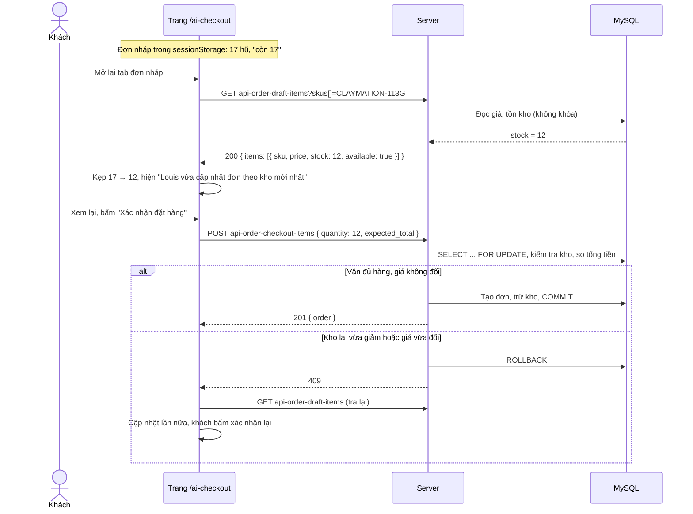

# Đồng bộ tồn kho và giá khi khách để trang đặt hàng lâu ("đơn treo")

Tài liệu nghiệp vụ cho cả hai trang đặt hàng:

| Trang | Route FE | Nguồn món hàng | API tạo đơn |
| --- | --- | --- | --- |
| Đặt hàng tay | `/checkout` (`CheckoutView.vue`) | Giỏ hàng lưu ở server (`api-cart`) | `api-order-checkout` |
| Đặt hàng AI | `/ai-checkout` (`AiCheckout.vue`) | Đơn nháp Louis lên, lưu trong `sessionStorage` của trình duyệt | `api-order-checkout-items` |

> Người mới: đọc mục 1 và 2 là đủ hiểu "vì sao". Mục 3 trở đi dành cho người sửa code.

## 1. Vấn đề

Trang đặt hàng hiển thị tồn kho và giá **tại lúc trang được tải**. Sau đó dữ liệu trên màn hình đứng yên, còn kho và giá thật trong DB vẫn có thể đổi:

- Khách mở tab khác (hoặc người khác) mua bớt hàng.
- Admin đổi giá, tắt bán một phiên bản.
- Đơn nháp AI nằm trong `sessionStorage` nên có thể đã cũ vài chục phút, kể cả sau khi F5.

**Ví dụ thật đã gặp:** Louis lên đơn 17 hũ Claymation (lúc đó kho còn 17). Khách mở tab mới, tự đặt tay 5 hũ, kho còn 12. Quay lại tab đơn nháp, trang vẫn ghi "còn 17", bấm "Xác nhận đặt hàng" thì bị từ chối với câu báo chung chung, số trên trang không đổi. Khách không biết phải sửa gì.

Trường hợp giá đổi còn nguy hiểm hơn ở trang đặt hàng tay: trước bản sửa này, server **tạo đơn luôn theo giá mới mà không báo**, khách thấy 1.000.000đ nhưng bị tính số khác.

## 2. Nguyên tắc nghiệp vụ

1. **Server là nơi quyết định cuối cùng.** Lúc bấm đặt, server khóa dòng hàng trong transaction (`SELECT ... FOR UPDATE`), kiểm tra tồn kho, tính lại giá từ DB rồi mới trừ kho. FE có hiển thị gì thì cũng không bán quá số còn lại, không tính sai tiền.
2. **Khách không bị tính tiền theo số họ chưa thấy.** FE gửi kèm `expected_total` (tổng khách đang nhìn). Lệch với tổng server tính lại thì **không tạo đơn**, trả 409.
3. **Bị từ chối thì phải chỉ ra cái gì đổi.** Nhận 409, FE tải lại số mới nhất và hiện rõ cho khách (món nào thiếu, còn bao nhiêu, giá mới bao nhiêu), rồi để **khách tự bấm đặt lại**. Không tự đặt lại thay khách.
4. **Kiểm tra sớm khi rẻ.** Mở trang là lấy số mới nhất một lần, để phần lớn trường hợp khách thấy đúng ngay từ đầu.
5. **Không hỏi server liên tục (polling) và không giữ hàng cho trang đang mở.** Tốn tài nguyên mà vẫn không loại được khoảnh khắc giữa lần hỏi cuối và lúc bấm đặt. Nguyên tắc 1-3 đã đủ an toàn.

> Ngoại lệ đã có từ trước: đơn **SePay** (thanh toán online) giữ hàng tới khi thanh toán hoặc quá `SEPAY_PAYMENT_TIMEOUT_MINUTES` (2 phút). Hàng của đơn quá hạn được trả "lười" (không có cron), nên server phải trả lại **trước mọi chỗ đọc tồn kho**:
>
> | Chỗ đọc tồn kho | Gọi |
> | --- | --- |
> | Tạo đơn (cả hai luồng), xem/thanh toán đơn | `expireStaleOnlineOrders` (có từ trước) |
> | `api-products`, `api-products-top`, `api-product-detail` | `Order::releaseExpiredStock()` |
> | `api-cart`, `api-cart-add`, `api-cart-update` | `Order::releaseExpiredStock()` |
> | `api-order-draft-items` | `Order::releaseExpiredStock()` |
> | Tool AI `search_product`, `create_order_draft` | `Order::releaseExpiredStock()` |
>
> `releaseExpiredStock` chỉ chạy tối đa **một lần mỗi request** (biến `static`), nên một lượt chat gọi tool nhiều lần cũng chỉ quét một lần.
>
> Vì sao cần: nếu đọc số chưa trả hàng của đơn quá hạn, khách thấy "Hết hàng", "Kho chỉ còn N", "vượt tồn kho" hoặc Louis báo "không đủ hàng" oan, còn FE khóa nút đặt hàng, trong khi lúc tạo đơn server vẫn cho đặt.

## 3. Ba thời điểm kiểm tra

| Thời điểm | Đặt hàng tay | Đặt hàng AI |
| --- | --- | --- |
| **Mở trang** | `GET api-cart`: server tính tồn kho, giá, `is_available` từ DB ngay lúc đó | `GET api-order-draft-items`: tra lại giá/tồn kho theo SKU, chạy song song với màn "Louis đang kiểm tra kho" |
| **Bấm đặt** | `POST api-order-checkout` kèm `expected_total` = `total_amount` của `api-cart` | `POST api-order-checkout-items` kèm `expected_total` = tổng đang hiển thị |
| **Bị 409** | Tải lại `api-cart`, dòng thiếu hàng hiện "Kho chỉ còn N" + link về giỏ, khóa nút Đặt hàng | Gọi lại `api-order-draft-items`, cập nhật đơn nháp, liệt kê thay đổi, khách bấm xác nhận lại |

FE **không cần phân biệt** 409 là do thiếu kho hay do giá đổi: gặp 409 là tải lại số mới rồi so với cái đang hiển thị.

## 4. Sơ đồ: ca 17 hũ, kho còn 12



Trang đặt hàng tay chạy giống hệt, chỉ thay `api-order-draft-items` bằng `api-cart` và không tự kẹp số lượng (xem mục 6).

## 5. Đặt hàng AI: quy tắc cập nhật đơn nháp

Hàm `refreshCheckoutDraftStock()` trong `FE/src/helpers/ai/checkoutDraft.js`, áp cho từng món:

| Dữ liệu mới từ server | Đơn nháp được sửa thành | Câu báo cho khách |
| --- | --- | --- |
| `available: false` (không tồn tại, ngừng bán, hết hàng) | `available = false`, `stock = 0`, **giữ** số lượng | "…: đã hết hàng hoặc ngừng bán, quý ông bỏ món này khỏi đơn giúp Louis." |
| Giá khác giá đang hiển thị | Cập nhật `price`, `original_price` | "…: giá đổi từ X thành Y." |
| Số lượng > tồn kho | Kẹp số lượng về tồn kho | "…: kho chỉ còn N, Louis đã giảm từ A xuống N." |
| Giá giữ nguyên nhưng hết giảm giá | Bỏ `original_price` | "…: đã hết chương trình giảm giá." |
| Tên, tên phiên bản, ảnh đổi | Cập nhật theo server | (không báo) |
| Không đổi gì | Giữ nguyên | (không báo) |

Món hết hàng/ngừng bán **không được cộng** vào Tạm tính, Đã giảm, Tổng và số sản phẩm; thành tiền của món đó bị gạch kèm ghi chú "không tính vào tổng".

Tra kho chỉ chạy khi **mở trang/F5** và khi **bị 409**. Đơn Louis vừa gửi trong lúc khách đang ở trang thì không tra lại (server vừa kiểm tra lúc lên đơn). Khi bị 409, trang chỉ tra lại nếu vẫn đang hiển thị đúng đơn nháp hiện tại (không sửa nhầm khi Louis vừa gửi đơn mới).

Trên trang:

- Món hết hàng: viền đỏ, chữ "Hết hàng hoặc ngừng bán", khóa bộ tăng/giảm. **Nút "Xác nhận đặt hàng" bị khóa** đến khi khách bỏ món đó (vì server chắc chắn sẽ từ chối). Nếu đó là món duy nhất, khách dùng "Nhờ Louis sửa đơn" hoặc "Bỏ đơn nháp".
- Món không tự bị xóa: khách phải thấy món nào bị ảnh hưởng, không để món "biến mất".
- Tra kho lúc mở trang lỗi (mất mạng...): vẫn cho đặt, hiện cảnh báo "Chưa kiểm tra được kho mới nhất. Cửa hàng sẽ kiểm tra lại khi quý ông xác nhận." Server vẫn chặn ở bước bấm đặt.
- Đơn nháp được cập nhật tại chỗ và lưu lại `sessionStorage`, nên lượt chat sau Louis cũng nhận đúng số lượng mới.

## 6. Đặt hàng tay: vì sao không tự kẹp số lượng

Giỏ hàng là dữ liệu **lưu ở server**. Muốn đổi số lượng phải qua `api-cart-update` ở trang Giỏ hàng (có kiểm tra riêng). Trang đặt hàng chỉ đọc giỏ, nên khi thiếu hàng nó:

- Hiện "Kho chỉ còn N, vui lòng giảm số lượng trong giỏ hàng" (link về `/cart`) dưới dòng bị thiếu.
- Khóa nút "Đặt hàng" cho tới khi giỏ hợp lệ.

Lưu ý: `api-cart` đặt `is_available = false` chỉ khi phiên bản **ngừng bán hoặc kho = 0**. Ca "giỏ 17, kho 12" vẫn là `is_available = true`, nên FE tự so `quantity > stock` để phát hiện (hàm `isShortItem`).

## 7. Contract liên quan

### 7.1. `GET api-order-draft-items` (mới)

| Mục | Nội dung |
| --- | --- |
| URL | `GET /BE/?action=api-order-draft-items&skus[]=A&skus[]=B` |
| Xác thực | Bắt buộc (`requireAuth`) |
| Query | `skus`: mảng 1-10 SKU, mỗi SKU 1-100 ký tự, không trùng (không phân biệt hoa thường) |
| 200 | `{ "status": "success", "items": [{ "sku", "name", "variant_name", "image", "price", "original_price", "stock", "available" }] }` |
| Lỗi | 401 thiếu token, 405 sai method, 422 danh sách SKU sai |

- Mỗi SKU gửi lên có **đúng một dòng**, giữ thứ tự gửi.
- SKU không tồn tại hoặc ngừng bán: `available: false`, `stock: 0`, các trường còn lại `null`.
- `stock` kẹp tối đa 99 (`Order::MAX_ITEM_QUANTITY`), giống đơn nháp Louis lên.
- Chỉ đọc, **không khóa dòng**: đây là số để hiển thị, quyết định cuối vẫn ở bước tạo đơn.
- axios tự gửi mảng `params: { skus: [...] }` thành `skus[]=A&skus[]=B`, PHP tự gom thành mảng. Gửi `skus=A` (không có `[]`) bị 422.

Ví dụ response:

```json
{
  "status": "success",
  "items": [
    { "sku": "CLAYMATION-113G", "name": "Sáp Vuốt Tóc Hanz de Fuko Claymation", "variant_name": "Hũ 113g",
      "image": "wax.webp", "price": 740000, "original_price": 790000, "stock": 12, "available": true },
    { "sku": "KHONG-CO", "name": null, "variant_name": null, "image": null,
      "price": null, "original_price": null, "stock": 0, "available": false }
  ]
}
```

### 7.2. `POST api-order-checkout` (thêm trường, không phá FE cũ)

- Body nhận thêm `expected_total` (**không bắt buộc**): số hoặc chuỗi số, tối đa 12 chữ số phần nguyên và 2 chữ số thập phân. Sai định dạng: 422 "Tổng tiền đối chiếu không hợp lệ".
- Không gửi hoặc gửi `null`: không đối chiếu (hành vi cũ).
- Lệch với tổng tính lại: **409** kèm `total_amount` mới:

```json
{
  "status": "error",
  "message": "Giá sản phẩm vừa thay đổi. Tổng mới là 1.580.000đ, quý khách vui lòng kiểm tra lại trước khi đặt.",
  "total_amount": "1580000.00"
}
```

- Thứ tự kiểm tra trong model: giỏ rỗng → tồn kho/ngừng bán → **so tổng tiền** → ghi đơn. Thiếu hàng luôn được báo trước giá đổi.

### 7.3. `POST api-order-checkout-items` (không đổi contract)

Vẫn như [05-api-xac-nhan.md](../chat-ai/len-don-nhanh/05-api-xac-nhan.md). Phần đọc `expected_total` và câu báo giá đổi giờ dùng chung với `api-order-checkout` (`OrderController::readExpectedTotal`, `respondPriceChanged`), nên hai luồng báo giống nhau.

## 8. Bản đồ code

| Phần | File | Hàm |
| --- | --- | --- |
| Route mới | `BE/routes/index.php` | `case 'api-order-draft-items'` |
| Tra kho đơn nháp | `BE/controllers/OrderController.php` | `draftItems` (dùng `Product::getActiveVariantsBySkus`) |
| Dựng món đơn nháp (dùng chung với tool AI) | `BE/models/Product.php` | `buildDraftItem`; `getActiveVariantsBySkus` trả key là SKU viết thường |
| Trả kho đơn SePay quá hạn trước khi đọc | `BE/models/Order.php` | `releaseExpiredStock` (gọi một lần mỗi request) |
| Đọc/đối chiếu tổng tiền | `BE/controllers/OrderController.php` | `readExpectedTotal`, `respondPriceChanged` |
| So tổng khi đặt từ giỏ | `BE/models/Order.php` | `checkout` (tham số `$expectedTotal`) |
| Cập nhật đơn nháp AI | `FE/src/helpers/ai/checkoutDraft.js` | `refreshCheckoutDraftStock` |
| Trang đặt hàng AI | `FE/src/views/ai/AiCheckout.vue` | `play` (tra kho lúc mở), `handleConfirm` (409), `syncDraftWithStock` |
| Trang đặt hàng tay | `FE/src/views/payment/CheckoutView.vue` | `submitCheckout` (gửi `expected_total`, 409 tải lại giỏ), `isShortItem` |

## 9. Kiểm thử tay

| # | Ca | Cách tạo | Kết quả đúng |
| --- | --- | --- | --- |
| 1 | AI, kho giảm trước khi mở trang | Nhờ Louis lên đơn N món, mở tab khác đặt tay bớt hàng, quay lại F5 trang `/ai-checkout` | Số lượng tự giảm về tồn kho, có khung "Louis vừa cập nhật đơn…" |
| 2 | AI, kho giảm khi trang đang mở | Mở `/ai-checkout`, tab khác đặt bớt hàng, quay lại bấm xác nhận | 409, đơn tự cập nhật, bấm xác nhận lại thì thành công |
| 3 | AI, món ngừng bán | Tắt `is_active` của phiên bản trong đơn rồi F5 | Món viền đỏ, nút xác nhận bị khóa đến khi bỏ món |
| 4 | AI, giá đổi | Đổi giá phiên bản trong đơn rồi bấm xác nhận | 409, giá và tổng mới hiện ra, báo "giá đổi từ X thành Y" |
| 5 | Tay, thiếu kho | Giỏ có số lượng > tồn kho, mở `/checkout` | "Kho chỉ còn N…", nút Đặt hàng bị khóa |
| 6 | Tay, giá đổi khi trang đang mở | Mở `/checkout`, đổi giá trong admin/DB, bấm Đặt hàng | 409 "Giá sản phẩm vừa thay đổi…", giỏ tải lại với tổng mới, không có đơn nào được tạo |
| 7 | Tay, FE cũ | Gọi `api-order-checkout` không có `expected_total` | Tạo đơn như trước |

## 10. Câu hỏi thường gặp

**Hỏi:** Mở trang đã lấy số mới rồi, sao lúc bấm đặt server còn kiểm tra lại?
**Đáp:** Số lúc mở trang chỉ đúng tại thời điểm đó. Từ lúc mở tới lúc bấm có thể vài phút, kho và giá vẫn đổi. Chỉ bước tạo đơn (có khóa dòng trong transaction) mới chắc chắn.

**Hỏi:** Sao không cho FE gọi API kiểm tra mỗi 10 giây?
**Đáp:** Tốn request cho mọi khách đang mở trang, mà vẫn còn khe hở giữa lần hỏi cuối và lúc bấm đặt. Kiểm tra ở bước tạo đơn và báo rõ khi bị từ chối là đủ.

**Hỏi:** `expected_total` do FE gửi, khách sửa bằng F12 thì sao?
**Đáp:** Không ảnh hưởng tiền. Server luôn tính tiền theo giá trong DB; `expected_total` chỉ dùng để **so**. Sửa nó thành số sai thì chỉ khiến chính khách bị 409.

**Hỏi:** Sao trang AI tự giảm số lượng, còn trang tay thì bắt khách về giỏ?
**Đáp:** Đơn nháp AI nằm ở trình duyệt, trang được quyền sửa. Giỏ hàng nằm ở server, phải sửa qua API giỏ hàng để server kiểm tra.
